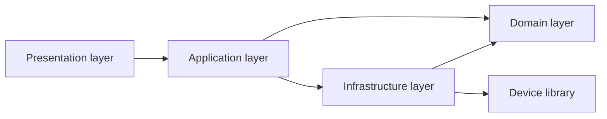

## Overview

This document sets the coding standards and low-level development instructions for the custom Home Assistant integration, a Python product intended for publication through the Home Assistant Marketplace. It follows the project requirements documents at [layer architecture requirements](../requirements/layer.architecture.requirements.instructions.md), [security architecture requirements](../requirements/security.architecture.requirements.instructions.md) and [technical requirements](../requirements/technical.requirements.instructions.md.md), and it governs how the codebase is structured, named, checked, secured, reviewed and delivered. Its scope is day-to-day development and maintenance of this integration only; product behaviour is defined by the requirements documents, and any conflict is resolved in favour of the security requirements for security matters and the more specific requirement otherwise.

## Architectural Foundation

The project is organised as a lightweight layered architecture with four layers inside one platform runtime, a protected storage zone and an external network zone, each layer owning one responsibility and communicating only through defined interfaces. Boundaries are enforced by the dependency rule — imports point inward only — and the guiding patterns are shared-state publication through a single coordinator, validation at every boundary, and fail-closed behaviour on authentication or integrity errors.

### Core Layers

- Presentation layer — holds entity classes and config flow forms, translates shared data into states and user input into validated requests — documented in [layer architecture requirements](../requirements/layer.architecture.requirements.instructions.md).
- Application layer — runs setup and teardown, owns the data update coordinator and application services, and orchestrates every use case — documented in [layer architecture requirements](../requirements/layer.architecture.requirements.instructions.md).
- Domain layer — holds models, value objects, validation rules and port contracts with no platform or transport imports — documented in [layer architecture requirements](../requirements/layer.architecture.requirements.instructions.md).
- Infrastructure layer — adapts the device library and storage access to the domain port contracts and is the only layer that reaches external devices — documented in [layer architecture requirements](../requirements/layer.architecture.requirements.instructions.md).

Dependencies point inward only: the presentation layer imports the application layer, the application layer imports the domain and infrastructure layers, the infrastructure layer imports the domain, and the domain imports nothing from the other layers.



The diagram shows the four layers and the allowed dependency direction, with only the infrastructure layer reaching the device library.

### Architectural Principles

- Separation of concerns — each layer owns one responsibility so a change rarely touches two layers at once.
- Dependency rule — imports point inward toward the domain so the platform surface and the transport stay replaceable.
- Modularity — each module exposes one small interface so modules can be tested and replaced independently.
- Information hiding — internal state stays private so callers depend on behaviour, not structure.
- Scalability — the design point of one shared refresh serving all entities keeps growth in entities nearly free.
- Maintainability — inward dependencies and single responsibility keep the cost of a change local to one layer.
- Flexibility — port contracts at the device boundary let the transport be swapped without touching use cases.
- Simplicity — every element must justify its existence, and speculative structure is removed rather than kept.

## Core Development Principles

The principles below are mandatory development rules; each carries an identifier, a priority in the RFC 2119 sense (Must, Should, May) and a rationale, and tools enforce them wherever a tool can.

- CI-001 (Must): Write code for readers first, preferring clear names and straight-line flow over cleverness. Rationale: the codebase is read far more often than it is written (PEP 8, https://peps.python.org/pep-0008/).
- CI-002 (Must): Keep every function focused on one task and short enough to read without scrolling. Rationale: small functions are easier to test, review and change in isolation.
- CI-003 (Should): Remove duplication by extracting shared behaviour into one place rather than copying it. Rationale: duplicated logic drifts apart and multiplies defect surface.
- CI-004 (Must): Make state changes explicit at the call site instead of relying on hidden side effects. Rationale: explicit data flow keeps the shared snapshot model auditable.
- CI-005 (Should): Build the simplest working solution now and add structure only when a concrete need appears. Rationale: the project context requires a lightweight architecture that can still scale.
- CI-006 (Must): Write each unit so it can be tested without a running platform instance or a real device. Rationale: the technical requirements demand an isolated test suite for the domain and application layers.

```python
# Compliant with CI-002: one task, easy to test
def normalise_reading(raw_value: float, scale: float) -> float:
    """Return the reading adjusted for the sensor scale."""
    return raw_value * scale
```

```python
# Non-compliant with CI-002: fetching, parsing, calculating and logging in one function
def handle_reading(client, scale: float) -> None:
    data = client.fetch()
    value = data["reading"] * scale
    client.save(value)
    print(f"saved {value}")
```

The linter and the reviewer enforce CI-002 by flagging functions that grow beyond one responsibility.

## Key Technologies & Frameworks

The stack below is the current baseline confirmed against primary sources on 2026-11-25; each item may be replaced only through a recorded decision that updates this document in the same change.

### Key Technologies

| Technology                | Confirmed version                             | Role                                                                   | Requirement or evidence                                            |
| ------------------------- | --------------------------------------------- | ---------------------------------------------------------------------- | ------------------------------------------------------------------ |
| Python                    | 3.14 or newer (host provides at least 3.14.2) | Implementation language for every module and sample                    | Technical requirements technology stack; platform project metadata |
| Platform runtime          | Host-provided single asynchronous event loop  | Executes all integration code; blocking work must be offloaded         | Technical requirements performance targets                         |
| Platform storage registry | Host-provided                                 | Persists configuration and encrypted credentials; no separate database | Security requirements SR-001 and SR-020                            |
| Ruff                      | 0.17.6                                        | Formatter and primary linter                                           | Platform code style; current release on the Python package index   |
| Pylint                    | 4.1.4                                         | Secondary linter with project-specific checks                          | Platform code style                                                |
| mypy                      | 2.4.1                                         | Static type checker                                                    | Technical requirements code quality gates                          |
| pytest                    | 9.2.0                                         | Test runner                                                            | Technical requirements testing strategy                            |
| Hosted workflow runner    | Host-provided                                 | Continuous integration gates                                           | Technical requirements deployment strategy                         |

An item is replaced by updating its row with the new confirmed version and re-running every gate in the same pull request.

### Key Frameworks & Libraries

| Framework or library           | Confirmed version          | Contribution                                                                   | Integration rule                                                                      |
| ------------------------------ | -------------------------- | ------------------------------------------------------------------------------ | ------------------------------------------------------------------------------------- |
| Platform integration framework | Host-provided              | Config flow, data update coordinator, entity platform and service registration | Use only through the presentation and application layers, never from the domain layer |
| Device client library          | Pinned exactly per release | Protocol access to the device or service                                       | Use only inside the infrastructure adapter, behind a domain port contract             |
| Platform test fixtures         | Host-provided              | Test harness for setup, config flow and entity behaviour                       | Reuse instead of building custom harnesses                                            |
| Platform manifest validator    | Host-provided              | Validates manifest, quality scale rules and repository structure               | Run in continuous integration before every merge                                      |

```toml
# Minimal project configuration showing the agreed tool integration (CI-048, CI-049, CI-050)
[tool.ruff]
line-length = 88
target-version = "py314"

[tool.ruff.lint]
select = ["E", "F", "I", "UP", "B"]

[tool.mypy]
python_version = "3.14"
strict = true

[tool.pytest.ini_options]
testpaths = ["tests"]
```

The configuration is parsed by the standard library configuration parser in the validation step of this document and is enforced by every continuous integration run.

> Assumption: The device client library's exact version and licence are fixed at the first release because no library has been selected yet; record them in the table when selection completes.

## Technical Standards

The standards below are mandatory rules identified as CI-xxx with a priority of Must, Should or May, and tools enforce them wherever a tool can; a rule without tool coverage is enforced by review.

### Coding Standards

- CI-010 (Must): Keep code inside its layer and never import across a boundary against the dependency direction (SR-013, SR-014, SR-015, SR-016, SR-018). Rationale: inward-only imports are the enforceable form of the architecture's dependency rule and of component isolation.
- CI-011 (Must): Put integration code in one domain folder with setup, config flow, coordinator and one file per entity type, and keep tests in the matching test folder. Rationale: the platform finds features by file name, so layout is part of the contract.
- CI-012 (Must): Catch only exceptions you expect, keep try blocks small, and use the barest final handler only in the last step of a config flow. Rationale: broad handlers hide defects and break fail-closed behaviour.
- CI-013 (Must): Prefer early returns over nested conditionals and keep functions flat. Rationale: flat control flow is easier to verify against requirements.
- CI-014 (Must): Treat shared snapshots as immutable once published and never mutate data owned by another layer. Rationale: atomic replacement of shared state prevents torn reads.
- CI-015 (Must): Perform all input and output inside async functions and hand blocking work to the executor. Rationale: one blocked call freezes the whole platform event loop.
- CI-016 (Must): Set a timeout on every outbound call and cancel tasks and unsubscribe listeners during unload. Rationale: leaked work after unload breaks setup and teardown cycles.
- CI-017 (Must): Validate data at every boundary before it enters the layer and reject anything not explicitly allowed. Rationale: boundary validation is the first line of defence for both correctness and security.
- CI-018 (Should): Keep module-level state minimal and prefer passing data as arguments. Rationale: explicit parameters keep modules reusable and testable.
- CI-019 (Must): Write at least one test for every change and keep the domain and application layers at or above 90 percent line coverage. Rationale: the technical requirements make coverage a release gate.
- CI-020 (Must): Keep tests deterministic — no real network, no real clock dependence, no shared global state between tests. Rationale: flaky tests destroy trust in the gate.
- CI-021 (Should): Group related constants in one shared constants module and replace magic values with named constants. Rationale: the platform style guide requires shared constants in one place.
- CI-022 (Must): Never leave commented-out code in a commit; version control already remembers it. Rationale: dead code misleads readers about current behaviour (platform code style).

```python
# Compliant with CI-010: the application layer imports only inward
from .domain.models import DeviceReading
from .infrastructure.adapter import DeviceAdapter


async def async_read(adapter: DeviceAdapter) -> DeviceReading:
    """Return the latest reading for the configured device."""
    return await adapter.fetch_reading()
```

```python
# Non-compliant with CI-010: reaching outward from the application layer
from homeassistant.components.sensor import SensorEntity  # Wrong layer


class BadReading(SensorEntity):
    """A reading that imports the presentation layer."""
```

The import direction is enforced in review and by the linter's import ordering rules; CI-012 and CI-013 are enforced by review and by the secondary linter.

### Naming Conventions

| Construct               | Convention                                                     | Example                                        |
| ----------------------- | -------------------------------------------------------------- | ---------------------------------------------- |
| Module and file names   | Short lowercase words joined with underscores                  | `coordinator.py`                               |
| Classes and exceptions  | PascalCase with a noun or error suffix                         | `DeviceReadingError`                           |
| Functions and variables | snake_case with a verb for actions                             | `async_refresh_reading`                        |
| Asynchronous functions  | Prefix async functions with `async_`                           | `async_setup_entry`                            |
| Constants               | UPPER_SNAKE_CASE in the shared constants module                | `DEFAULT_SCAN_INTERVAL`                        |
| Private members         | Leading underscore for anything not part of the public surface | `_client`                                      |
| Test functions          | Prefix `test_` and state the behaviour expected                | `test_refresh_marks_unavailable_on_failure`    |
| Test files and folders  | Mirror the source layout under the test folder                 | `tests/components/example/test_coordinator.py` |
| Branches                | Name by the condition they test                                | `if is_authenticated:`                         |
| Commits                 | Conventional Commits type and scope with imperative subject    | `fix(coordinator): stop overlapping refreshes` |

```python
# Compliant with the naming conventions table: descriptive names at every level
from typing import Protocol

DEFAULT_POLL_SECONDS = 60


class DeviceClient(Protocol):
    """Contract for the device client used by this sample."""

    async def read(self) -> int:
        """Return one reading."""


class DeviceReadingError(Exception):
    """Raised when a device payload cannot be mapped."""


async def async_fetch_reading(client: DeviceClient) -> int:
    """Fetch one reading from the device."""
    return await client.read()
```

```python
# Non-compliant: vague names, wrong case, missing async prefix
class Foo(Exception):
    pass


def fetchData(c):
    return c.read()
```

The linter enforces naming patterns it can see, and the reviewer checks the rest against this table.

### Comment and Documentation Standards

- CI-028 (Must): Give every module, class and function a docstring in the Google style with types carried by annotations. Rationale: the platform style guide requires a docstring on every public unit.
- CI-029 (Should): Write comments as full sentences ending with a period that explain why, never what. Rationale: comments that restate code rot first.
- CI-030 (Should): Keep the project README, the change log and each architecture decision record updated in the same change that invalidates them. Rationale: documentation that lags the code misleads the next maintainer.

```python
def calculate_dew_point(temperature: float, humidity: float) -> float:
    """Calculate the dew point.

    Args:
        temperature: The temperature in degrees Celsius.
        humidity: The relative humidity, in percent.

    Returns:
        The dew point in degrees Celsius.

    Raises:
        ValueError: If the humidity is outside the range 0 to 100.
    """
    if not 0 <= humidity <= 100:
        raise ValueError("humidity must be between 0 and 100")
    return temperature - (100 - humidity) / 5
```

The docstring linter rule checks the Google section structure shown above.

### Performance Standards

- CI-031 (Must): Keep every event-loop callback under 100 milliseconds, a threshold the runtime itself flags in debug mode. Rationale: the platform freezes for everyone when one callback runs long.
- CI-032 (Must): Complete a scheduled refresh within 50 percent of the configured poll interval at the 95th percentile. Rationale: slower refreshes overlap and queue behind each other.
- CI-033 (Must): Publish entity states within one event-loop turn of snapshot completion. Rationale: delayed publication shows users torn state.
- CI-034 (Should): Measure before optimising and record the measurement method with any performance change. Rationale: unmeasured optimisation adds complexity without evidence.

```python
from time import perf_counter
from typing import Protocol


class Refreshable(Protocol):
    """Contract for a coordinator that can run one refresh."""

    async def async_refresh(self) -> None:
        """Run one refresh cycle."""


async def async_timed_refresh(coordinator: Refreshable) -> float:
    """Return the duration of one refresh in seconds (CI-034)."""
    start = perf_counter()
    await coordinator.async_refresh()
    return perf_counter() - start
```

Refresh duration is logged by the coordinator so CI-032 and CI-034 can be verified from production logs and from the performance test suite.

## Quality Assurance Measures

Quality is assured by automated gates in the editor, in pre-commit hooks and in continuous integration, combined with structured human review; the test levels are unit, integration and end-to-end, and the pass thresholds are zero lint errors, zero type errors, all tests green and at or above 90 percent line coverage on the domain and application layers.

### Software Design Principles

- CI-040 (Must): Give each class and module one reason to change so updates stay local (single responsibility). Rationale: change isolation is the primary maintainability driver of the chosen architecture.
- CI-041 (Should): Structure modules so new behaviour is added without modifying existing working code (open and closed). Rationale: stable cores reduce regression risk.
- CI-042 (Must): Depend on port contracts owned by the domain, not on concrete external classes (dependency inversion). Rationale: testability and transport replaceability both depend on it.
- CI-043 (Should): Prefer composition of small collaborators over inheritance hierarchies. Rationale: deep hierarchies couple release cycles and complicate tests.
- CI-044 (Should): Apply keep-it-simple and do-not-repeat-yourselves together, extracting shared behaviour only after the second occurrence. Rationale: premature abstraction costs more than the duplication it removes.

```python
# Compliant with CI-042: the application depends on a domain-owned contract
from typing import Protocol


class DevicePort(Protocol):
    """Contract the infrastructure layer must implement."""

    async def fetch_reading(self) -> int:
        """Return one reading from the device."""


async def async_read(port: DevicePort) -> int:
    """Return the latest reading through the port."""
    return await port.fetch_reading()
```

```python
# Non-compliant with CI-042: application logic bound to a concrete client
from some_device_sdk import Client


async def async_read() -> int:
    """Return a reading from the concrete client."""
    return await Client().read()
```

The type checker confirms conformance to the protocol at call sites, and the reviewer checks that no application module imports a concrete external client.

### Code Quality Enforcement

- CI-045 (Must): Run the editor checks, the pre-commit hook and the continuous integration gate on every change, and never merge with a failing gate. Rationale: a red gate that is allowed to fail stops protecting anything.
- CI-046 (Must): Protect the main branch so merges require a green gate and at least one approving review. Rationale: enforced process beats remembered process.
- CI-047 (Should): Keep the gate fast enough to run on every pull request and split slow suites only when measured duration demands it. Rationale: slow gates get bypassed or ignored.

```yaml
# Main gate for every pull request (CI-045)
name: gate
on: [pull_request]
jobs:
  checks:
    runs-on: ubuntu-latest
    steps:
      - uses: actions/checkout@v4
      - name: Lint and format check
        run: ruff check . && ruff format --check .
      - name: Type check
        run: mypy .
      - name: Tests with coverage
        run: pytest --cov-fail-under=90
```

The workflow file above is validated as part of this document's sample checks, and branch protection makes it mandatory.

### Linting Standards

- CI-048 (Must): Use Ruff as the primary linter with the project rule set and treat every finding as an error in continuous integration. Rationale: the platform's own style guide makes Ruff the enforcing tool.
- CI-049 (Must): Run the secondary linter with the project's custom checks to catch patterns the primary linter cannot see. Rationale: two independent analysers catch disjoint defect classes (platform code style).
- CI-050 (Must): Suppress a lint finding only with an inline suppression that names the reason, and never a blanket disable. Rationale: silent suppressions hide future defects.

```toml
# Linter configuration (CI-048)
[tool.ruff.lint]
select = ["E", "F", "I", "UP", "B"]
ignore = []

[tool.ruff.lint.per-file-ignores]
"tests/*" = ["S101"]
```

The configuration is parsed during this document's sample validation and is applied by the gate shown under Code Quality Enforcement.

### Formatting Standards

- CI-051 (Must): Format every file with Ruff's formatter before committing and never hand-format code. Rationale: one formatter ends style debate and keeps diffs minimal (platform code style).
- CI-052 (Must): Use a line length of 88, four-space indentation, sorted imports and double quotes as configured below. Rationale: fixed settings make output reproducible everywhere.

```toml
# Formatter configuration (CI-051, CI-052)
[tool.ruff]
line-length = 88
target-version = "py314"

[tool.ruff.format]
quote-style = "double"
indent-style = "space"
```

The formatter runs in check mode in the gate, so any unformatted file fails the pull request.

### Type-Checking Standards

- CI-053 (Must): Annotate every public function signature and enable strict checking for the project. Rationale: type errors found before runtime are the cheapest defects to fix.
- CI-054 (Must): Represent absence with the platform's optional type rather than sentinel values, and let exceptions propagate to the layer boundary. Rationale: explicit optionals and boundary errors keep failure paths visible to the type checker.

```python
# Compliant with CI-053 and CI-054: full annotations, explicit absence
def format_reading(value: float | None, unit: str) -> str:
    """Return the reading as display text, or unknown when absent."""
    if value is None:
        return "unknown"
    return f"{value:.1f} {unit}"
```

```python
# Non-compliant: untyped signature and sentinel value hiding absence
def format_reading(value, unit):
    if value == -1:
        return "unknown"
    return str(value) + unit
```

The strict configuration under Key Frameworks & Libraries and the type checker in the gate enforce both rules.

### Code Review Standards

- CI-055 (Must): Keep every pull request to one fix, one feature or one refactor so review stays thorough. Rationale: small pull requests are reviewed faster and break less (platform development workflow).
- CI-056 (Must): Require at least one approving review from someone other than the author before merge. Rationale: independent review catches defects the author has stopped seeing.
- CI-057 (Must): Check every change against the flat review checklist below before approving. Rationale: a shared checklist makes review consistent between reviewers.
- CI-058 (Should): Trigger a security-focused review whenever a change touches credentials, cryptography, input validation, logging or dependencies. Rationale: those areas carry the security requirements' highest impact.
- CI-059 (Should): Respond to review comments within two working days and keep the tone constructive and specific. Rationale: stalled reviews stall the whole pipeline.

- The change matches the pull request description and the linked requirement.
- The change respects the layer boundaries and the dependency direction.
- Tests cover the changed behaviour and the coverage gate still passes.
- Names, docstrings and comments follow the conventions in this document.
- No secrets, credentials or personal data appear in code, tests or logs.
- Error paths fail closed and log without exposing internals.
- Performance targets and unload cleanup are preserved.

The checklist is part of the pull request template, and branch protection enforces the approval rule.

> Assumption: The team provides at least one reviewer other than the author for every change; adjust CI-056 if the team becomes a single maintainer and record the change as a decision.

## Security Standards

The secure coding rules below implement the security requirements of the [security architecture requirements](../requirements/security.architecture.requirements.instructions.md) (SR-001 to SR-026) and the secure development practices of the Secure Software Development Framework (NIST SP 800-218 Version 1.1, 2022, https://csrc.nist.gov/pubs/sp/800/218/final); every rule carries a sample or a review check, and the OWASP Application Security Verification Standard 5.0.0 (2025, https://asvs.owasp.org/) supplies the verification wording.

- CI-060 (Must): Validate every input at the boundary with explicit schemas and allow-lists and reject anything not explicitly accepted (SR-015, SR-017, ASVS verification requirements). Rationale: unvalidated input is the root of injection and tampering defects.
- CI-061 (Must): Never write credentials, tokens, keys or raw sensitive payloads to logs, exceptions or diagnostics (SR-008, SR-024). Rationale: logs are widely read and long retained.
- CI-062 (Must): Store credentials only through the platform's protected storage and never hard-code, commit or pass them through command lines (SR-020). Rationale: committed secrets leak with the repository history.
- CI-063 (Must): Use only platform-provided or approved cryptographic operations, keep decryption keys at their intended endpoints and never design custom cryptographic schemes (SR-001, SR-003, SR-004). Rationale: bespoke cryptography fails review and often fails quietly.
- CI-064 (Must): Fail closed on authentication failures, integrity errors and downgrade attempts, and never fall back to an unencrypted or unauthenticated path (SR-002, SR-017). Rationale: fail-open fallbacks convert a detection into a breach.
- CI-065 (Must): Treat device payloads as hostile — bound their size, never execute dynamic code and map only known fields into the domain (SR-010, threat T8). Rationale: crafted payloads are the main remote attack surface of an integration.
- CI-066 (Must): Pin every third-party dependency to an exact version, check advisories before each release and generate a software bill of materials per release (SR-025). Rationale: unmanaged dependencies carry known vulnerabilities into the product.
- CI-067 (Should): Encode output by context and never emit markup or raw exception text into entity states or user-facing messages (SR-024, threat T3). Rationale: unencoded output is the injection path at the other end.
- CI-068 (Must): Keep secrets out of tests and samples by using obvious placeholders such as example.invalid (SR-020). Rationale: test fixtures are a common accidental leak path.
- CI-069 (Must): Run the security test suite and dependency scan for every change and block release on any high-severity finding (SR-025). Rationale: untested security controls drift into non-function.
- CI-070 (Must): Hold sensitive data in the clear only for the duration of one authorised operation, keep it out of swap, crash dumps and diagnostics, and drop the reference when the operation completes (SR-005, SR-006, SR-007, SR-009). Rationale: shorter exposure reduces the value of an in-memory disclosure.
- CI-071 (Must): Record an audit event for every privileged action — setup, reconfiguration, credential change and action execution — without any secret values (SR-019, SR-022, SR-023). Rationale: detection and forensics depend on those records existing and staying intact.

```python
# Compliant with CI-060: allow-list validation at the boundary
ALLOWED_HOSTS = {"sensor.example.invalid", "gateway.example.invalid"}


def validate_host(host: str) -> str:
    """Return the host when it is explicitly allowed.

    Raises:
        ValueError: If the host is not in the allow-list.
    """
    if host not in ALLOWED_HOSTS:
        raise ValueError("host is not allowed")
    return host
```

```python
# Non-compliant with CI-060: accepting whatever arrives
def validate_host(host: str) -> str:
    """Return the host without checking it."""
    return host
```

```python
# Compliant with CI-061: lazy log arguments with no secret values
import logging

_LOGGER = logging.getLogger(__name__)


def _log_auth_failure(device_host: str) -> None:
    """Record an authentication failure without secret values."""
    _LOGGER.error("Authentication failed for device at %s", device_host)
```

```python
# Non-compliant with CI-061: secret material in the log line
import logging

_LOGGER = logging.getLogger(__name__)


def _log_auth_failure(access_token: str) -> None:
    """Record an authentication failure including the token."""
    _LOGGER.error("Authentication failed with token %s", access_token)
```

```python
# Compliant with CI-064: authentication failure stops the operation
from typing import Protocol


class AuthenticationError(Exception):
    """Raised when the device rejects the stored credentials."""


class AuthClient(Protocol):
    """Contract for a client that can authenticate."""

    async def authenticate(self) -> bool:
        """Return True when the device accepts the credentials."""


async def async_connect(client: AuthClient) -> None:
    """Connect to the device or raise without falling back."""
    if not await client.authenticate():
        raise AuthenticationError("device rejected credentials")
```

```python
# Non-compliant with CI-064: falling back to an unauthenticated path
async def async_connect(client) -> None:
    """Continue even when authentication fails."""
    if not await client.authenticate():
        await client.connect_unauthenticated()
```

```python
# Compliant with CI-065: bounded parsing of untrusted device input
import json

MAX_PAYLOAD_BYTES = 64 * 1024


def parse_payload(raw: bytes) -> dict[str, int]:
    """Parse a device payload with a hard size bound."""
    if len(raw) > MAX_PAYLOAD_BYTES:
        raise ValueError("payload exceeds the size limit")
    values = json.loads(raw)
    return {key: int(value) for key, value in values.items()}
```

The linter and the security test suite enforce these rules statically and dynamically, and the reviewer checks the ones no tool can see.

## Compliance Standards

The table below maps each applicable framework and regulation to the coding practices that satisfy it and the evidence a reviewer checks; this content is engineering guidance, not legal advice, and applicability must be confirmed with legal review.

| Framework or regulation                             | Brief description                                                                | Coding practices that satisfy it                                                                                  | Evidence the reviewer checks                                 |
| --------------------------------------------------- | -------------------------------------------------------------------------------- | ----------------------------------------------------------------------------------------------------------------- | ------------------------------------------------------------ |
| GDPR (Regulation (EU) 2016/679) Articles 25 and 32  | Data protection by design and security of processing                             | Data minimisation at setup, no personal data beyond configuration, redacted diagnostics, erasure on entry removal | Data inventory, erasure test result, redaction check         |
| EU Cyber Resilience Act (Regulation (EU) 2024/2847) | Security by design and vulnerability handling for products with digital elements | Secure development gates, pinned dependencies, verified releases, advisory intake                                 | Gate run records, bill of materials, advisory log            |
| ISO/IEC 27001:2022 Annex A                          | Information security control objectives                                          | Least privilege per module, key lifecycle via platform helpers, controlled changes                                | Control mapping in the security requirements, review records |
| NIST SP 800-53 Revision 5                           | Control catalogue for access control, auditing and protection                    | Boundary validation, audit events for privileged actions, encrypted storage                                       | Control mapping table, security test results                 |
| NIST SP 800-218 Version 1.1 (SSDF)                  | Secure software development practices                                            | Pinned dependencies, signed releases, reviewed changes, documented response                                       | Release pipeline records                                     |
| Platform integration quality scale                  | Tier rules for published integrations                                            | Tested config flow, unique identifiers, translated strings, documentation                                         | Quality scale file with each rule marked done or exempt      |

The obligations above are summarised from the official texts linked in References and Sources and require legal review before being relied on for compliance decisions.

## Style and Tone Standards

- CI-080 (Must): Interpret Must, Should and May in this document according to RFC 2119 (IETF BCP 14). Rationale: shared modal meaning removes ambiguity from every rule.
- CI-081 (Must): Write in plain, direct, present tense with one idea per sentence and define every acronym at first use. Rationale: clear prose is reviewable by the whole team.
- CI-082 (Must): Use identical names for layers, modules, rules and data classes everywhere, matching the requirements documents exactly. Rationale: diverging names make traceability impossible.
- CI-083 (Should): Format commit messages as Conventional Commits, pull request descriptions with context and evidence, and change log entries under Keep a Changelog headings. Rationale: consistent history enables tooling and release notes.
- CI-084 (Should): Keep documentation neutral and factual, with no marketing language and no unverified claims. Rationale: documentation must stay trustworthy as the single source for decisions.

## References and Sources

**Language and platform**

- PEP 8 – Style Guide for Python Code. Python Software Foundation, 2001 (active). https://peps.python.org/pep-0008/
- PEP 257 – Docstring Conventions. Python Software Foundation, 2001. https://peps.python.org/pep-0257/
- Code style for Home Assistant Core. Home Assistant, 2026. https://contributors.home-assistant.io/core/development/style/
- Development workflow for Home Assistant Core. Home Assistant, 2026. https://contributors.home-assistant.io/core/development/
- Integration quality scale. Home Assistant, 2026. https://contributors.home-assistant.io/core/quality-scale/
- Python downloads and support lifecycle. Python Software Foundation, 2026. https://www.python.org/downloads/
- Home Assistant Core project metadata (requires Python 3.14.2 or newer). Home Assistant, 2026. https://github.com/home-assistant/core/blob/dev/pyproject.toml

**Tools**

- Ruff 0.17.6 release. Astral, 2026. https://pypi.org/project/ruff/
- Pylint 4.1.4 release. Pylint developers, 2026. https://pypi.org/project/pylint/
- mypy 2.4.1 release. mypy community, 2026. https://pypi.org/project/mypy/
- pytest 9.2.0 release. pytest developers, 2026. https://pypi.org/project/pytest/

**Security and quality standards**

- OWASP Top 10:2025. OWASP, 2025. https://owasp.org/Top10/2025/en/
- OWASP Application Security Verification Standard 5.0.0. OWASP, 2025. https://asvs.owasp.org/
- NIST SP 800-218 Version 1.1, Secure Software Development Framework. NIST, 2022. https://csrc.nist.gov/pubs/sp/800/218/final
- NIST SP 800-53 Revision 5 (Release 5.2.0). NIST, 2020 (release 2025). https://csrc.nist.gov/pubs/sp/800/53/r5/upd1/final
- ISO/IEC/IEEE 29148:2018, Requirements engineering. ISO, IEC, IEEE, 2018. https://www.iso.org/standard/72089.html
- ISO/IEC/IEEE 42010:2022, Architecture description. ISO, IEC, IEEE, 2022. https://www.iso.org/standard/74393.html
- ISO/IEC 25010:2023, Product quality model. ISO, IEC, 2023. https://www.iso.org/standard/78176.html
- ISO/IEC 27001:2022, Information security management systems. ISO, IEC, 2022. https://www.iso.org/standard/27001
- RFC 9846, The Transport Layer Security (TLS) Protocol Version 1.3. IETF, 2026. https://www.rfc-editor.org/rfc/rfc9846.html

**Regulations**

- Regulation (EU) 2016/679 (General Data Protection Regulation). European Union, 2016. https://eur-lex.europa.eu/eli/reg/2016/679/oj
- Regulation (EU) 2024/2847 (Cyber Resilience Act). European Union, 2024. https://eur-lex.europa.eu/eli/reg/2024/2847/oj

**Practice and process**

- RFC 2119 / BCP 14, Requirement levels. IETF, 1997 (clarified 2017). https://www.rfc-editor.org/rfc/rfc2119
- Semantic Versioning 2.0.0. semver.org, 2013. https://semver.org/
- Conventional Commits 1.0.0. conventionalcommits.org, 2018. https://www.conventionalcommits.org/en/v1.0.0/
- Keep a Changelog 1.1.0. keepachangelog.com, 2023. https://keepachangelog.com/en/1.1.0/

These sources are reviewed at least annually, and before any rule in this document cites a new edition or version, the publisher page is checked and this document is updated in the same change.
