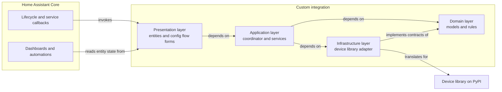
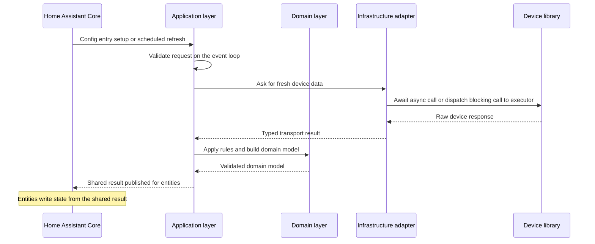

## Introduction

This document defines the layer architecture requirements for a custom Home Assistant integration written in Python and intended for publication through the Home Assistant Marketplace. Its purpose is to give developers and maintainers a single, lightweight reference for how the codebase is divided into layers, what each layer may do, and how data moves between them, so that development and maintenance stay consistent as the integration grows. The architecture proposed here is a lightweight layered architecture with a pure domain core, selected from a scored comparison of common patterns against Home Assistant platform guidance and international standards; the decision is documented in the Architecture Layer Overview. In line with ISO/IEC/IEEE 29148:2018, each requirement below is written to be necessary, unambiguous and verifiable (ISO/IEC/IEEE 29148:2018 — Requirements engineering, ISO, IEC, IEEE, 2018, https://www.iso.org/standard/72089.html).

**Layer covered.** This document covers the **Application layer** of the four-layer architecture: the orchestration layer that coordinates setup, data acquisition, and user actions between the Home Assistant platform surface (entities and config flow forms) and the domain and infrastructure layers beneath it. Home Assistant integrations are built from a small set of concepts — library, config flow, config entry, coordinator, platform, entity — all running on a single event loop (Home Assistant, "How an integration fits in", 2026, https://contributors.home-assistant.io/core/integrations/concepts/), and the Application layer is where those concepts are orchestrated.

**Primary objectives of the layer.**

- Keep setup, refresh and action handling in one place so changes stay local and reviewable.
- Isolate the domain core from the Home Assistant platform and from the device library, so both can evolve or be replaced independently.
- Guarantee that no code in the layer blocks the single Home Assistant event loop (Home Assistant, "Architecture principles", 2026, https://contributors.home-assistant.io/architecture/principles/).
- Make the layer testable in isolation with fake device access and without a running Home Assistant instance.
- Stay deliberately lightweight: structure is added only when a real need appears, never in advance.

> Assumption: The integration is small to medium in scope — one device family or service, tens of entities at most — so a lightweight layered structure is sufficient; the structure is revisited if the codebase grows beyond a few modules per layer.

## Architecture Layer Overview

The Application layer is the centre of gravity of the integration. It receives inbound calls from Home Assistant Core (config entry setup, scheduled refreshes, service and action invocations), validates and processes them with the help of the domain layer, obtains device data through the infrastructure layer, and publishes shared results that the presentation layer (entity classes and config flow forms) turns into states and dialogs. It is the only layer allowed to depend on both the domain and the infrastructure, which keeps the platform surface thin and the device protocol code out of Home Assistant (Home Assistant, "Architecture principles", 2026, https://contributors.home-assistant.io/architecture/principles/).

**Architecture decision.** Candidates were scored against eight weighted criteria derived from the project context (lightweight, simple, scalable, maintainable) and from the product quality model of ISO/IEC 25010:2023 (ISO/IEC 25010:2023 — Product quality model, ISO, IEC, 2023, https://www.iso.org/standard/78176.html). Weights are shown in the column headers on a scale of 1 to 5; each cell holds the raw score 1 to 5, and the weighted total is the sum of score times weight. The views and diagram conventions used in this document follow ISO/IEC/IEEE 42010:2022 for architecture descriptions (ISO/IEC/IEEE 42010:2022 — Architecture description, ISO, IEC, IEEE, 2022, https://www.iso.org/standard/74393.html).

| Candidate                                 | Fit with platform (5) | Delivery speed (5) | Maintainability (5) | Testability (4) | Team scale (4) | Threading fit (3) | Security (2) | Ecosystem (3) | Weighted total | Decision |
| ----------------------------------------- | --------------------- | ------------------ | ------------------- | --------------- | -------------- | ----------------- | ------------ | ------------- | -------------- | -------- |
| Lightweight layered architecture          | 5                     | 5                  | 4                   | 3               | 4              | 4                 | 3            | 5             | 131            | Chosen   |
| Clean Architecture                        | 3                     | 2                  | 5                   | 5               | 5              | 4                 | 4            | 3             | 119            | Rejected |
| Hexagonal, also called Ports and Adapters | 3                     | 2                  | 5                   | 5               | 4              | 4                 | 5            | 3             | 117            | Rejected |
| Model-View-Controller (MVC)               | 2                     | 4                  | 3                   | 2               | 2              | 3                 | 2            | 4             | 86             | Rejected |
| Model-View-ViewModel (MVVM)               | 1                     | 3                  | 3                   | 3               | 2              | 3                 | 2            | 3             | 77             | Rejected |

**Rationale.** The lightweight layered architecture wins because it maps directly onto the file structure Home Assistant already prescribes for integrations — setup entry points, config flow, coordinator, platform files — so it is idiomatic for the platform, needs the least ceremony for a small team, and still isolates the domain core for later scaling (Home Assistant, "Integration file structure", 2026, https://contributors.home-assistant.io/core/integrations/file-structure/). Clean Architecture and Hexagonal scored higher on testability and change isolation but lower on fit and delivery speed: their mapping and interface overhead is disproportionate for an integration of this size, though the chosen architecture borrows their dependency rule for the domain core. MVC and MVVM are presentation patterns for server-rendered or data-bound user interfaces; Home Assistant's interface is a separate JavaScript frontend and the integration is a Python backend service, so neither applies (Model-View-Presenter (MVP) and Model-View-Intent (MVI) were considered for the same reason and not scored).

**Risks and mitigations.**

- **Leaky layers.** Modules import across layers and the structure erodes. Mitigation: the inward-only dependency rule in Design Principles is enforced in code review and by an import-lint rule.
- **Coordinator bloat.** The data update coordinator accumulates unrelated logic and becomes a single point of change. Mitigation: the coordinator only refreshes and publishes; use-case logic lives in application services.
- **Blocking the event loop.** A synchronous device call freezes Home Assistant. Mitigation: the async-first principle requires awaits for async libraries and executor hand-off for blocking libraries (Home Assistant, "Async in Home Assistant", 2026, https://contributors.home-assistant.io/core/internals/asyncio/).
- **Over-engineering.** Layers generate empty scaffolding. Mitigation: the lightweight-by-default principle forbids adding modules before a concrete need.

**Mapping to the common layers.** The four common layers map onto the chosen architecture as follows; the Application layer row is the layer documented here.

| Common layer   | Equivalent in this integration                                                                      | Depends on                         |
| -------------- | --------------------------------------------------------------------------------------------------- | ---------------------------------- |
| Presentation   | Entity classes, config flow forms, service registrations (Home Assistant platform surface)          | Application layer                  |
| Application    | Setup orchestration, data update coordinator, application services, data mappers (documented layer) | Domain layer, infrastructure layer |
| Domain         | Models, value objects, validation rules, port contracts                                             | Nothing outside the domain         |
| Infrastructure | Device library adapter, storage adapters                                                            | Domain layer                       |

### Role and Responsibilities

The Application layer performs the core functions below. Each responsibility names the architectural principle it serves, so a reviewer can trace every duty back to the architecture.

| Responsibility                                                                                                  | Rationale                                                                                                                                                                                                                      | Architectural principle served                                |
| --------------------------------------------------------------------------------------------------------------- | ------------------------------------------------------------------------------------------------------------------------------------------------------------------------------------------------------------------------------ | ------------------------------------------------------------- |
| Run setup and teardown for every config entry and wire the layers together                                      | Home Assistant calls `async_setup_entry` per config entry at startup and when a user adds an instance (Home Assistant, "How an integration fits in", 2026, https://contributors.home-assistant.io/core/integrations/concepts/) | Single entry point; separation of concerns                    |
| Own the data update coordinator that polls or receives data and publishes one shared result                     | One request per integration updates all entities; the coordinator also handles errors, retries and back-off (Home Assistant, "Fetching data", 2026, https://contributors.home-assistant.io/core/integrations/fetching-data/)   | Single responsibility; DRY                                    |
| Orchestrate user actions and service or action calls into domain use cases                                      | Keeps commands out of entity classes and makes each use case callable and testable on its own                                                                                                                                  | Single responsibility; use-case isolation                     |
| Validate input and translate errors into platform outcomes such as unavailable state or a reauthentication flow | Failures are handled once, in one place, and surface consistently to users                                                                                                                                                     | Fail-fast validation; open-closed extension via error mapping |
| Translate transport payloads into domain models and domain results into entity-facing data                      | Prevents device library types from leaking into entities and domain logic                                                                                                                                                      | Dependency rule; information hiding                           |
| Guarantee non-blocking execution on the single event loop                                                       | Home Assistant is one process with one event loop; blocking code freezes the whole system (Home Assistant, "Architecture principles", 2026, https://contributors.home-assistant.io/architecture/principles/)                   | Platform conformance; performance isolation                   |

**What this layer must never do.**

- Never contain device protocol code such as HTTP calls, packet parsing or authentication flows; that code lives in the external Python library on PyPI (Home Assistant, "Architecture principles", 2026, https://contributors.home-assistant.io/architecture/principles/).
- Never block the event loop with synchronous I/O; blocking library code is handed to the executor (Home Assistant, "Async in Home Assistant", 2026, https://contributors.home-assistant.io/core/internals/asyncio/).
- Never put business rules or calculations directly in entity classes; entities only translate shared data into state.
- Never let the presentation layer call the infrastructure layer directly; all device access passes through this layer.
- Never import from the presentation layer; dependencies point inward only.

### Boundaries and Interactions

The Application layer sits between the Home Assistant platform surface above and the domain and infrastructure layers below. Its inbound interfaces are lifecycle callbacks, config flow submissions and service or action calls; its outbound interfaces are shared coordinator data, domain results, infrastructure port calls, and platform outcomes such as state writes and error translations. Configuration of device and service integrations happens through the UI config flow, not YAML, by accepted Home Assistant decision ADR-0010 (Home Assistant, "ADR-0010 Integration configuration", 2020, https://github.com/home-assistant/architecture/blob/master/adr/0010-integration-configuration.md).

| Interface                                                       | Direction                                 | Content                                                     | Constraint                                                                                  |
| --------------------------------------------------------------- | ----------------------------------------- | ----------------------------------------------------------- | ------------------------------------------------------------------------------------------- |
| Lifecycle callbacks (`async_setup_entry`, `async_unload_entry`) | Home Assistant Core into the layer        | Config entry, Home Assistant instance handle                | Must complete or fail within platform timeouts; must not block                              |
| Config flow submission                                          | Presentation into the layer               | User input collected by the config flow form                | Validated and connection-tested before a config entry is created                            |
| Service and action calls                                        | Home Assistant Core into the layer        | Action name and parameters                                  | Translated into a domain use case; parameters validated against domain rules                |
| Shared coordinator data                                         | The layer out to the presentation layer   | Immutable snapshot of the latest result                     | Read-only for entities; replaced atomically on each refresh                                 |
| Device access port                                              | The layer out to the infrastructure layer | Operations declared as domain port contracts                | Implemented only by the infrastructure adapter; the domain never imports the device library |
| Error and availability outcomes                                 | The layer out to Home Assistant Core      | Update failure, authentication failure, unavailable marking | Mapped to translated, user-visible messages; never raised raw to users                      |
| Execution constraint                                            | Applies to the whole layer                | Single asyncio event loop                                   | Async libraries are awaited; blocking libraries run in the executor                         |

**Allowed dependency direction.** Imports point inward only: presentation depends on the application layer; the application layer depends on the domain and infrastructure layers; infrastructure depends on the domain to implement its contracts; the domain depends on nothing outside itself. The diagram below shows the layer as a subgraph with its adjacent layers and the allowed dependency direction; arrows point from the dependent module to the module it may depend on, and data flows the opposite way.

The diagram shows Home Assistant Core invoking the presentation surface, the presentation layer depending on the application layer, and the application layer depending inward on the domain and outward on the infrastructure adapter, which alone reaches the device library.

## Core Components and Design

This section names the components the Application layer is built from and the design principles that keep the layer intact as the integration grows. Component types follow the chosen lightweight layered architecture; design principles combine SOLID, separation of concerns and Home Assistant platform rules.

### Key Components

The table below enumerates the primary building blocks of the Application layer with an example name for each; example names are illustrative identifiers, not a prescribed API.

| Component                  | Responsibility                                                                                                                  | Architectural role              | Example name                              |
| -------------------------- | ------------------------------------------------------------------------------------------------------------------------------- | ------------------------------- | ----------------------------------------- |
| Entry lifecycle handler    | Runs setup and teardown per config entry and wires coordinator, services and platforms together                                 | Orchestration entry point       | `async_setup_entry`, `async_unload_entry` |
| Data update coordinator    | Schedules refreshes, calls the device access port, and publishes one shared result with retry and back-off handling             | Shared state publisher          | `ExampleCoordinator`                      |
| Config flow controller     | Collects and validates user input, tests the connection, and creates the config entry                                           | User-facing application service | `ExampleConfigFlow`                       |
| Application service        | Encapsulates one use case, such as triggering a device action or reconfiguring an instance, callable from services and entities | Use-case execution              | `DeviceActionService`                     |
| Data mapper                | Translates device transport payloads into domain models and domain results into entity-facing data                              | Translation boundary            | `DeviceDataMapper`                        |
| Service and action handler | Registers integration actions and translates incoming calls into application service invocations                                | Platform adapter                | `async_register_actions`                  |

Files follow the platform conventions for an integration: setup in `__init__.py`, coordination in `coordinator.py`, flows in `config_flow.py`, and one platform file per entity type (Home Assistant, "Integration file structure", 2026, https://contributors.home-assistant.io/core/integrations/file-structure/). For Marketplace publication the integration lives in its own repository under `custom_components/<domain>/` and its manifest carries the `version` and `issue_tracker` keys that custom integrations require (Home Assistant, "Publish a custom integration", 2026, https://contributors.home-assistant.io/marketplace/guides/integrations/).

### Design Principles

**Inward-only dependencies (dependency rule).** Imports may point only toward the domain: presentation imports the application layer, the application layer imports domain and infrastructure, infrastructure imports the domain, and the domain imports nothing from the other layers. This is the dependency rule of Clean and Hexagonal architecture, applied in lightweight form (Robert C. Martin, _Clean Architecture_, 2017; Alistair Cockburn, _Hexagonal Architecture_, 2005). A violation looks like an entity importing the device library or the domain importing `homeassistant` modules; both break replaceability of the platform surface and the transport, and both would spread change across layers as the codebase scales.

**Single responsibility per module.** Each component in the Key Components table has one reason to change: the coordinator refreshes, services execute use cases, mappers translate. A violation is a coordinator that also formats entity values or handles service registration; such a module forces unrelated changes into the same file and slows every future change.

**Dependency inversion at the device boundary.** The domain declares the port contracts the application needs; the infrastructure adapter implements them, and the application depends on the contracts rather than on a concrete client. A violation is a direct instantiation of the device library client inside an application service; that couples use cases to transport details and forces them to run against the real device in tests. This principle is also what makes the layer testable with fake ports and no running Home Assistant instance.

**Async-first execution.** Anything that waits on I/O must be a coroutine awaited on the event loop; anything that can only block runs in the executor via `hass.async_add_executor_job`; pure computation and event handlers are callbacks that never block (Home Assistant, "Async in Home Assistant", 2026, https://contributors.home-assistant.io/core/internals/asyncio/; Python Software Foundation, "Developing with asyncio", 2026, https://docs.python.org/3/library/asyncio-dev.html). A violation is a synchronous HTTP call inside a refresh, which freezes the whole house rather than one integration; at scale, such defects multiply into system-wide latency.

**Thin presentation, shared state.** Entity classes read the shared coordinator data and translate it into state; they contain no business rules, no device access and no error policy. A violation is a sensor entity that re-fetches data or computes domain invariants; duplicated logic across dozens of entities is the classic scaling failure this rule prevents.

**Lightweight by default.** Every new module, port or abstraction must answer a concrete current need; otherwise the simplest working structure stands. A violation is scaffolding created speculatively for hypothetical features; empty layers cost maintenance and confuse contributors without delivering the maintainability they were meant to buy. This principle directly serves the context requirement of a simple architecture that can still scale later.

**Alignment with the quality scale.** The Home Assistant integration quality scale defines tiered, checkable rules for integrations, and every rule the layer touches — tested config flow, unique identifiers, translated errors, documented actions — must be marked `done` or `exempt` with a reason (Home Assistant, "Integration quality scale", 2026, https://contributors.home-assistant.io/core/quality-scale/). The principles above are the structural preconditions for keeping those rules satisfied as the integration grows.

## Data Flow

Data moves through the Application layer in five stages, from input reception to output generation. The lifecycle is the same whether the trigger is a scheduled refresh, a service call, or a config flow submission.

1. **Input reception.** Home Assistant Core invokes the entry lifecycle handler at startup or when a user adds an instance; later, the coordinator schedules a refresh or a service call arrives. The handler runs on the single event loop and immediately delegates to application services.
2. **Validation.** Config flow input is checked by the flow schema and, where it crosses into the domain, by domain validation rules. Invalid input never reaches the infrastructure layer.
3. **Processing.** The application layer calls the device access port. The infrastructure adapter awaits the async device library on the event loop, or hands a blocking library call to the executor with `hass.async_add_executor_job`; no path blocks the loop (Home Assistant, "Fetching data", 2026, https://contributors.home-assistant.io/core/integrations/fetching-data/).
4. **State or result.** The raw response is mapped into a domain model. The application layer stores the result as the shared coordinator data — one immutable snapshot per refresh, replaced atomically so a state change is never half done when other code reads it (Home Assistant, "Async in Home Assistant", 2026, https://contributors.home-assistant.io/core/internals/asyncio/).
5. **Output.** Entities derive their state from the shared snapshot and write it to Home Assistant; dashboards, automations and history then consume the entity states. On failure the layer raises a platform update failure, the coordinator logs once and marks entities unavailable, and authentication failures trigger the reauthentication flow.

The sequence diagram below shows the complete flow with its asynchronous hand-offs: the event loop hands the refresh to the application layer, the adapter awaits the library (or dispatches blocking work to an executor thread), the domain builds the model, and the result is published back for entities to write.

The diagram shows input reception, validation, processing with an async or executor hand-off, construction of the domain result, and publication of the shared output that entities turn into state.

> Assumption: The device library exposes an asynchronous interface; if it is synchronous-only, every call is dispatched to the executor as shown, and no other part of the flow changes.
