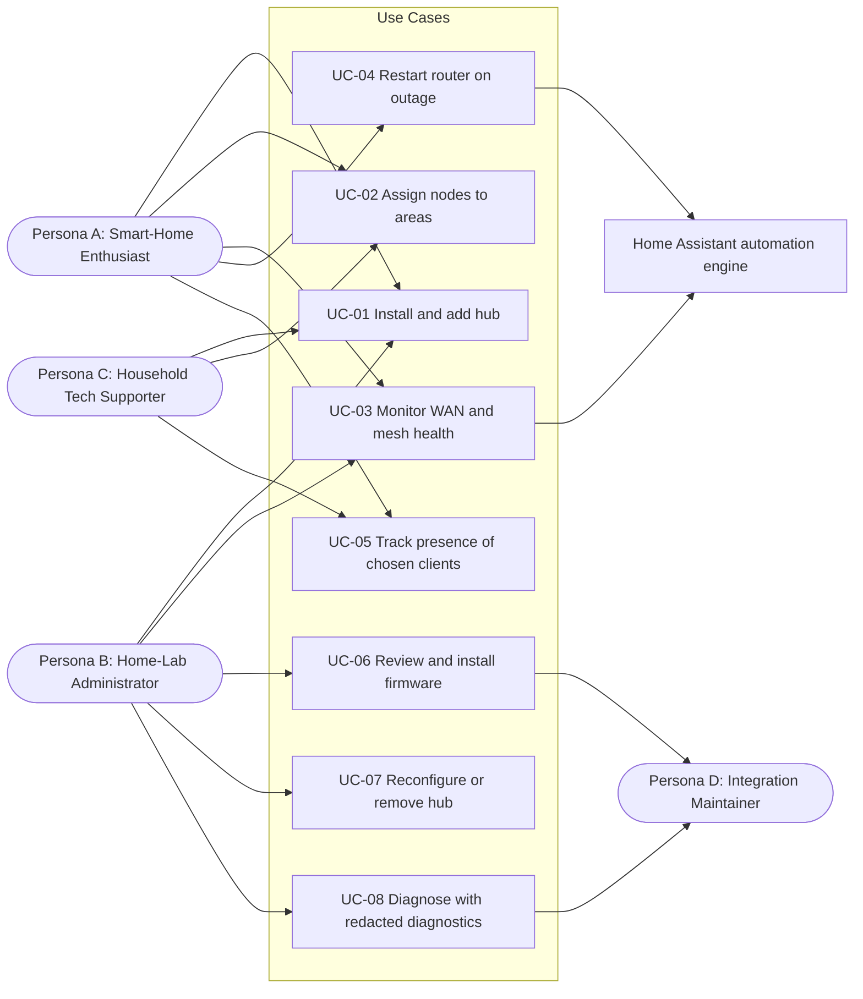
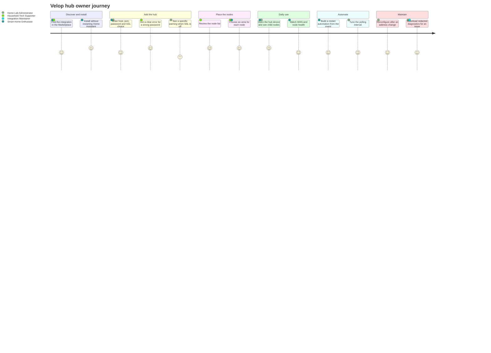
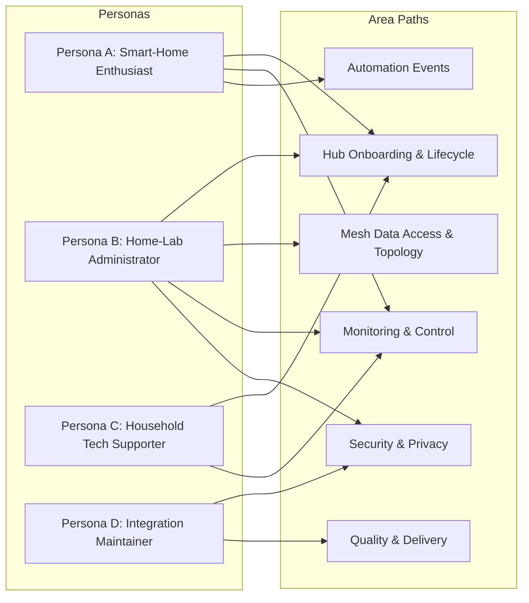
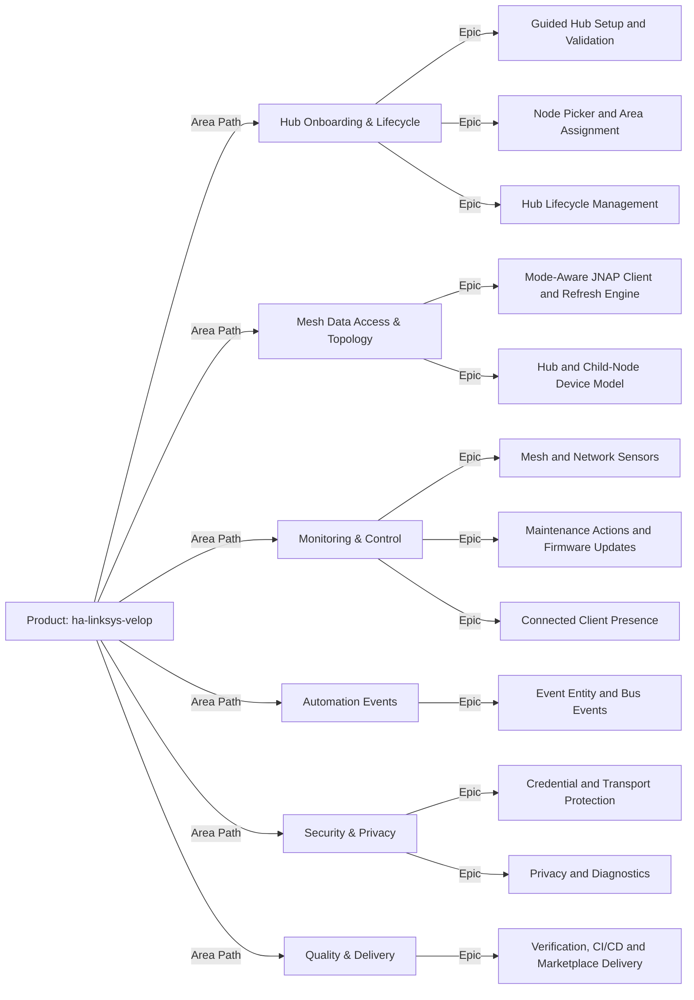
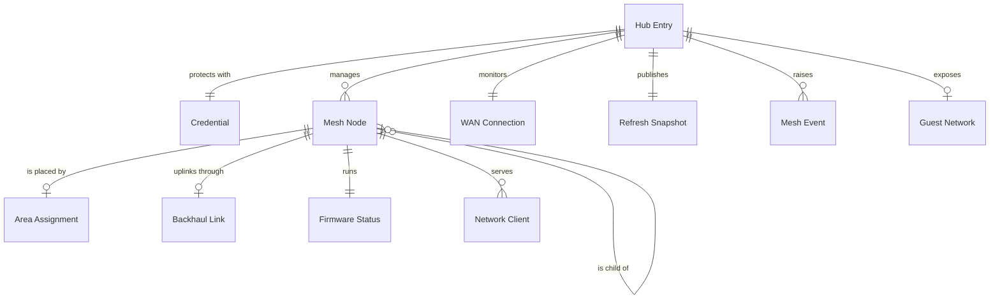
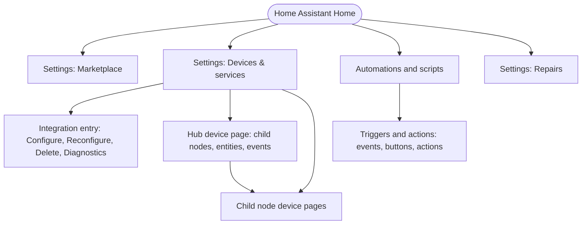
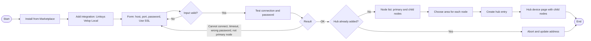
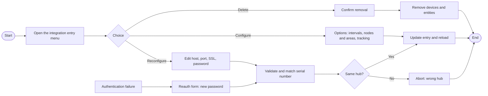
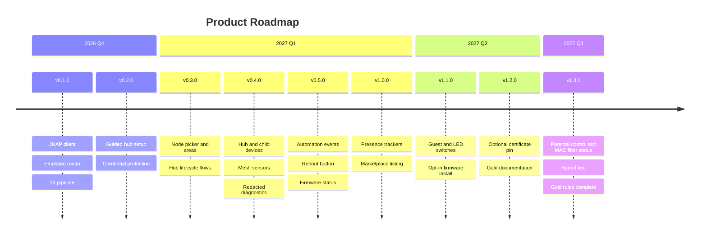

# Product Requirements — ha-linksys-velop

| Field               | Value                                                                                        |
| ------------------- | -------------------------------------------------------------------------------------------- |
| Document version    | 1.0.0-draft                                                                                  |
| Date                | 2026-11-25                                                                                   |
| Owner               | Repository maintainer of ha-linksys-velop                                                    |
| Status | Draft; deviations DEV-01 to DEV-08 accepted by the owner on 2026-11-25 |
| Product             | ha-linksys-velop (Home Assistant custom integration for Linksys Velop MX-series)             |
| Target platform     | Home Assistant Core 2026.11.0 and newer (live reference instance: 2026.11.3, Python 3.14.10) |
| Evidence convention | IDs such as HA-8, LK-3, ST-14 and WS-1 are listed in Appendix B and Appendix C               |

This document is not legal advice. Regulatory statements are plain-language readings of public texts and need legal review before anyone relies on them.

## Executive Summary

ha-linksys-velop is a secure, simple and lightweight Python custom integration that lets Home Assistant manage a Linksys Velop MX2000 (Atlas 6) mesh Wi-Fi system and other MX-series systems. It talks to the primary node over the local JNAP HTTP API, so no cloud account, no vendor service and no telemetry are involved. The integration is installed from the Home Assistant Marketplace, which replaced the standalone HACS installer in release 2026.11 [HA-1, HA-7].

The target market is Home Assistant owners who run a Velop mesh and want presence, health, maintenance and automation data inside their own smart home. They currently rely on one mature community integration and a small sample integration that cannot complete setup against a real router: it posts a wrongly shaped transaction body, validates only with an unauthenticated call so a wrong password goes unnoticed, and supports only plain HTTP [WS-5, LK-3, LK-4]. This product keeps the proven feature set and fixes those faults.

The product aligns with the maintainer's goal of a listed, maintainable and security-conscious open-source integration that passes the Marketplace checks (hassfest and the HACS action) and follows the Home Assistant quality scale. The user's requirements add a guided setup that lists the mesh nodes with a per-node area selector, SSL support without certificate validation, add, remove and reconfigure of hubs, router and bridge mode support, a configurable refresh interval and automation events.

This document supports three decisions: approve the scope of twelve Epics, accept the recorded deviations from the workspace security and technical instructions (DEV-01 to DEV-08), and confirm the integration domain, which the owner set to `ha_linksys_velop` on 2026-11-25.

### Product Vision

Every Home Assistant owner with a Velop mesh can add their hub in under three minutes, see every mesh node in the right room, and automate their network (for example a restart after a long internet outage) without sending a single byte outside the home.

### Product Strategy Alignment

The product is open-source and has no revenue goal. The strategic objectives below are the maintainer's, and each one is marked as an assumption because no organisation strategy was supplied.

> Assumption A-01: The maintainer's strategic objectives are a Marketplace listing, a self-assessed quality scale tier, and a low-maintenance codebase; no funding or commercial goal exists.

| Strategic objective                        | How the product contributes                                                                                    | Measure                                                                       | Evidence          |
| ------------------------------------------ | -------------------------------------------------------------------------------------------------------------- | ----------------------------------------------------------------------------- | ----------------- |
| Be discoverable and installable by default | Meets every Marketplace listing check so users install in the Home Assistant UI                                | Both GitHub Actions checks green on main; catalog entry accepted              | HA-8, HA-10       |
| Be trustworthy for network credentials     | Stores the admin password only in the config entry, redacts it everywhere and documents residual risk honestly | Zero secrets in logs, diagnostics and entity attributes across the test suite | HA-43, WS-2       |
| Stay maintainable by one person            | Layered code, strict typing, 95 percent coverage, emulated router tests and automated checks                   | CI green, coverage at or above 95 percent                                     | WS-3, WS-4, HA-15 |
| Follow Home Assistant direction            | Uses runtime data, reconfigure and reauth flows, `via_device_id`, `DeviceInfo` dataclass and event entities    | Zero deprecation warnings on Home Assistant 2026.11 and 2026.12 beta          | HA-34, HA-35      |
| Respect household privacy                  | Treats MAC addresses, hostnames and IP addresses as personal data and minimises them                           | No client identifiers in attributes, logs or diagnostics without redaction    | ST-19             |

### Product Value Proposition

For Home Assistant owners with a Velop mesh, ha-linksys-velop is the local, guided and self-contained way to see and control the mesh: it validates the real admin password during setup, places every mesh node in an area during setup, supports HTTPS with the router's self-signed certificate, works in router and bridge mode, and raises events that automations can act on.

| Capability                                      | ha-linksys-velop (this product) | uvjim linksys_velop                                      | Conexo-Casa sample        | Core linksys_smart |
| ----------------------------------------------- | ------------------------------- | -------------------------------------------------------- | ------------------------- | ------------------ |
| Local JNAP, no cloud                            | Yes                             | Yes                                                      | Yes                       | Yes (legacy API)   |
| Real password validation at setup               | Yes (authenticated call)        | Router password required; validation method not verified | No (unauthenticated call) | No                 |
| SSL toggle with self-signed certificate support | Yes                             | Not confirmed                                            | No (HTTP only)            | No                 |
| Node picker with per-node area at setup         | Yes                             | No                                                       | No                        | No                 |
| Child nodes linked to a hub device              | Yes                             | Not confirmed                                            | No                        | No                 |
| Event entity and bus events                     | Yes                             | Event entities                                           | No                        | No                 |
| Bridge mode handling                            | Yes (mode-aware)                | Partial (parental controls disabled)                     | No                        | No                 |
| Reauth, reconfigure, options, diagnostics       | Yes                             | Repairs and options                                      | None                      | None               |
| Maturity and installed base                     | New                             | 79 stars, releases through 2026-11-24                    | 1 star                    | 64 installs        |

Sources: LK-1, LK-2, LK-10, LK-20, WS-5. The uvjim project is the mature alternative; the differentiation is guided setup, SSL support, the explicit security posture and an emulator-backed test suite, not feature count.

### Market Opportunity & Problem Statement

**Problem.** Velop owners who use Home Assistant either install a large community integration with many options or a small sample integration that fails against a real router. Users want a setup that checks the real password, tolerates the router's self-signed certificate, shows which mesh nodes exist and where they are, and exposes events for automations. The sample's transaction request is not what JNAP expects, so every refresh fails after a successful config flow [WS-5, LK-3, PV-1].

**Market size.** The sizing below uses published figures; the Velop-owning share of Home Assistant users is unknown.

| Level | Definition                                                  | Value                                                                                                           | Source       |
| ----- | ----------------------------------------------------------- | --------------------------------------------------------------------------------------------------------------- | ------------ |
| TAM   | Active Home Assistant installations                         | 742,088 opted-in installations on 2026-11-24; more than 2 million reported by the Open Home Foundation for 2025 | LK-21, LK-22 |
| SAM   | Home Assistant users who own a Linksys Velop MX-series mesh | Unknown; no public figure                                                                                       | LK-23        |
| SOM   | Users who install this integration                          | Unknown; proxy: the incumbent has 79 GitHub stars                                                               | LK-1         |

> Assumption A-02: The Velop-owning share of Home Assistant users cannot be sized from public sources; objectives use adoption proxies (stars, issues, beta testers) instead of a market share figure.

**Competitive landscape.** Home Assistant analytics list only core integrations, so custom integrations have no install count [LK-21].

| Alternative                            | Type                                         | Status in 2026                                                          | Source       |
| -------------------------------------- | -------------------------------------------- | ----------------------------------------------------------------------- | ------------ |
| uvjim/linksys_velop                    | Custom integration with pyvelop library      | Active; release 2026.11.1 on 2026-11-24; 79 stars; 1 open issue         | LK-1, LK-2   |
| Conexo-Casa/linksys-velop              | Custom integration (sample for this project) | 1 star; announced 2026-06-16                                            | LK-10, LK-19 |
| AdamNaj/linksys_velop                  | Fork of the core linksys_smart code          | 15 stars; tested on one older model                                     | LK-11        |
| Core linksys_smart                     | Core device tracker                          | 64 installations; legacy Smart Wi-Fi routers                            | LK-20        |
| Generic presence (ping, nmap_tracker)  | Core integrations                            | 48,753 and 8,906 installations                                          | LK-21        |
| Other router integrations (benchmarks) | Core integrations                            | tplink 80,837; fritz 51,706; unifi 44,803; asuswrt 5,449; netgear 2,932 | LK-21        |

**Opportunity.** A smaller, security-explicit integration with guided setup, Marketplace delivery and a verifiable test suite can serve users who find the incumbent heavy, and gives the maintainer a reusable pattern for other local-API routers.

## Product Objectives

Every objective below is S.M.A.R.T.: specific in scope, measured by a named metric, achievable for a single maintainer, relevant to the strategy above and bounded by a date. Dates are resolved against the document date of 2026-11-25.

### Business Objectives

| ID    | Objective                                                      | Metric                                                                                          | Baseline                  | Target                              | Deadline                | Owner      |
| ----- | -------------------------------------------------------------- | ----------------------------------------------------------------------------------------------- | ------------------------- | ----------------------------------- | ----------------------- | ---------- |
| BO-01 | List the integration in the Home Assistant Marketplace catalog | Hassfest and HACS action both pass on main; catalog entry live                                  | Not listed                | Listed with version 1.0.0           | 2027-03-31              | Maintainer |
| BO-02 | Reach the Silver quality scale rules by self-assessment        | Share of Bronze and Silver rules marked done (exempt rules justified) in `quality_scale.yaml`   | 0 of 30                   | 30 of 30                            | 2027-03-31              | Maintainer |
| BO-03 | Reach the Gold rules by self-assessment                        | Share of Gold rules done or justified exempt                                                    | 0 of 21                   | 21 of 21                            | 2027-09-30              | Maintainer |
| BO-04 | Keep quality gates green                                       | Line coverage of the integration package; zero lint and type errors on main                     | No code                   | At least 95 percent and zero errors | Every merge from v0.1.0 | Maintainer |
| BO-05 | Fix vulnerabilities promptly                                   | Days from confirmed report to fixed release                                                     | No process                | Critical 7, high 30, medium 90 days | From v1.0.0             | Maintainer |
| BO-06 | Validate against real hardware | Real models tested with the beta, and modes covered | 0 (the sample author tested an MX4200) | The owner's MX2000 in bridge mode on firmware 1.1.7.210469; router mode and other models covered by emulator fixtures and community beta testers, labelled best effort until confirmed | 2027-03-15 | Maintainer |
| BO-07 | Build an adopter signal                                        | GitHub stars                                                                                    | 0                         | At least 100 (incumbent has 79)     | 2027-12-31              | Maintainer |
| BO-08 | Respond to issues                                              | Median time to first maintainer response                                                        | No process                | 7 days or less                      | From v1.0.0             | Maintainer |

> Assumption A-03: BO-06 to BO-08 targets are maintainer proposals, not evidence-based benchmarks; ST-31 shows no official aggregate for adoption, and issue-response targets are set by the owner.

### User Objectives

| ID    | User goal (user's view)                                          | Measurable outcome                                                                                                            | Time frame                   | Persona |
| ----- | ---------------------------------------------------------------- | ----------------------------------------------------------------------------------------------------------------------------- | ---------------------------- | ------- |
| UO-01 | "I can add my Velop hub without reading documentation."          | Setup finishes in 3 minutes or less with at most 5 inputs (host, port, password, SSL, areas)                                  | Every setup                  | A, C    |
| UO-02 | "Wrong passwords and wrong addresses are caught immediately."    | 100 percent of invalid password, unreachable host and non-primary-node cases show a specific error before an entry is created | Every setup                  | A, B    |
| UO-03 | "My nodes are in the right rooms from the first minute."         | One area choice per node in the setup flow; zero device edits needed afterwards                                               | Every setup                  | A, C    |
| UO-04 | "I can see which mesh nodes belong to my hub."                   | All child nodes appear as connected devices under the hub device page                                                         | Within 1 refresh after setup | A, B    |
| UO-05 | "I can move the router to a new address without losing history." | Reconfigure keeps entity IDs and history; completes in 1 minute or less                                                       | Every reconfigure            | B       |
| UO-06 | "My automation restarts the router after a long outage."         | A WAN-disconnected event or state fires within 2 polling intervals; a reboot button action runs in under 5 seconds            | Every outage                 | A, B    |
| UO-07 | "I control how often the data refreshes."                        | Polling interval selectable from 15 to 600 seconds in the options flow; change applies within 1 minute                        | Any time                     | B       |
| UO-08 | "My family's devices are not exposed by default."                | No client entity or client identifier is created or shown until the user opts in                                              | From first install           | C       |
| UO-09 | "I find setup and daily use easy."                               | System Usability Scale score of 80 or more among at least 10 beta users                                                       | 2027-03-15                   | A, B, C |

> Assumption A-04: UO-09 uses a System Usability Scale target of 80, a common good-usability reference score; no source was fetched, and the number is a maintainer proposal.

## Target Market & User Research

This section summarises desk research only: no interviews or surveys were run. Sources are the existing integrations and their issue trackers [LK-1, LK-10, LK-19], Home Assistant analytics [LK-21], Linksys support and security material [LK-9, LK-15, LK-14] and the audit of the sample code [WS-5]. Confidence is medium for needs (many public sources agree) and low for market size (no public Velop figure). The key insights that shape the requirements are:

- Setup trust is the first barrier: the sample validates only with an unauthenticated call (`core/GetDeviceInfo` is flagged no-auth in the pyvelop registry), so a wrong password is not detected and users discover failures later [WS-5, LK-4].
- Router mode and bridge mode behave differently: Linksys documents that Device List, Parental Control and Priority are unavailable in bridge mode [LK-15].
- Presence from DHCP leases is wrong because leases outlive connections [WS-5].
- Client lists are personal data and bloat the registry when created by default [ST-19, WS-5].
- Automations need explicit events, not only polled states.

### Market Segmentation

| Segment                                   | Definition                                                                                     | Size           | Needs                                             | Priority | Rationale                                                               |
| ----------------------------------------- | ---------------------------------------------------------------------------------------------- | -------------- | ------------------------------------------------- | -------- | ----------------------------------------------------------------------- |
| S1 Router-mode MX owners (beachhead)      | Home Assistant owners whose Velop primary node is the router (MX2000, MX4200, MX5300 families) | Unknown (A-02) | Setup, WAN health, node health, reboot, presence  | Must     | Largest fit with the user's requirements and the available JNAP actions |
| S2 Bridge-mode MX owners                  | Velop behind an ISP gateway or other router                                                    | Unknown (A-02) | Node health, firmware, reboot; no router features | Must     | The requirements demand bridge mode support                             |
| S3 Multi-hub households and small offices | Two or more Velop systems (for example house and outbuilding)                                  | Unknown        | Several hubs in one Home Assistant, clear naming  | Should   | Needed by the add, remove and reconfigure requirement                   |
| S4 Older WHW-series owners                | Original Velop WHW03 families                                                                  | Unknown        | Best-effort compatibility                         | Could    | Claimed JNAP consistency across series is unverified [LK-10]            |

The beachhead is S1; S2 is a co-priority because the requirement is explicit.

### Personas

These are proto-personas built from desk research; none is based on interviews. Names are role labels, not real people.

**Persona A: Smart-Home Enthusiast (primary).** Age 30 to 50, runs Home Assistant on a mini PC or Home Assistant OS appliance, comfortable with YAML and automations. Behaviours: installs integrations from the Marketplace, builds automations around presence and network state. Motivations: wants the network to be a first-class part of the home model and to restart the router automatically when the internet is down. Pain points: setup that appears to work but never fetches data, entities named after IP addresses, noisy client entities. Technology proficiency: high. Accessibility needs: standard Home Assistant frontend support (keyboard, screen reader). Representative quote: "If the router locks up while I am away, I want Home Assistant to fix it."

**Persona B: Home-Lab Administrator (primary).** Age 25 to 55, runs several VLANs, a Velop in bridge mode behind another router, and strong opinions about TLS and credentials. Behaviours: reads release notes, inspects traffic, uses diagnostics. Motivations: least privilege, clear security statements, control over polling load. Pain points: integrations that hide how credentials are stored, fail on self-signed certificates, or poll too often. Technology proficiency: very high. Representative quote: "Tell me exactly what is stored and where, and let me set the interval."

**Persona C: Household Tech Supporter (primary).** Age 35 to 65, the person in the family who keeps the Wi-Fi working, installs integrations by following a guide. Behaviours: uses the user interface only, relies on suggested defaults. Motivations: knows which node is in which room and wants a simple restart button. Pain points: jargon, long forms, devices of family members exposed by default. Technology proficiency: medium. Accessibility needs: clear labels and error text, larger touch targets on a phone. Representative quote: "Just show me the nodes and let me put them in rooms."

**Persona D: Integration Maintainer (secondary).** The repository owner and any contributor. Behaviours: runs tests against an emulated router, reviews pull requests, publishes releases. Motivations: a codebase that stays green and is cheap to maintain. Pain points: no hardware for every model, quality scale paperwork, silent API changes. Technology proficiency: very high.

### Use Cases

The diagram links the primary personas to the use cases they perform; the Maintainer and the Home Assistant automation engine appear on the right because they use the outcomes.

The diagram shows eight use cases; Persona A drives automation use cases, Persona B drives maintenance and diagnostics, and Persona C drives guided setup and area assignment.

| ID    | Goal                             | Trigger                                                            | Main flow                                                                                                 | Outcome                                                                   | Persona |
| ----- | -------------------------------- | ------------------------------------------------------------------ | --------------------------------------------------------------------------------------------------------- | ------------------------------------------------------------------------- | ------- |
| UC-01 | Add a Velop hub                  | User installs the integration from the Marketplace and selects Add | Enter host or IP, port, admin password and SSL choice; integration validates; node list appears           | Config entry created with a unique ID from the primary node serial number | A, B, C |
| UC-02 | Place each node in an area       | Node picker step                                                   | Review the nodes (primary and child nodes only); choose an area per node; confirm                         | Devices created in the chosen areas                                       | A, C    |
| UC-03 | Watch network health             | Daily use                                                          | Dashboards and history show WAN state, node online state, backhaul and client counts                      | Problems seen within 2 polling intervals                                  | A, B    |
| UC-04 | Restart the router automatically | WAN disconnected for a set time                                    | Automation uses the WAN event or binary sensor, adds a rate-limit condition and presses the reboot button | Router reboots; sensors return to available                               | A       |
| UC-05 | Know who is home                 | User selects clients to track                                      | Choose clients in the options flow; trackers are created disabled-by-default unless chosen                | Presence based on live connections, not leases                            | A, C    |
| UC-06 | Keep firmware current            | New firmware reported                                              | Update entity shows installed and latest version; optional install when enabled                           | Firmware status visible; install only after opt-in                        | B       |
| UC-07 | Change or remove a hub           | Router IP, password or SSL setting changed, or hub retired         | Use Reconfigure, reauth, or Delete                                                                        | Entry updated without losing history, or all devices and entities removed | B       |
| UC-08 | Report a problem                 | Unexpected behaviour                                               | Download diagnostics; secrets and client identifiers are redacted                                         | Maintainer can reproduce without personal data                            | B, D    |

### User Journey Map

| Stage                | Pain point                                                                       | Opportunity                                                               | Requirement            |
| -------------------- | -------------------------------------------------------------------------------- | ------------------------------------------------------------------------- | ---------------------- |
| Discover and install | Several similarly named integrations; domain collision risk                      | Distinct name and domain; clear README with images                        | REQ-QLT-08, DEV-07     |
| Add the hub          | SSL on a self-signed router fails in other integrations; wrong password accepted | Authenticated validation and an SSL option without certificate validation | REQ-ONB-03, REQ-ONB-05 |
| Place the nodes      | Nodes land in no area and are named by IP                                        | Per-node area selector in the flow                                        | REQ-ONB-10, REQ-ONB-11 |
| Daily use            | Child nodes are hard to find; entities flood the registry                        | Child devices linked to the hub; noisy entities disabled by default       | REQ-TOP-10, REQ-MON-06 |
| Automate             | No events; automations poll states                                               | Event entity and bus event                                                | REQ-EVT-01, REQ-EVT-02 |
| Maintain             | Address changes force remove and re-add; no safe way to share logs               | Reconfigure flow; redacted diagnostics                                    | REQ-ONB-14, REQ-SEC-09 |

## Product Architecture

The product is a single Home Assistant custom integration, `custom_components/ha_linksys_velop/`, built in four layers (Presentation, Application, Domain, Infrastructure) with dependencies pointing inward only, as required by the workspace layer architecture and coding instructions [WS-3, WS-4]. Presentation holds the entities and the thin config flow; Application holds the setup entry point, coordinator, use cases and mapper; Domain holds pure models, rules and port protocols and imports nothing from Home Assistant; Infrastructure holds the JNAP HTTP client and TLS handling behind a domain-owned port. The JNAP client lives inside the repository instead of an external package (DEV-08), and only the entry handler wires the adapter into the application.

| Layer          | Contents                                                                                   | Location inside `custom_components/ha_linksys_velop/`                                                                                                                                                              |
| -------------- | ------------------------------------------------------------------------------------------ | ------------------------------------------------------------------------------------------------------------------------------------------------------------------------------------------------------------------ |
| Presentation   | Entities, config flow forms, strings, icons, diagnostics view                              | `sensor.py`, `binary_sensor.py`, `button.py`, `update.py`, `event.py`, `device_tracker.py`, `switch.py`, `config_flow.py`, `diagnostics.py`, `strings.json`, `translations/en.json`, `icons.json`, `services.yaml` |
| Application    | Entry setup and unload (composition root), coordinator, use cases, mapper, event detection | `__init__.py`, `coordinator.py`, `application/`                                                                                                                                                                    |
| Domain         | Models, validation rules, errors, port protocols                                           | `domain/`                                                                                                                                                                                                          |
| Infrastructure | JNAP client, transport and SSL context, response limits                                    | `infrastructure/`                                                                                                                                                                                                  |

Detailed requirements for security, layering and coding are in `docs/requirements/security.architecture.requirements.instructions.md`, `docs/requirements/layer.architecture.requirements.instructions.md`, `docs/requirements/technical.requirements.instructions.md.md` and `docs/instructions/coding.instructions.md`. Where they conflict with this product's requirements, the deviation register in the Security & Data Protection section applies.

### Architecture Stack

Area Paths group the strategic themes of the product, and each Area Path is realised by one or more SAFe Epics that bundle the features and components needed for that theme [ST-33]. Epics carry requirement IDs of the form REQ-AREA-NN; the priority of each requirement uses MoSCoW wording (Must, Should, Could).

#### Hub Onboarding & Lifecycle

This theme covers everything a user does to bring a hub into Home Assistant and keep it healthy: the setup popup, validation, node selection with areas, and add, remove, reconfigure, reauthenticate and tune.

##### Guided Hub Setup and Validation

###### Description

Epic E-01. The first step of the config flow asks for the hub address and credentials, proves they work with an authenticated call, and only then proceeds. Users served: Personas A, B and C. Dependencies: E-04 for the client and E-10 for credential handling. Out of scope: automatic discovery (a later Could item, because JNAP routers publish no confirmed discovery record) and cloud login.

- REQ-ONB-01 (Must): The `user` step shows these fields, each with a `data_description`: Host (hostname or IP address), Port (1 to 65535), Admin password (masked password selector), Use SSL (boolean, default off). When Port is empty, it resolves to 443 with SSL and 80 without SSL.
- REQ-ONB-02 (Must): Host input accepts a hostname, IPv4 or IPv6 address only. Input containing a scheme, path, query, user information or whitespace is rejected with a field error. Loopback, unspecified, multicast and link-local addresses (including 169.254.169.254) are rejected; IPv6 hosts are bracketed when the URL is built.
- REQ-ONB-03 (Must): Validation first calls the unauthenticated `core/GetDeviceInfo`, then an authenticated read action. A wrong password must produce `invalid_auth`; the flow never creates an entry on an unauthenticated success alone [WS-5, LK-3, LK-4].
- REQ-ONB-04 (Must): Errors map to distinct translated keys: `cannot_connect`, `timeout`, `invalid_auth`, `account_locked` (JNAP `ErrorAdminAccountLocked` or `ErrorPasswordCheckDelayed`), `unsupported_device` (not a JNAP router), `not_primary_node` (device mode is not master) and `unknown`. Messages contain no host, URL or stack trace.
- REQ-ONB-05 (Must): With Use SSL on, the integration connects over HTTPS with certificate verification disabled, so a self-signed router certificate is accepted (DEV-01). It never silently switches between HTTP and HTTPS.
- REQ-ONB-06 (Must): The unique ID is the primary node serial number from `GetDeviceInfo`, never the host. A second add of the same hub aborts with `already_configured` and updates host, port and SSL through `_abort_if_unique_id_configured(updates=...)` [HA-17].
- REQ-ONB-07 (Must): The entry title is the model and the last four characters of the serial number, for example "Velop MX2000 A1B2"; it never contains an IP address.
- REQ-ONB-08 (Must): Every request in the flow has a timeout (connect 5 seconds, total 10 seconds), and the whole validation step finishes or fails within 30 seconds.
- REQ-ONB-09 (Must): All flow strings, errors and abort reasons exist in `strings.json` and `translations/en.json`, every `async_show_form` passes a `step_id`, and the config flow test coverage is 100 percent of the flow code [HA-17, HA-25].

###### Business Outcome Hypothesis

For Home Assistant owners with a Velop mesh who need a setup they can trust, the guided setup popup with authenticated validation will give a working hub on the first attempt unlike the sample integration that validates with an unauthenticated call and fails on every refresh, because our approach proves the real credentials and the real transport before creating an entry. Leading indicator: share of beta setups that succeed at the first try; target value: at least 95 percent among at least 10 beta users.

##### Node Picker and Area Assignment

###### Description

Epic E-02. After validation, the second step lists only the Wi-Fi mesh nodes (the primary node and child nodes), not the connected clients, and offers one area dropdown per node. Users served: Personas A and C. Dependencies: E-01, E-04, E-05. Out of scope: creating new areas inside the flow (Home Assistant's area selector chooses existing areas only).

- REQ-ONB-10 (Must): The `nodes` step is built from the device list and topology data. It filters out every client device and displays only mesh nodes, each with name, model, role (primary or child) and serial number. The primary node is always included; each child node has an Include option, default on.
- REQ-ONB-11 (Must): The step offers one area selector per included node, built from the registered areas, optional and empty by default. A node whose JNAP location name matches an existing area name is pre-selected, and the user can change it.
- REQ-ONB-12 (Must): Chosen areas are stored in the config entry options as a map of node serial number to area ID and applied through the device registry when each device is first created. A later user edit of a device's area in Home Assistant is never overwritten on reload; only a change made in the options flow updates the area.
- REQ-ONB-13 (Should): With no registered areas the step still completes and explains how to add areas later.

> Assumption A-05: Mesh nodes can be told apart from clients in the device list data (for example by a node type field), and Home Assistant's form framework has no native table widget, so the per-node dropdowns are generated as dynamic schema fields keyed by node name; both points must be confirmed against a captured JNAP session and the Home Assistant 2026.11 data entry flow API before implementation.

###### Business Outcome Hypothesis

For household tech supporters who want each node in the right room, the node picker with per-node areas will remove the manual device editing step unlike integrations that create devices without areas, because our approach asks for the room while the user is already in the setup flow. Leading indicator: number of device area edits needed after setup; target value: zero for at least 90 percent of beta setups.

##### Hub Lifecycle Management

###### Description

Epic E-03. Users can add several hubs, remove a hub, change its address or credentials without losing history, recover from an expired password, and tune the integration. Users served: Personas A and B. Dependencies: E-01, E-02, E-10.

- REQ-ONB-14 (Must): `async_step_reconfigure` lets the user change host, port, SSL and password (an empty password keeps the stored one), validates exactly like setup, aborts with `wrong_hub` when the serial number differs, and ends with `async_update_reload_and_abort` so entity IDs and history stay [HA-18, HA-19].
- REQ-ONB-15 (Must): An authentication failure during setup or refresh raises `ConfigEntryAuthFailed` immediately and starts the reauth flow (`async_step_reauth` then `async_step_reauth_confirm`), which updates only the password after validation and aborts on a serial number mismatch [HA-18, HA-26].
- REQ-ONB-16 (Must): The options flow uses `OptionsFlowWithReload` and offers: fast polling interval (15 to 600 seconds, default 60), slow polling interval (5 to 1440 minutes, default 30), node inclusion and areas, client tracking selection (off by default), client join and leave events (off by default) and firmware install permission (off by default). No separate update listener is registered [HA-20].
- REQ-ONB-17 (Must): Several hubs can be added; each is an independent config entry. Removing an entry unloads it cleanly and removes its devices, entities and stored data, and performs no change on the router.
- REQ-ONB-18 (Should): Unsupported options never appear (for example guest network controls on a hub whose capability list lacks them).

###### Business Outcome Hypothesis

For home-lab administrators who change addresses and passwords, the reconfigure, reauth and options flows will keep the hub running without removal unlike integrations that force delete and re-add, because our approach updates the same entry and reloads it. Leading indicator: reconfigure completion time; target value: 1 minute or less with entity history intact in every test.

#### Mesh Data Access & Topology

This theme covers the data foundation: a correct, mode-aware JNAP client and refresh engine, and the Home Assistant device model that shows the hub with its child nodes.

##### Mode-Aware JNAP Client and Refresh Engine

###### Description

Epic E-04. An asynchronous client in the Infrastructure layer speaks JNAP, hides protocol details behind a domain port, detects router or bridge mode and refreshes data on schedule through a `DataUpdateCoordinator`. Users served: all. Dependencies: Home Assistant's shared aiohttp session helpers [HA-47]. Out of scope: push or event-stream subscriptions (JNAP offers none that were found).

- REQ-TOP-01 (Must): Requests are HTTP POST to `/JNAP/` with headers `Content-Type: application/json`, `X-JNAP-Action` (the full action URI) and `X-JNAP-Authorization: Basic base64(admin:password)`. A single action sends a JSON object (`{}` when empty). `core/Transaction` sends a bare JSON array of action objects, never an object with an `actions` key; this is the fault that breaks the sample [LK-3, PV-1, WS-5].
- REQ-TOP-02 (Must): Success is the result value `OK` only. `_ErrorUnauthorized`, `ErrorInvalidAdminPassword`, `ErrorPasswordCheckDelayed`, `ErrorAdminAccountLocked`, `_ErrorUnknownAction`, `_ErrorInvalidInput` and `_ErrorInvalidOutput` map to distinct domain errors; the invented value `_success` is not accepted [LK-3].
- REQ-TOP-03 (Must): Every aiohttp client error, timeout, invalid JSON, non-object body, unexpected status and mid-request disconnect becomes a domain connection error. Redirects are not followed. Bodies larger than 2 MiB are rejected; the response is mapped through an allow-list of known fields (CI-065) [WS-4].

> Assumption A-06: The 2 MiB response cap is a proposal sized for 250 clients; the coding instructions' 64 KiB example is too small for a full device list.

- REQ-TOP-04 (Must): Mode is read from `nodes/smartmode/GetDeviceMode` (master or not) and from `router/GetWANStatus` (a detected WAN type containing bridge means bridge mode). In bridge mode, router-only actions are never called, their entities are never created, and the mode is logged once at info level [LK-4, LK-15].
- REQ-TOP-05 (Must): Available capabilities come from the `services` list of `GetDeviceInfo`; an action not advertised is not called. An unsupported or unknown action returns a degraded but working integration, never a setup failure.
- REQ-TOP-06 (Must): The coordinator receives `config_entry`, uses `_async_setup` for one-time work and has two tiers: a fast tier (default 60 seconds: WAN status, nodes, backhaul, client connections) and a slow tier (default 30 minutes: firmware status, settings, system statistics). Each interval is user-configurable (REQ-ONB-16). Authenticated and unauthenticated actions are sent in separate transactions because newer firmware rejects mixed ones, and the 300-second limit for `Refresh*` actions is respected [LK-4].
- REQ-TOP-07 (Must): Transient failures raise `UpdateFailed` with exponential back-off; authentication failures raise `ConfigEntryAuthFailed` at once and polling stops. Account lock or delay results stop polling, create a repair issue and never retry in a loop, because retries with a wrong password can lock the admin account [HA-26, LK-3].
- REQ-TOP-08 (Must): `PARALLEL_UPDATES` is defined in every platform module; one hub issues at most one in-flight request batch at a time.

JNAP action coverage. The policy is: every read-only action advertised by the router and useful for monitoring is adopted by version 1.3.0; write actions are adopted selectively and each needs a translated user-visible purpose; account-changing and destructive actions are excluded. Action names come from the pyvelop registry (Tier 3) and need confirmation against a live capture [LK-4].

| Action (prefix `http://linksys.com/jnap/`)                                                                                                                                                                                                                                       | Purpose                                            | Auth | Phase    |
| -------------------------------------------------------------------------------------------------------------------------------------------------------------------------------------------------------------------------------------------------------------------------------- | -------------------------------------------------- | ---- | -------- |
| `core/GetDeviceInfo`                                                                                                                                                                                                                                                             | Model, serial, firmware, services list             | No   | 0.1.0    |
| `nodes/smartmode/GetDeviceMode`                                                                                                                                                                                                                                                  | Primary or child                                   | No   | 0.1.0    |
| `router/GetWANStatus`                                                                                                                                                                                                                                                            | WAN state, IP, WAN type (bridge detection)         | No   | 0.1.0    |
| `core/CheckAdminPassword`                                                                                                                                                                                                                                                        | Credential check candidate (verify behaviour live) | No   | 0.2.0    |
| `devicelist/GetDevices` (v3)                                                                                                                                                                                                                                                     | Nodes and clients with connections                 | Yes  | 0.1.0    |
| `nodes/diagnostics/GetBackhaulInfo`                                                                                                                                                                                                                                              | Node uplink type, speed, signal                    | Yes  | 0.4.0    |
| `networkconnections/GetNetworkConnections`, `nodes/networkconnections/GetNodesWirelessNetworkConnections`                                                                                                                                                                        | Per-node connections                               | Yes  | 0.4.0    |
| `diagnostics/GetSystemStats`                                                                                                                                                                                                                                                     | Uptime, load (disabled-by-default sensors)         | Yes  | 0.4.0    |
| `router/GetLANSettings`, `router/GetDHCPClientLeases`                                                                                                                                                                                                                            | LAN and DHCP facts (not used for presence)         | Yes  | 1.0.0    |
| `router/GetEthernetPortConnections`                                                                                                                                                                                                                                              | Port link state                                    | Yes  | 1.1.0    |
| `nodes/firmwareupdate/GetFirmwareUpdateStatus`, `firmwareupdate/GetFirmwareUpdateSettings`                                                                                                                                                                                       | Latest version and policy                          | Yes  | 0.5.0    |
| `nodes/firmwareupdate/UpdateFirmwareNow`                                                                                                                                                                                                                                         | Install (opt-in only)                              | Yes  | 1.1.0    |
| `core/Reboot`                                                                                                                                                                                                                                                                    | Reboot a node                                      | Yes  | 0.5.0    |
| `guestnetwork/GetGuestRadioSettings`, `SetGuestRadioSettings`                                                                                                                                                                                                                    | Guest Wi-Fi switch                                 | Yes  | 1.1.0    |
| `routerleds/GetLedNightModeSetting`, `SetLedNightModeSetting`                                                                                                                                                                                                                    | LED night mode switch                              | Yes  | 1.1.0    |
| `parentalcontrol/*`, `macfilter/*`                                                                                                                                                                                                                                               | Read-only status first, controls later             | Yes  | 1.3.0    |
| `healthcheck/*`                                                                                                                                                                                                                                                                  | Speed test results and run button                  | Yes  | 1.3.0    |
| `routerupnp/GetUPnPSettings`, `firewall/GetALGSettings`, `wirelessap/GetWPSServerSettings`, `wirelessap/GetMLOSettings`, `homekit/GetHomeKitSettings`, `nodes/topologyoptimization/GetTopologyOptimizationSettings`, `diagnostics/GetScheduledRebootSettings`, `nodes/storage/*` | Read-only diagnostic sensors and diagnostics data  | Yes  | 1.3.0    |
| `core/GetAdminPasswordAuthStatus`, `core/IsAdminPasswordDefault`                                                                                                                                                                                                                 | Security hints in diagnostics                      | No   | 1.3.0    |
| `nodes/setup/SetAdminPassword`, `devicelist/DeleteDevice`, `router/SetLANSettings`, any factory reset                                                                                                                                                                            | Account or network-changing                        | Yes  | Excluded |

> Assumption A-07: The inner key of a transaction element is `request` (so an element is an object with `action` and `request`), and HTTPS on port 443 exists on MX-series firmware; pyvelop confirms only the `action` key and plain HTTP, so both must be confirmed with a captured session before release.

###### Business Outcome Hypothesis

For every Velop owner whose hub must refresh reliably, the mode-aware client and two-tier coordinator will keep data current and recover from outages unlike the sample integration that fails every refresh on a wrong request shape, because our approach follows the real protocol shape and classifies every failure. Leading indicator: refresh success rate against the emulated router and real beta hubs; target value: 99 percent of polls succeed over a 7-day soak and recovery within 2 intervals after an outage.

##### Hub and Child-Node Device Model

###### Description

Epic E-05. The primary node becomes the hub device, and every child node becomes its own device connected through the hub, so the hub device page lists the child nodes and their entities. Users served: Personas A and B. Dependencies: E-01, E-04. Out of scope: per-node config subentries (a possible later change) and clients as devices (see E-08).

- REQ-TOP-09 (Must): The hub device uses identifiers `(domain, serial number)`, manufacturer Linksys, the model number, firmware version as `sw_version`, hardware version, serial number, a `configuration_url` to the hub address and MAC connections. It is built with the `DeviceInfo` dataclass and attribute access, never dict-style access [HA-34, HA-35].
- REQ-TOP-10 (Must): Each child node is a separate device linked with `via_device_id` set to the hub's device registry ID (not the deprecated `via_device`), so the hub device page shows the child nodes as connected devices. A node's area comes from REQ-ONB-12 [HA-34, HA-36].
- REQ-TOP-11 (Must): Entities use `has_entity_name = True` and translation keys; the main entity of a device uses `name=None`. Node names come from the router's device name and fall back to model and serial suffix, never to an IP address [HA-29].
- REQ-TOP-12 (Must): A node that appears later is added as a device (dynamic devices) and raises a node-added event. A node absent for 3 consecutive successful refreshes is removed from the device registry (stale devices) and raises a node-removed event; an offline node that is still listed is kept and shown unavailable [HA-16].
- REQ-TOP-13 (Should): The hub exposes a Mesh nodes count sensor so dashboards can show the node count without reading the device registry.

###### Business Outcome Hypothesis

For smart-home enthusiasts who want a clear picture of the mesh, the hub device with linked child-node devices will show the whole mesh from one page unlike integrations that attach everything to a single device, because our approach models each physical node. Leading indicator: child nodes shown under the hub in the device page; target value: 100 percent of nodes in the emulated and real beta meshes.

#### Monitoring & Control

This theme covers the entities users see and use every day: sensors, binary sensors, buttons, updates, switches and presence.

##### Mesh and Network Sensors

###### Description

Epic E-06. Hub-level and node-level sensors and binary sensors report WAN, mode, node and client facts. Users served: Personas A and B. Dependencies: E-04, E-05. Out of scope: per-client traffic counters.

- REQ-MON-01 (Must): Hub entities: WAN status (enum sensor), internet connectivity (binary sensor, connectivity device class), WAN IP address (diagnostic category, disabled by default).
- REQ-MON-02 (Must): Hub diagnostics entities: operating mode (router or bridge), firmware version, mesh node count.
- REQ-MON-03 (Must): Hub client counts: total, wireless and wired connected clients; counts only, with no client list attribute (see REQ-SEC-10).
- REQ-MON-04 (Must): Per-node entities: connectivity (binary sensor), backhaul type, backhaul link speed, connected client count, parent node name, signal strength in dBm (disabled by default), IP address (diagnostic).
- REQ-MON-05 (Must): A missing value is reported as unknown (`None`), never as false or zero; an unreachable hub makes all its entities unavailable and logs once on loss and once on recovery (log-when-unavailable) [HA-16].
- REQ-MON-06 (Must): Entities that are noisy or sensitive use `entity_category` diagnostic and `entity_registry_enabled_default = False`; every entity has a device class where one exists, a translated name and an icon translation.
- REQ-MON-07 (Must): In bridge mode, entities that rely on router actions are not created, and a hub that changes mode reloads once and creates or removes the affected entities.

###### Business Outcome Hypothesis

For home-lab administrators who monitor the network, the sensor set with unknown-safe states and mode awareness will give accurate dashboards in both router and bridge mode unlike the sample that crashes on a wrongly typed field, because our approach maps typed domain models from an allow-list. Leading indicator: sensor errors per 24 hours in the soak test; target value: zero.

##### Maintenance Actions and Firmware Updates

###### Description

Epic E-07. Users reboot nodes, see and optionally install firmware updates, and later switch guest Wi-Fi and LED night mode. Users served: Personas A and B. Dependencies: E-04, E-05, E-10. Out of scope: factory reset, password changes and client deletion.

- REQ-MON-08 (Must): A reboot button exists for the hub and for each child node. A dropped connection during a reboot counts as success; other errors raise a translated `HomeAssistantError`. A second press within 60 seconds is ignored with a translated message.
- REQ-MON-09 (Must): An update entity per node shows installed and latest version (installed from `GetDeviceInfo`, latest from the authenticated firmware status call) with the `has_update` property [HA-32]. Installation support is off by default and is enabled only by the options flow permission in REQ-ONB-16.
- REQ-MON-10 (Should): Home Assistant actions `ha_linksys_velop.reboot_node` (device target) and `ha_linksys_velop.refresh_now` exist with `services.yaml`, translated exceptions and documented examples; both are raised through the same use cases as the buttons.
- REQ-MON-11 (Could): Guest Wi-Fi switch and LED night mode switch appear only when the capability list advertises them (version 1.1.0).

###### Business Outcome Hypothesis

For smart-home enthusiasts who want to restart the network when it fails, the reboot button, actions and update entity will enable safe remote maintenance unlike the sample whose reboot button always shows an error after a successful reboot, because our approach treats the disconnect as the expected result. Leading indicator: reboot action outcome in emulator and hardware tests; target value: 100 percent report success with the hub unavailable then recovered within 2 intervals.

##### Connected Client Presence

###### Description

Epic E-08. Device trackers report presence for the clients the user chooses, based on live connection state. Users served: Personas A and C. Dependencies: E-04, E-06. Out of scope: creating a tracker for every client by default.

- REQ-MON-12 (Must): Trackers are created only for clients the user selects in the options flow (by MAC), or for all clients when the user enables the track-all option; auto-created trackers are disabled by default.
- REQ-MON-13 (Must): Presence uses the live connection data from the device list (connected or not), never DHCP lease presence, with a `consider_home` delay of 180 seconds by default and configurable [ST-29, WS-5].
- REQ-MON-14 (Should): Tracker attributes are limited to the connected node name and connection type; hostnames are used as names and the MAC is the unique ID, and no IP address or MAC is placed in a list attribute (REQ-SEC-10).
- REQ-MON-15 (Should): A tracker's listener is unsubscribed on unload (no listener leak) and a removed client's tracker is pruned.

###### Business Outcome Hypothesis

For household tech supporters who want presence without exposing everyone, the opt-in trackers using live connections will give correct home and away states unlike lease-based tracking that shows a device as home for hours after it left, because our approach reads actual connection state. Leading indicator: presence accuracy in the emulator when a client disconnects; target value: state changes to not home within `consider_home` plus one polling interval in 100 percent of tests.

#### Automation Events

This theme exposes what happens on the network as events that automations can trigger on, and documents the patterns that use them.

##### Event Entity and Bus Events

###### Description

Epic E-09. An event entity and a bus event announce network state changes so automations such as an automatic router restart can use them. Users served: Personas A and B. Dependencies: E-04, E-05, E-06. Out of scope: new device triggers, which the project does not add.

- REQ-EVT-01 (Must): The hub has an event entity with event types `wan_connected`, `wan_disconnected`, `node_online`, `node_offline`, `node_added`, `node_removed`, `firmware_update_available`, `mode_changed` and `authentication_failed`; node-related events carry the node name and serial number as attributes [HA-41].
- REQ-EVT-02 (Must): Each event is also fired on the bus as `ha_linksys_velop_event` with `device_id`, `type` and a minimal details object, following the `<domain>_event` convention [HA-42].
- REQ-EVT-03 (Must): A state change must be seen in 2 consecutive refreshes (configurable) before it fires, so a one-poll glitch does not trigger a reboot automation.
- REQ-EVT-04 (Must): Events fire only on transitions after startup and never replay the current state when the integration loads.
- REQ-EVT-05 (Should): Client joined and client left events exist but are off by default, because they carry client identifiers (REQ-SEC-10).
- REQ-EVT-06 (Must): The documentation includes a tested automation that reboots the hub after the WAN has been disconnected for 5 minutes, with a condition that blocks a second reboot within 30 minutes.

###### Business Outcome Hypothesis

For smart-home enthusiasts who want self-healing networks, the event entity and bus event will trigger a safe restart automation unlike polling-only integrations where automations must watch state changes themselves, because our approach announces confirmed transitions. Leading indicator: time from WAN loss to event; target value: within 2 polling intervals in every emulator test.

#### Security & Privacy

This theme covers how credentials, transport and personal network data are protected, and the honest statement of what Home Assistant does and does not protect.

##### Credential and Transport Protection

###### Description

Epic E-10. The admin password and the connection are handled with the strongest protection the platform allows, and every deviation is recorded. Users served: Personas B and A. Dependencies: all epics that touch the client. Out of scope: any cryptography the integration would implement itself (no custom crypto).

- REQ-SEC-01 (Must): The admin password is stored only in the config entry `data`, which is Home Assistant's own storage registry. It is never copied to `options`, `hass.data`, files, entity attributes, registry names or the integration's own stores (DEV-02) [HA-43, WS-4].
- REQ-SEC-02 (Must): The password and the authorisation header never appear in logs at any level, exceptions, reprs, error messages or tracebacks; debug logs of JNAP calls redact secrets and client identifiers (coding instruction CI-061) [WS-4].
- REQ-SEC-03 (Must): User-visible error messages are translated templates with no host, URL or stack trace (layer rule on translated errors) [WS-3].
- REQ-SEC-04 (Must): HTTPS is supported through the Use SSL option, using Home Assistant's shared session with `verify_ssl=False`; HTTP is allowed only when Use SSL is off and the form text says the password is then sent in clear on the local network (DEV-03) [HA-47, HA-48].
- REQ-SEC-05 (Must): The integration does not validate the router certificate chain or host name (DEV-01), and keeps working with self-signed certificates.
- REQ-SEC-06 (Must): Lockout protection per REQ-TOP-07; at most one authentication attempt per refresh cycle, none after an authentication failure until the user reauthenticates.
- REQ-SEC-07 (Must): The integration contacts only the configured host, with no redirects and no telemetry or third-party calls (security rule SR-015) [WS-2].
- REQ-SEC-08 (Could): An opt-in certificate fingerprint pin captured on first use detects a changed router certificate and raises a repair issue; it is off by default so the user's no-validation requirement stays the default (version 1.2.0).

###### Business Outcome Hypothesis

For home-lab administrators who protect credentials, the strict storage and logging rules with a documented residual risk will give a trustworthy integration unlike products that claim encryption they do not provide, because our approach states exactly what Home Assistant stores and how. Leading indicator: secrets found by the automated log and diagnostics scan; target value: zero in every run.

##### Privacy and Diagnostics

###### Description

Epic E-11. MAC addresses, hostnames and IP addresses of household devices are treated as personal data and kept to the minimum. Users served: Personas C, B and D. Dependencies: E-04, E-06, E-08.

- REQ-SEC-09 (Must): `diagnostics.py` implements `async_get_config_entry_diagnostics` and a device diagnostics variant, with `async_redact_data` removing the password, host, serial numbers, MAC addresses, hostnames and IP addresses; topology counts, mode, capabilities, firmware versions and refresh timings stay [HA-39].
- REQ-SEC-10 (Must): No client list, MAC, hostname or IP of a client appears in an entity attribute, event payload or log by default (the sample put every lease in one attribute) [WS-5, ST-19].
- REQ-SEC-11 (Must): Removing the entry removes everything the integration created; the integration keeps no files of its own.
- REQ-SEC-12 (Must): The runtime has no third-party Python requirements, GitHub Actions are pinned to commit hashes, dependency advisories are scanned in CI, and every release ships a software bill of materials [WS-4, ST-36].
- REQ-SEC-13 (Should): The README states what data is read, what is stored and that recorder history can contain client names; it recommends host disk encryption and backup protection.

###### Business Outcome Hypothesis

For household members whose devices appear on the network, the minimal-data defaults and redaction will keep personal identifiers out of attributes, logs and shared diagnostics unlike integrations that publish every lease, because our approach makes identifiers opt-in and redacts the rest. Leading indicator: identifiers found in default entities and diagnostics by the automated scan; target value: zero.

#### Quality & Delivery

This theme covers how the product is proven correct, released and published.

##### Verification, CI/CD and Marketplace Delivery

###### Description

Epic E-12. The product ships with an emulated JNAP router and a layered test suite, a CI pipeline that enforces every gate, and a release flow that satisfies the Marketplace. Users served: Persona D, indirectly all. Dependencies: all epics. Out of scope: a commercial penetration test (DEV-06).

- REQ-QLT-01 (Must): An emulated JNAP router (an aiohttp test server) serves fixtures for router mode, bridge mode, a three-node mesh, a 12-node and 250-client mesh, wrong password, account lock, unauthenticated-only actions, a self-signed HTTPS endpoint, TLS handshake failure, timeouts, a disconnect during reboot, invalid JSON, oversized bodies and mixed-auth transaction rejection.
- REQ-QLT-02 (Must): Unit, integration (config flow, coordinator, setup, unload, reload, reconfigure, reauth, options), end-to-end (setup, first refresh, entities, events, reboot, unload, remove), regression, security (secret scan of logs and diagnostics, hostile payload tests with a fixed fuzz corpus), compatibility and performance tests exist, using `pytest-homeassistant` 2026.11.3 [PP-1].
- REQ-QLT-03 (Must): Line coverage is at least 95 percent for the integration package and 100 percent for the config flow code; the quality scale Silver rule requires more than 95 percent [HA-15, WS-4].
- REQ-QLT-04 (Must): A pull request cannot merge unless ruff (check and format), mypy strict, pylint, pytest with coverage, hassfest, the HACS action, a dependency advisory scan, a secret scan and the workflow lint all pass; the sample workflow lacks lint, type checking, tests and pinning [WS-5].
- REQ-QLT-05 (Must): Workflows use least-privilege `permissions`, pinned action hashes, a concurrency group and a weekly scheduled run on `main`.
- REQ-QLT-06 (Must): A tested end-to-end run on a real Home Assistant 2026.11 instance confirms setup, no errors in the system log and no deprecation warnings; when such an instance is attached, the check is done through the Home Assistant MCP server (configuration entries, system log and logs) [MC-1].
- REQ-QLT-07 (Must): Versions follow Semantic Versioning, the `manifest.json` version equals the release tag, commits follow Conventional Commits and the changelog follows Keep a Changelog [ST-32, HA-8].
- REQ-QLT-08 (Must): The repository meets every Marketplace listing rule: public GitHub repository with description, topics and a README with images, `hacs.json` at the root, `custom_components/ha_linksys_velop/`, `brand/icon.png`, `translations/en.json`, `issue_tracker`, a GitHub release, and both the hassfest and HACS action passing [HA-8, HA-10, HA-11, HA-13].
- REQ-QLT-09 (Must): `quality_scale.yaml` marks every rule done, todo or exempt with a reason, and the Bronze and Silver rules are all done by version 1.0.0 [HA-16].

###### Business Outcome Hypothesis

For the maintainer who has no hardware for every model, the emulated router and gated pipeline will catch regressions before users see them unlike the sample that has no tests and unpinned workflows, because our approach tests every protocol failure and enforces every gate. Leading indicator: defects found after release versus before; target value: zero defects in v1.0.0 that an emulator scenario could have caught.

### Conceptual Architecture Diagrams

The diagram maps each persona to the Area Paths it relies on; every Area Path name equals the name used in the Architecture Stack.

### Logical Functional Areas

Each Logical Functional Area is the Area Path of the same name in the Architecture Stack, and its Epics are the Epic titles listed there.

### Domain Models

| Entity           | Definition                                                                                         |
| ---------------- | -------------------------------------------------------------------------------------------------- |
| Hub Entry        | The Home Assistant config entry for one Velop system, identified by the primary node serial number |
| Credential       | The admin password and connection options (host, port, SSL) stored in the entry data               |
| Mesh Node        | One Velop unit, primary or child, represented as a Home Assistant device                           |
| WAN Connection   | The internet uplink state, address and detected WAN type that also defines router or bridge mode   |
| Refresh Snapshot | The immutable coordinator data replaced atomically after each refresh                              |
| Mesh Event       | A confirmed network state transition announced by the event entity and the bus event               |
| Guest Network    | The optional guest Wi-Fi settings exposed as a switch when the router supports them                |
| Area Assignment  | The mapping from a node serial number to a Home Assistant area chosen in the flow                  |
| Backhaul Link    | The link between a child node and its parent, wired or wireless, with speed and signal             |
| Firmware Status  | Installed and latest firmware versions for a node                                                  |
| Network Client   | A device connected to a node; shown only as a count unless the user opts in to tracking            |

### Information Architecture

The structure keeps the product inside Home Assistant's own navigation, with at most three levels from the home page, and reuses the platform's integration page, device page, Marketplace and Repairs instead of adding custom panels.

### User Interface Flow Diagram

Setup flow:

Lifecycle flow:

The setup flow reveals two usability risks: a long validation (mitigated by the 30-second bound in REQ-ONB-08) and a node step without areas (mitigated by REQ-ONB-13). The lifecycle flow shows that reauth and reconfigure share one validation path, which keeps behaviour consistent.

## Product Constraints & Dependencies

The items below affect several Epics or the whole product; limits that belong to one Epic are written in that Epic.

### Business & Operational Constraints

| Constraint                                   | Type          | Impact                                                                                                  | Source              |
| -------------------------------------------- | ------------- | ------------------------------------------------------------------------------------------------------- | ------------------- |
| One maintainer, volunteer time, no budget    | Resources     | Small scope per release, automation of every check, no paid penetration test (DEV-06)                   | A-01                |
| Marketplace listing target 2027-03-31        | Timeline      | Version 1.0.0 must include Epics E-01 to E-09 and E-12 at minimum; guest and LED switches move to 1.1.0 | BO-01               |
| Open-source licence                          | Business rule | Repository ships an MIT licence like the sample (assumption), no contributor licence agreement          | WS-5                |
| No cloud, no telemetry, no third-party calls | Business rule | Every feature must work with the local JNAP API only                                                    | Context, REQ-SEC-07 |
| Best-effort support through GitHub issues    | Operations    | No support hours or maintenance windows; response target 7 days (BO-08)                                 | A-03                |
| Hardware access limited                      | Resources     | Compatibility is claimed only for tested models (BO-06); the owner's own hardware is one MX2000 (Atlas 6) in bridge mode on firmware 1.1.7.210469, so router-mode behaviour cannot be checked on real hardware by the owner and relies on emulator fixtures and community testers | LK-17               |
| Home Assistant release train is monthly      | Operations    | Compatibility checks every beta; deprecations dated 2026.12 are handled before they land                | HA-35, HA-36        |
| Router firmware changes without notice       | Operations    | Defensive parsing, capability discovery and the emulator fixtures updated per firmware                  | LK-9, LK-11         |

> Assumption A-08: The sample's MIT licence (Copyright 2024 Conexo-Casa) applies to the sample only; the licence of this product is the maintainer's choice and is assumed to be MIT.

### Ecosystem & System Dependencies

| Dependency                                                      | Type          | Owner                              | Criticality | Risk                                                                             | Mitigation                                                                                                    |
| --------------------------------------------------------------- | ------------- | ---------------------------------- | ----------- | -------------------------------------------------------------------------------- | ------------------------------------------------------------------------------------------------------------- |
| Home Assistant Core 2026.11.0 and newer, Python 3.14.2 or newer | Platform      | Open Home Foundation               | Critical    | Deprecations (2026.12: dict-style `DeviceInfo`, `via_device`; flow `step_id`)    | Use the new APIs from day one; test on beta each month [HA-25, HA-34, HA-35, WS-6]                            |
| Home Assistant Marketplace and `hacs.json`                      | Distribution  | Open Home Foundation, HACS project | Critical    | Listing rules and install refusals when files are missing                        | Pass the hassfest and HACS action checks on every merge; keep `version` equal to the tag [HA-8, HA-10, HA-14] |
| Linksys JNAP API on the primary node                            | Device API    | Linksys                            | Critical    | Undocumented, firmware-dependent, no public specification                        | Emulator fixtures from captured sessions, capability discovery, defensive parsing [LK-3, LK-4]                |
| Router admin password (not the Linksys cloud password)          | Credential    | User                               | Critical    | User confusion between the two                                                   | Field help text and documentation [LK-1]                                                                      |
| aiohttp via Home Assistant's shared session helpers             | Library       | Home Assistant                     | Critical    | None extra; inherits core's pinned version                                       | Use `async_get_clientsession(hass, verify_ssl=...)`; no own `ClientSession` [HA-47]                           |
| `pytest-homeassistant` 2026.11.3 and Home Assistant dev tooling | Test platform | Community                          | High        | The older `pytest-homeassistant-custom-component` still pins 2026.10.4           | Use `pytest-homeassistant` pinned to the matching Home Assistant version [PP-1]                               |
| GitHub Actions and repository hosting                           | CI/CD         | GitHub                             | High        | Unpinned actions are a supply-chain risk (the sample uses `@main` and `@master`) | Pin by commit hash; Dependabot for actions [WS-5, ST-36]                                                      |
| uvjim/linksys_velop (same domain in the sample)                 | Ecosystem     | Third party                        | Medium      | Two custom components with one domain cannot be installed together               | Use a distinct domain (DEV-07, A-09)                                                                          |
| Home Assistant MCP server for live checks                       | Test aid      | User environment                   | Low         | Instance may be unavailable                                                      | Optional smoke check; the emulator suite is the gate [MC-1]                                                   |

### Design & User Experience Constraints

- The integration uses only Home Assistant's own interface: config flow forms, options flow, device and entity pages, repairs and diagnostics. It adds no custom panel or card.
- Accessibility follows Home Assistant's bar of WCAG 2.2 level AA for forms and text; the integration controls labels, helper text and error strings [ST-23, ST-26].
- Every form field has a visible label and a `data_description`; errors say what is wrong in text; the password field is a standard password selector [ST-26].
- Mobile-first: forms use single-column fields and no wide tables, because the companion app renders the same flow.
- Naming follows the 2026.11 rules: `has_entity_name`, translation keys, no IP address in names, and no reliance on `friendly_name` [HA-29, HA-30].
- Branding: a neutral icon in `brand/icon.png`; no Home Assistant marks and no Linksys logo. The README states that the project is not affiliated with Linksys [HA-13].
- Consistent interaction: setup, reconfigure and reauth share the same fields, labels and validation order.

### Regulatory and Compliance Requirements

This section is not legal advice; counsel must confirm applicability. The product is free, local, open-source software run by the user on their own server; it reads household network data but sends none to the maintainer.

| Regulation or standard                                   | Jurisdiction  | Applicability reason                                                                                                                                                                                 | Obligation                                                                                                                                                            | Product implication                                                                                                                                                                                  |
| -------------------------------------------------------- | ------------- | ---------------------------------------------------------------------------------------------------------------------------------------------------------------------------------------------------- | --------------------------------------------------------------------------------------------------------------------------------------------------------------------- | ---------------------------------------------------------------------------------------------------------------------------------------------------------------------------------------------------- |
| GDPR (Regulation (EU) 2016/679) and UK GDPR              | EU, UK        | MAC addresses, IP addresses and device names can identify people; storing them is processing [ST-19]                                                                                                 | Data minimisation, security, deletion; the household exemption covers the user's own purely personal use, but is unlikely to cover a developer who processes the data | Local-only operation, no telemetry, opt-in client tracking, redacted diagnostics, deletion with the entry (REQ-SEC-09 to REQ-SEC-11) [ST-20]                                                         |
| EU Cyber Resilience Act (Regulation (EU) 2024/2847)      | EU            | Applies to products placed on the market in commercial activity; non-monetised open source is outside it, and donation-funded projects are unlikely to be placed on the market [ST-14, ST-15, ST-16] | Reporting duties apply from 2026-09-11 and the rest from 2027-12-11 for manufacturers; stewards have light duties                                                     | Presently out of scope. Adopt hygiene anyway: `SECURITY.md`, a disclosure route, a stated support period. Triggers to re-assess: paid editions, a bundled commercial service or backing by a company |
| UK Product Security regime (PSTI Act 2022, SI 2023/1007) | UK            | Binds manufacturers, importers and distributors of consumer connectable products; a free software add-on is probably not one                                                                         | No default passwords, a vulnerability contact, a published update period                                                                                              | The product ships no default password, publishes a security contact and a support statement [ST-21]                                                                                                  |
| ETSI EN 303 645 V3.1.3                                   | EU, global    | Consumer IoT baseline; a design reference only, because a software integration is not a device [ST-4]                                                                                                | Provisions on passwords, storage, communication, personal data, deletion and input validation                                                                         | Used as a checklist for REQ-SEC items; no certification claimed                                                                                                                                      |
| WCAG 2.2, EN 301 549, European Accessibility Act         | W3C, EU       | Home Assistant's frontend renders the forms; the Accessibility Act covers listed products and services, not this software [ST-23, ST-24, ST-25]                                                      | Level AA text and labelling for the parts the integration controls                                                                                                    | See Design & User Experience Constraints and Usability & Accessibility                                                                                                                               |
| ISO/IEC 27001:2022 and 27002:2022                        | International | Informative vocabulary only; certification is not meaningful here [ST-3]                                                                                                                             | None binding                                                                                                                                                          | Used for wording of credential, logging and access requirements                                                                                                                                      |
| US Cyber Trust Mark                                      | United States | Voluntary label for consumer IoT products; not operational for software integrations [ST-22]                                                                                                         | None                                                                                                                                                                  | Not applicable                                                                                                                                                                                       |

Open source licences of dependencies are checked in CI; the product has no runtime Python dependency beyond Home Assistant itself (REQ-SEC-12).

## Product Quality Attributes

The attributes below describe how well the product performs and map to ISO/IEC 25010:2023: performance efficiency, reliability, security, interaction capability (which replaced usability), maintainability, flexibility (portability) and compatibility [ST-1]. Targets are measurable; where no benchmark exists they are marked as assumptions.

### Performance & Responsiveness

- A fast refresh (WAN status, nodes, backhaul, client connections) needs at most 2 HTTP requests to the hub, and its p95 duration is at most 5 seconds on the emulated router with 12 nodes and 250 clients at 10 ms latency; it is never more than 50 percent of the configured interval (coding rule CI-032) [WS-4].
- Setup validation takes 5 seconds or less on a healthy LAN and never more than 30 seconds (REQ-ONB-08).
- No callback blocks the event loop for more than 100 milliseconds (CI-031), no blocking call runs on the loop, and new state is published within one loop turn (CI-033).
- The default fast interval is 60 seconds, selectable from 15 to 600 seconds; the slow tier defaults to 30 minutes. Home Assistant's own examples use 30 seconds and a community router integration uses 30 seconds with observed latency of about a minute, so 60 seconds is a conservative default [ST-29, ST-30].
- A reboot action returns within 5 seconds.
- Memory use stays bounded: heap growth is under 5 percent across a 7-day soak on the emulator.

> Assumption A-10: The design size is 12 nodes and 250 clients per hub and up to 5 hubs per Home Assistant instance; Linksys publishes no hard limit that was verified, and the figures are used to size tests only.

### Reliability & Availability

- After a router outage or reboot, entities return from unavailable within 2 polling intervals in 100 percent of emulator scenarios.
- Unexpected exceptions raised by the integration in a 7-day soak: zero. Every expected failure maps to a domain error (REQ-TOP-03).
- Entities show unavailable, not stale values, when the hub cannot be reached; one log line on loss and one on recovery (log-when-unavailable) [HA-16].
- Back-off for transient failures grows exponentially with jitter up to 5 minutes; three consecutive failures raise one degradation warning; any authentication failure is reported at once [WS-1].
- No data is stored by the integration itself, so recovery is a Home Assistant restore: the recovery point is the last Home Assistant backup and the recovery time is 1 hour or less for a reinstall from the Marketplace plus a restore [WS-1].

### Security & Data Protection

Requirements are product-level and tie to named standards; the workspace security instructions are the binding baseline, with the deviations listed below [WS-2].

- Authentication: the admin password is the only credential; the integration ships no default password (ETSI EN 303 645 provision 5.1) and gives the user a reauth path (REQ-ONB-15) [ST-4].
- Storage: the password lives only in the config entry data (REQ-SEC-01). Home Assistant stores config entries as plain JSON in `.storage/core.config_entries`, and the login password hash uses bcrypt, which is a one-way hash that cannot be reused for a credential that must be sent to the router [HA-43, HA-44, HA-46].
- Transport: HTTPS with certificate verification disabled, or HTTP, both on the local network only, with the host restricted by REQ-ONB-02 and no redirects [HA-47, HA-48].
- Logging and errors: no secrets in logs, exceptions or diagnostics (CWE-532, CWE-798, CWE-312 as the weakness references) [ST-8].
- Input validation: allow-list parsing of every response, size limits and timeouts (ETSI EN 303 645 provision 5.13; ASVS chapters on data handling and communication, cherry-picked) [ST-4, ST-6].
- Vulnerability management: `SECURITY.md` with a private reporting route, fix targets of 7, 30 and 90 days for critical, high and medium findings, advisory scanning on every build, and a software bill of materials per release [WS-1, ST-11].
- Incident handling: a confirmed vulnerability is fixed in a patch release with a security advisory and a regression test.

Deviation register. The security instructions state that they take precedence over product documents on conflict [WS-2]. The user's explicit requirements (no certificate validation, password storage like login credentials) conflict with them, so each conflict is recorded below for the owner's sign-off (Q-01) instead of being resolved silently.

| ID     | Workspace rule or expectation                                                                                 | Product position                                                                                                       | Reason                                                                                                                                                                                  | Compensating control and residual risk                                                                                                                                                        |
| ------ | ------------------------------------------------------------------------------------------------------------- | ---------------------------------------------------------------------------------------------------------------------- | --------------------------------------------------------------------------------------------------------------------------------------------------------------------------------------- | --------------------------------------------------------------------------------------------------------------------------------------------------------------------------------------------- |
| DEV-01 | SR-002 and prose on verifying peer identity and failing closed on certificate mismatch; TR TLS rules; CWE-295 | The integration does not validate the router certificate                                                               | Explicit user requirement; Velop certificates are self-signed                                                                                                                           | Local network only, host restrictions, no redirects, optional fingerprint pin (REQ-SEC-08). Residual risk: a machine on the LAN can impersonate the router and capture the admin password     |
| DEV-02 | SR-001, SR-004, SR-020 and the request to encrypt the password like Home Assistant login credentials          | The password is stored in the config entry data without extra encryption                                               | Login passwords are one-way bcrypt hashes; the integration needs the real password; a key stored next to the ciphertext adds no protection; Home Assistant stores entries as plain JSON | Single storage location, redaction everywhere, host disk encryption and protected backups documented. Residual risk: anyone who reads `.storage` or an unprotected backup learns the password |
| DEV-03 | TR statement that the integration never falls back to an unencrypted channel                                  | HTTP is allowed when Use SSL is off                                                                                    | Some firmware or users only have HTTP; the user's option                                                                                                                                | Form text warns; the documentation recommends HTTPS. Residual risk: the password is sent in clear on the LAN                                                                                  |
| DEV-04 | Mutual authentication and TLS 1.3 only                                                                        | Not achievable; the router presents a certificate and expects no client certificate; its TLS version is not documented | Device limit                                                                                                                                                                            | Admin credential acts as client authentication; negotiate the highest version the router supports (A-11)                                                                                      |
| DEV-05 | SR-023 tamper-proof audit logs with defined retention; the persisted audit event store in TR                  | Standard Home Assistant logging only                                                                                   | Home Assistant offers no per-integration audit store                                                                                                                                    | Event entity and logbook record security-relevant transitions; no retention control                                                                                                           |
| DEV-06 | SR-026 and the independent annual assessment and penetration test                                             | Self-assessment plus automated scanning                                                                                | Volunteer project without budget                                                                                                                                                        | CI scans, fuzz corpus, quality gates; the owner may commission a review later                                                                                                                 |
| DEV-07 | Sample domain `linksys_velop`                                                                                 | Domain `ha_linksys_velop`                                                                                              | The incumbent integration uses `linksys_velop`; two custom components with one domain cannot coexist                                                                                    | Domain chosen by the owner on 2026-11-25 (A-09)                                                                                                                                               |
| DEV-08 | Layer rule and TR DR-004 on an external device library                                                        | JNAP client inside the repository (`infrastructure/`)                                                                  | No PyPI publishing burden for one maintainer; keeps `requirements` empty                                                                                                                | Port protocol keeps the client extractable into a library later                                                                                                                               |

> Assumption A-09: The integration domain is `ha_linksys_velop`, chosen by the owner on 2026-11-25; it cannot change after the first release without migrating every installed entry.

> Assumption A-11: The router negotiates TLS 1.2 or higher through Home Assistant's no-verify client context; the exact versions and ciphers of MX-series firmware are not documented and must be measured.

### Usability & Accessibility

- Learnability: a first-time user completes setup in 3 minutes or less with at most 5 inputs (UO-01), and the System Usability Scale target is 80 or more among at least 10 beta users (A-04).
- Efficiency: reconfigure takes 1 minute or less (UO-05); an automation using the reboot button needs no custom code.
- Accessibility conformance: WCAG 2.2 level AA for everything the integration controls, which is text, labels and helper texts rendered by Home Assistant's frontend; EN 301 549 V3.2.1 remains the legal reference until V4.1.1 is cited in the Official Journal [ST-23, ST-24].
- Keyboard and screen reader operation come from Home Assistant's frontend; the integration provides a label and `data_description` for every field, text errors that never rely on colour, and no placeholders as the only label [ST-26].
- Manual checks each release: complete setup, reconfigure and reauth with keyboard only and with a screen reader.
- Dropdown node rows have unique names (node name plus model), so a screen reader user can tell them apart.

### Maintainability & Supportability

- Logging: one module logger per module; info for lifecycle, warning for degradation, error for failures; debug logs of JNAP calls are redacted (REQ-SEC-02).
- Diagnostics: downloadable redacted diagnostics for the entry and each node (REQ-SEC-09).
- Documentation: README with images, installation, configuration parameters, data update behaviour, supported devices, supported functions, use cases, examples, known limitations, troubleshooting and removal; these match the quality scale documentation rules [HA-16].
- Code: layered packages, strict typing, ruff, pylint and mypy gates, Google-style docstrings, 95 percent coverage [WS-3, WS-4].
- API stability: event types, the `ha_linksys_velop_event` payload and action names follow Semantic Versioning; a change to them is a major version.
- Release cadence: patch release within 14 days of a confirmed defect (critical within 7); a compatibility release within 14 days of a Home Assistant release that breaks the integration.

### Scalability & Extensibility

- Design size: 12 nodes and 250 clients per hub, up to 5 hubs in one Home Assistant (A-10); entity count per hub stays at or below 400 including opt-in trackers.
- Load: the poll cost does not grow with client count beyond one device list request; `PARALLEL_UPDATES` bounds concurrent calls.
- Extensibility: new JNAP actions are added by extending the action registry and the mapper; new models need fixtures only; the port protocol allows another adapter (for example an older firmware generation) without touching entities.
- Future structure: per-node config subentries remain possible without breaking entity IDs [HA-21].

### Internationalization and Localization

- Version 1.0.0 ships English (`en`); every user-facing string is in `strings.json` and `translations/en.json`, with no string concatenation, so contributors can add languages by pull request using BCP 47 file names.
- Dates, numbers, units and time zones are formatted by Home Assistant; the integration publishes raw values and device classes.
- Router, node and client names are handled as UTF-8 (including non-Latin scripts and emoji) in names, logs and diagnostics.
- Text direction and locale formats are inherited from the frontend.
- Regional differences: Velop models are sold with regional variants, but the JNAP protocol is assumed identical across regions; privacy duties differ by jurisdiction (GDPR and UK GDPR in Europe) and are covered by the minimal-data defaults.

## Product Roadmap & Release Plan

The plan phases the Epics by value and effort, targets Marketplace listing in the first quarter of 2027 and moves optional controls after it.

Prioritisation uses Weighted Shortest Job First: cost of delay divided by job size, on a relative scale of 1 to 21 estimated by the maintainer [ST-33].

> Assumption A-12: The cost of delay and job size numbers are the maintainer's relative estimates, not measured values.

| Epic                                         | Cost of delay | Job size | WSJF | Release        |
| -------------------------------------------- | ------------- | -------- | ---- | -------------- |
| Credential and Transport Protection          | 20            | 3        | 6.7  | 0.2.0          |
| Privacy and Diagnostics                      | 13            | 3        | 4.3  | 0.4.0          |
| Guided Hub Setup and Validation              | 20            | 5        | 4.0  | 0.2.0          |
| Mode-Aware JNAP Client and Refresh Engine    | 21            | 8        | 2.6  | 0.1.0          |
| Verification, CI/CD and Marketplace Delivery | 21            | 8        | 2.6  | 0.1.0 to 1.0.0 |
| Node Picker and Area Assignment              | 13            | 5        | 2.6  | 0.3.0          |
| Hub Lifecycle Management                     | 13            | 5        | 2.6  | 0.3.0          |
| Hub and Child-Node Device Model              | 13            | 5        | 2.6  | 0.4.0          |
| Mesh and Network Sensors                     | 13            | 5        | 2.6  | 0.4.0          |
| Event Entity and Bus Events                  | 13            | 5        | 2.6  | 0.5.0          |
| Maintenance Actions and Firmware Updates     | 8             | 5        | 1.6  | 0.5.0 to 1.1.0 |
| Connected Client Presence                    | 8             | 5        | 1.6  | 1.0.0          |

Release assumptions: the first release (0.1.0) depends on a captured JNAP session to confirm A-05 and A-07; Home Assistant 2026.12 ships in early December 2026 and its deprecations are already covered by the chosen APIs; Marketplace catalog acceptance depends on the Marketplace team and is outside the maintainer's control [HA-10, HA-34].

## Appendices

The appendices define terms, list the references and summarise the supporting evidence and open assumptions.

### Appendix A: Glossary

| Term            | Definition                                                                                                                 |
| --------------- | -------------------------------------------------------------------------------------------------------------------------- |
| Area Path       | A strategic theme that groups related Epics, also called a Logical Functional Area                                         |
| Atlas 6         | The marketing name of the Linksys Velop MX2000 mesh system                                                                 |
| Backhaul        | The link between a child node and its parent node, wired or wireless                                                       |
| Bridge mode     | A Velop mode in which another device routes; router features such as the device list and parental controls are unavailable |
| Child node      | A Velop unit that extends coverage and connects to the primary node                                                        |
| Config entry    | Home Assistant's stored configuration for one integration instance                                                         |
| Config flow     | The user-interface wizard that creates a config entry                                                                      |
| Coordinator     | Home Assistant's `DataUpdateCoordinator`, which polls and shares data with entities                                        |
| CRA             | EU Cyber Resilience Act, Regulation (EU) 2024/2847                                                                         |
| Deviation (DEV) | A recorded departure from a workspace instruction, with a compensating control                                             |
| Epic            | A SAFe body of work that realises part of an Area Path                                                                     |
| ETSI EN 303 645 | The European baseline standard for consumer IoT cybersecurity                                                              |
| GDPR            | EU General Data Protection Regulation, Regulation (EU) 2016/679                                                            |
| HACS            | Home Assistant Community Store, whose function is built into the Marketplace from release 2026.11                          |
| Hassfest        | The Home Assistant validation tool for integration manifests and structure                                                 |
| Hub             | The Velop system as represented by one config entry; its primary node is the hub device                                    |
| JNAP            | Linksys's HTTP JSON API used by Velop routers, called with POST requests to `/JNAP/`                                       |
| LFA             | Logical Functional Area, see Area Path                                                                                     |
| MAC address     | The hardware address of a network interface; personal data when tied to a person                                           |
| Marketplace     | Home Assistant's built-in catalog for custom integrations since release 2026.11                                            |
| MCP             | Model Context Protocol, used here to reach the Home Assistant instance and documentation tools                             |
| MoSCoW          | Priority labels: Must, Should, Could, Won't                                                                                |
| MX-series       | Linksys Velop models whose names start with MX, such as MX2000, MX4200 and MX5300                                          |
| Primary node    | The Velop unit that is the router (or bridge) and hosts the admin interface                                                |
| Quality scale   | Home Assistant's rule set in four tiers (Bronze, Silver, Gold, Platinum)                                                   |
| Reauth          | The flow that asks for a new password after an authentication failure                                                      |
| Reconfigure     | The flow that changes connection details of an existing entry                                                              |
| Router mode     | A Velop mode in which the primary node routes and provides the full feature set                                            |
| SAFe            | Scaled Agile Framework                                                                                                     |
| SBOM            | Software bill of materials                                                                                                 |
| SemVer          | Semantic Versioning 2.0.0                                                                                                  |
| SUS             | System Usability Scale                                                                                                     |
| TOFU            | Trust on first use, the pinning approach in REQ-SEC-08                                                                     |
| WAN             | The wide area network uplink to the internet provider                                                                      |
| WCAG            | Web Content Accessibility Guidelines                                                                                       |
| WSJF            | Weighted Shortest Job First, a prioritisation method                                                                       |

### Appendix B: Reference Documents

All web references were accessed on 2026-11-25. Tier 1 is an official standard, regulation or platform source; Tier 2 is reputable vendor or project documentation; Tier 3 is community or practitioner material.

Workspace and tool evidence:

| ID   | Title                                                                                | Publisher                                 | Year | URL or path                                                            |
| ---- | ------------------------------------------------------------------------------------ | ----------------------------------------- | ---- | ---------------------------------------------------------------------- |
| WS-1 | Technical Requirements, Home Assistant Custom Integration                            | Project workspace                         | 2026 | `docs/requirements/technical.requirements.instructions.md.md`          |
| WS-2 | Security Architecture Requirements                                                   | Project workspace                         | 2026 | `docs/requirements/security.architecture.requirements.instructions.md` |
| WS-3 | Layer Architecture Requirements                                                      | Project workspace                         | 2026 | `docs/requirements/layer.architecture.requirements.instructions.md`    |
| WS-4 | Coding Instructions                                                                  | Project workspace                         | 2026 | `docs/instructions/coding.instructions.md`                             |
| WS-5 | Sample integration (Conexo-Casa linksys-velop copy)                                  | Project workspace                         | 2026 | `docs/samples/`                                                        |
| WS-6 | Home Assistant environment facts                                                     | Home Assistant MCP server (live instance) | 2026 | Core 2026.11.3, Python 3.14.10, Home Assistant OS 18.4                 |
| MC-1 | Home Assistant MCP server queries                                                    | Home Assistant MCP server                 | 2026 | System information, integration search, configuration entries          |
| MC-2 | Home Assistant developer documentation via Context7                                  | Context7                                  | 2026 | `/home-assistant/developers.home-assistant`                            |
| PV-1 | pyvelop `jnap.py` source                                                             | uvjim (GitHub)                            | 2026 | https://raw.githubusercontent.com/uvjim/pyvelop/main/pyvelop/jnap.py   |
| PP-1 | PyPI metadata for `pytest-homeassistant` and `pytest-homeassistant-custom-component` | Python Package Index                      | 2026 | https://pypi.org/project/pytest-homeassistant/                         |

Home Assistant:

| ID    | Title                                                   | Publisher                | Year | URL                                                                                                                         | Tier |
| ----- | ------------------------------------------------------- | ------------------------ | ---- | --------------------------------------------------------------------------------------------------------------------------- | ---- |
| HA-1  | Release 2026.11                                         | Home Assistant           | 2026 | https://www.home-assistant.io/blog/2026/11/04/release-202611/                                                               | 1    |
| HA-7  | Marketplace integration                                 | Home Assistant           | 2026 | https://www.home-assistant.io/integrations/marketplace/                                                                     | 1    |
| HA-8  | Publish a custom integration                            | Home Assistant           | 2026 | https://contributors.home-assistant.io/marketplace/guides/integrations/                                                     | 1    |
| HA-10 | Marketplace validation reference                        | Home Assistant           | 2026 | https://contributors.home-assistant.io/marketplace/reference/validation/                                                    | 1    |
| HA-11 | hacs.json and repository structure                      | Home Assistant           | 2026 | https://contributors.home-assistant.io/marketplace/reference/hacs-json/                                                     | 1    |
| HA-13 | Custom integrations ship their own brand images         | Home Assistant           | 2026 | https://contributors.home-assistant.io/blog/2026/02/24/brands-proxy-api/                                                    | 1    |
| HA-14 | Marketplace update missing hacs.json (community report) | Home Assistant Community | 2026 | https://community.home-assistant.io/t/is-marketplace-update-is-missing-the-hacs-json-file-required-for-installation/1034550 | 3    |
| HA-15 | Integration quality scale                               | Home Assistant           | 2026 | https://contributors.home-assistant.io/core/quality-scale/                                                                  | 1    |
| HA-16 | Quality scale rules                                     | Home Assistant           | 2026 | https://contributors.home-assistant.io/core/quality-scale/rules/                                                            | 1    |
| HA-17 | Config flow                                             | Home Assistant           | 2026 | https://contributors.home-assistant.io/core/integrations/config-flow/                                                       | 1    |
| HA-18 | Reauth and reconfigure                                  | Home Assistant           | 2026 | https://contributors.home-assistant.io/core/integrations/reauth-reconfigure/                                                | 1    |
| HA-19 | Rule: reconfiguration-flow                              | Home Assistant           | 2026 | https://contributors.home-assistant.io/core/quality-scale/reconfiguration-flow/                                             | 1    |
| HA-20 | Options flow                                            | Home Assistant           | 2026 | https://contributors.home-assistant.io/core/integrations/options-flow/                                                      | 1    |
| HA-21 | Config subentries                                       | Home Assistant           | 2026 | https://contributors.home-assistant.io/core/integrations/subentries/                                                        | 1    |
| HA-25 | Always pass a step_id in flow results                   | Home Assistant           | 2026 | https://contributors.home-assistant.io/blog/2026/10/23/flow-results-require-step-id/                                        | 1    |
| HA-26 | Fetching data with the coordinator                      | Home Assistant           | 2026 | https://contributors.home-assistant.io/core/integrations/fetching-data/                                                     | 1    |
| HA-29 | Entity naming                                           | Home Assistant           | 2026 | https://contributors.home-assistant.io/core/entities/naming/                                                                | 1    |
| HA-30 | Naming things in Home Assistant                         | Home Assistant           | 2026 | https://www.home-assistant.io/blog/2026/11/03/naming-things-in-home-assistant/                                              | 1    |
| HA-32 | Update entity availability property                     | Home Assistant           | 2026 | https://contributors.home-assistant.io/blog/2026/10/10/update-entity-update-availability/                                   | 1    |
| HA-34 | DeviceInfo is a dataclass; via_device deprecated        | Home Assistant           | 2026 | https://contributors.home-assistant.io/blog/2026/10/13/device-info-class/                                                   | 1    |
| HA-35 | Dict-style device info deprecated                       | Home Assistant           | 2026 | https://contributors.home-assistant.io/blog/2026/11/19/device-info-mapping/                                                 | 1    |
| HA-36 | Child devices                                           | Home Assistant           | 2026 | https://contributors.home-assistant.io/blog/2026/10/22/child-devices/                                                       | 1    |
| HA-39 | Rule: diagnostics                                       | Home Assistant           | 2026 | https://contributors.home-assistant.io/core/quality-scale/diagnostics/                                                      | 1    |
| HA-41 | Event entity                                            | Home Assistant           | 2026 | https://contributors.home-assistant.io/core/entities/event/                                                                 | 1    |
| HA-42 | Button event types revised (event naming context)       | Home Assistant           | 2026 | https://contributors.home-assistant.io/blog/2026/11/09/button-event-types-revised/                                          | 1    |
| HA-43 | Registries and storage architecture                     | Home Assistant           | 2026 | https://contributors.home-assistant.io/architecture/core/registries/                                                        | 1    |
| HA-44 | `config_entries.py` at 2026.11.2                        | home-assistant/core      | 2026 | https://raw.githubusercontent.com/home-assistant/core/2026.11.2/homeassistant/config_entries.py                             | 1    |
| HA-46 | `auth/providers/homeassistant.py` at 2026.11.2          | home-assistant/core      | 2026 | https://raw.githubusercontent.com/home-assistant/core/2026.11.2/homeassistant/auth/providers/homeassistant.py               | 1    |
| HA-47 | `helpers/aiohttp_client.py` at 2026.11.2                | home-assistant/core      | 2026 | https://raw.githubusercontent.com/home-assistant/core/2026.11.2/homeassistant/helpers/aiohttp_client.py                     | 1    |
| HA-48 | `util/ssl.py` at 2026.11.2                              | home-assistant/core      | 2026 | https://raw.githubusercontent.com/home-assistant/core/2026.11.2/homeassistant/util/ssl.py                                   | 1    |

Linksys, JNAP and market:

| ID    | Title                                         | Publisher                | Year | URL                                                                                     | Tier |
| ----- | --------------------------------------------- | ------------------------ | ---- | --------------------------------------------------------------------------------------- | ---- |
| LK-1  | uvjim/linksys_velop repository                | uvjim (GitHub)           | 2026 | https://github.com/uvjim/linksys_velop                                                  | 3    |
| LK-2  | linksys_velop releases                        | uvjim (GitHub)           | 2026 | https://github.com/uvjim/linksys_velop/releases                                         | 3    |
| LK-3  | pyvelop `jnap.py`                             | uvjim (GitHub)           | 2026 | https://raw.githubusercontent.com/uvjim/pyvelop/main/pyvelop/jnap.py                    | 3    |
| LK-4  | pyvelop `action_registry.py`                  | uvjim (GitHub)           | 2026 | https://raw.githubusercontent.com/uvjim/pyvelop/main/pyvelop/action_registry.py         | 3    |
| LK-9  | MX4200 firmware support page (preview)        | Linksys                  | 2026 | https://support.linksys.com/kb/article/6376                                             | 1    |
| LK-10 | Conexo-Casa/linksys-velop repository          | Conexo-Casa (GitHub)     | 2026 | https://github.com/Conexo-Casa/linksys-velop                                            | 3    |
| LK-11 | AdamNaj/linksys_velop repository              | AdamNaj (GitHub)         | 2026 | https://github.com/AdamNaj/linksys_velop                                                | 3    |
| LK-14 | SYSS-2025-011 advisory on MX4200              | SySS                     | 2026 | https://seclists.org/fulldisclosure/2026/Feb/19                                         | 2    |
| LK-15 | Bridge Mode (WHW01 series)                    | Linksys                  | n.d. | https://support.linksys.com/kb/article/3436                                             | 1    |
| LK-17 | Linksys Atlas 6 (MX2000) device finder        | Qualcomm                 | n.d. | https://www.qualcomm.com/networking-infrastructure/device-finder/linksys-atlas-6-mx2000 | 2    |
| LK-19 | Linksys Velop Home Assistant integration post | Home Assistant Community | 2026 | https://community.home-assistant.io/t/linksys-velop-home-assistant-integration/1014059  | 3    |
| LK-20 | Linksys Smart Wi-Fi integration               | Home Assistant           | 2026 | https://www.home-assistant.io/integrations/linksys_smart/                               | 1    |
| LK-21 | Home Assistant analytics data                 | Home Assistant           | 2026 | https://analytics.home-assistant.io/data.json                                           | 1    |
| LK-22 | Annual report 2025                            | Open Home Foundation     | 2026 | https://www.openhomefoundation.org/assets/documents/annual-report-2025-11-jun-2026.pdf  | 1    |
| LK-23 | Mesh Wi-Fi systems market                     | Mordor Intelligence      | 2026 | https://www.mordorintelligence.com/industry-reports/mesh-wifi-systems-market            | 2    |

Standards and regulation:

| ID    | Title                                                                         | Publisher                             | Year | URL                                                                                                                    | Tier |
| ----- | ----------------------------------------------------------------------------- | ------------------------------------- | ---- | ---------------------------------------------------------------------------------------------------------------------- | ---- |
| ST-1  | ISO/IEC 25010:2023 product quality model                                      | ISO                                   | 2023 | https://www.iso.org/standard/78176.html                                                                                | 1    |
| ST-3  | ISO/IEC 27001:2022 and ISO/IEC 27002:2022                                     | ISO                                   | 2022 | https://www.iso.org/standard/27001                                                                                     | 1    |
| ST-4  | ETSI EN 303 645 V3.1.3                                                        | ETSI                                  | 2024 | https://www.etsi.org/deliver/etsi_EN/303600_303699/303645/03.01.03_60/en_303645v030103p.pdf                            | 1    |
| ST-6  | OWASP Application Security Verification Standard 5.0.0                        | OWASP                                 | 2025 | https://github.com/OWASP/ASVS                                                                                          | 1    |
| ST-8  | CWE-295, CWE-798, CWE-312, CWE-532                                            | MITRE                                 | 2026 | https://cwe.mitre.org/data/definitions/295.html                                                                        | 1    |
| ST-11 | NIST SP 800-218 Secure Software Development Framework v1.1                    | NIST                                  | 2022 | https://csrc.nist.gov/pubs/sp/800/218/final                                                                            | 1    |
| ST-14 | Cyber Resilience Act summary                                                  | European Commission                   | 2026 | https://digital-strategy.ec.europa.eu/en/policies/cra-summary                                                          | 2    |
| ST-15 | Cyber Resilience Act and open source                                          | European Commission                   | 2026 | https://digital-strategy.ec.europa.eu/en/policies/cra-open-source                                                      | 2    |
| ST-16 | Commission guidance on the Cyber Resilience Act                               | European Commission                   | 2026 | https://eur-lex.europa.eu/legal-content/EN/TXT/PDF/?uri=OJ%3AC_202606013                                               | 2    |
| ST-19 | GDPR and the Commission's application page                                    | EU                                    | 2016 | https://eur-lex.europa.eu/eli/reg/2016/679/oj/eng                                                                      | 1    |
| ST-20 | Smart-home controllership and the household exemption                         | Oxford Academic                       | 2020 | https://academic.oup.com/idpl/article/10/4/279/5900395                                                                 | 3    |
| ST-21 | UK Product Security regime and Regulations 2023                               | GOV.UK, legislation.gov.uk            | 2024 | https://www.legislation.gov.uk/uksi/2023/1007/schedules                                                                | 1    |
| ST-22 | FCC advances the US Cyber Trust Mark program                                  | Cooley                                | 2026 | https://www.cooley.com/news/insight/2026/2026-11-10-fcc-advances-us-cyber-trust-mark-program                           | 3    |
| ST-23 | WCAG 2.2                                                                      | W3C                                   | 2024 | https://www.w3.org/TR/WCAG22/                                                                                          | 1    |
| ST-24 | EN 301 549 V4.1.1 and the AccessibleEU note                                   | ETSI, European Commission             | 2026 | https://www.etsi.org/deliver/etsi_EN/301500_301599/301549/04.01.01_60/en_301549v040101p.pdf                            | 1    |
| ST-25 | European Accessibility Act, Directive (EU) 2019/882                           | EU                                    | 2019 | https://eur-lex.europa.eu/eli/dir/2019/882/oj/eng                                                                      | 1    |
| ST-26 | Home Assistant accessibility foundations                                      | Home Assistant                        | 2026 | https://contributors.home-assistant.io/design/foundations/accessibility/                                               | 2    |
| ST-29 | Platform options and polling defaults                                         | Home Assistant                        | 2026 | https://www.home-assistant.io/docs/configuration/platform_options/                                                     | 1    |
| ST-30 | Netgear scan interval thread                                                  | Home Assistant Community              | 2024 | https://community.home-assistant.io/t/netgear-integration-make-scan-interval-configurable-or-shorter-by-default/781386 | 3    |
| ST-31 | 2026.10 beta notes                                                            | Home Assistant Community              | 2026 | https://community.home-assistant.io/t/2026-10-beta-week/1027000                                                        | 3    |
| ST-32 | Semantic Versioning 2.0.0, Keep a Changelog 1.1.0, Conventional Commits 1.0.0 | semver.org and others                 | n.d. | https://semver.org/                                                                                                    | 1    |
| ST-33 | SAFe Weighted Shortest Job First                                              | Scaled Agile                          | n.d. | https://framework.scaledagile.com/wsjf                                                                                 | 2    |
| ST-36 | PEP 740, PyPI attestations, pip-audit and Dependabot                          | Python Software Foundation and others | 2024 | https://peps.python.org/pep-0740/                                                                                      | 1    |

### Appendix C: Supporting Research & Data

Method: desk research on 2026-11-25 using web search and page fetch, the Home Assistant MCP server for live instance facts, Context7 for Home Assistant developer documentation, a read of every workspace requirement and instruction document and the sample integration, and six parallel analysis and research tasks whose reports were reconciled by the author. Confidence is high for Home Assistant rules (primary pages and source files), medium for JNAP behaviour (open-source clients, Tier 3, no live router) and low for market size (no public Velop figure). No interviews or surveys were run.

| Evidence            | Source                                                                 | Finding                                                                                                                                                             | Date         | Confidence            | Section supported                         |
| ------------------- | ---------------------------------------------------------------------- | ------------------------------------------------------------------------------------------------------------------------------------------------------------------- | ------------ | --------------------- | ----------------------------------------- |
| WS-5, PV-1, LK-3    | Sample `api.py`; pyvelop `jnap.py`                                     | The sample sends a transaction as an object with an `actions` key, accepts `_success`, hard-codes HTTP; pyvelop sends a list                                        | 2026-11-25   | High                  | E-04, REQ-TOP-01, REQ-TOP-02              |
| WS-5                | Sample `config_flow.py`, `sensor.py`, `device_tracker.py`, `button.py` | Unauthenticated validation, nested `.get` on a status field, lease-based presence, a listener never unsubscribed, a hard-coded model name                           | 2026-11-25   | High (code read)      | E-01, E-06, E-07, E-08                    |
| LK-4, LK-3          | pyvelop                                                                | Mixed auth and no-auth transactions fail on newer firmware; primary node reports master mode; bridge mode is detected from the WAN type                             | 2026         | Medium                | REQ-TOP-04, REQ-TOP-06                    |
| LK-15               | Linksys support                                                        | Bridge mode disables Device List, Parental Control and Priority                                                                                                     | n.d.         | Medium (older series) | REQ-TOP-04, REQ-MON-07                    |
| HA-7, HA-8, HA-10   | Home Assistant                                                         | Marketplace replaces HACS; listing needs hassfest, HACS action, `hacs.json`, `version`, `issue_tracker`, brand image                                                | 2026         | High                  | E-12, BO-01                               |
| HA-15, HA-16        | Home Assistant                                                         | Quality scale has 54 rules: Bronze 20, Silver 10, Gold 21, Platinum 3                                                                                               | 2026         | High                  | BO-02, BO-03, REQ-QLT-09                  |
| HA-34, HA-35, HA-36 | Home Assistant                                                         | `DeviceInfo` is a dataclass; `via_device` deprecated for `via_device_id`; child devices exist                                                                       | 2026         | High                  | REQ-TOP-09, REQ-TOP-10                    |
| HA-43, HA-44, HA-46 | Home Assistant docs and source                                         | Config entries are plain JSON; login passwords are bcrypt hashes                                                                                                    | 2026         | High                  | DEV-02, REQ-SEC-01                        |
| HA-47, HA-48        | Home Assistant source                                                  | `verify_ssl=False` selects the no-verify client context; no tooling bans it                                                                                         | 2026         | High                  | DEV-01, REQ-SEC-04                        |
| MC-2                | Home Assistant developer documentation (Context7)                      | Reconfigure and reauth helpers, coordinator error semantics (`ConfigEntryAuthFailed` versus `UpdateFailed`) and the full quality scale rule list match the research | 2026-11-25   | High                  | REQ-ONB-14, REQ-ONB-15, REQ-TOP-07, BO-02 |
| PP-1                | PyPI                                                                   | `pytest-homeassistant` 2026.11.3 matches Home Assistant 2026.11.3; the older package pins 2026.10.4                                                                 | 2026-11-25   | High                  | E-12, REQ-QLT-02                          |
| WS-6, MC-1          | Home Assistant MCP server                                              | Reference instance runs Core 2026.11.3, Python 3.14.10; no Linksys integration installed                                                                            | 2026-11-25   | High                  | Target platform                           |
| LK-21, LK-22        | Home Assistant analytics, Open Home Foundation                         | 742,088 opted-in installations; more than 2 million reported                                                                                                        | 2026         | Medium                | Market Opportunity                        |
| ST-14, ST-15, ST-16 | European Commission                                                    | Non-commercial open source is outside the Cyber Resilience Act; donation-funded projects are unlikely to be placed on the market                                    | 2026         | Medium                | Regulatory and Compliance Requirements    |
| ST-19               | EU                                                                     | Storing IP or MAC addresses is processing of personal data                                                                                                          | 2016         | High                  | REQ-SEC-09 to REQ-SEC-11                  |
| ST-29, ST-30        | Home Assistant, community                                              | 30 seconds is the common polling default for local routers                                                                                                          | 2024 to 2026 | Medium                | Performance & Responsiveness              |

Open assumptions and questions for the owner:

| ID   | Assumption or question                                                                                                                              | Needed before                                 |
| ---- | --------------------------------------------------------------------------------------------------------------------------------------------------- | --------------------------------------------- |
| A-01 | Strategic objectives are a listing, a quality tier and low maintenance; no funding goal                                                             | Approval                                      |
| A-02 | The Velop share of Home Assistant users is unknown                                                                                                  | None                                          |
| A-03 | Targets BO-06 to BO-08 are the owner's proposals                                                                                                    | Approval                                      |
| A-04 | A System Usability Scale target of 80                                                                                                               | Beta                                          |
| A-05 | Nodes can be told apart from clients in the device list; no native table widget in flows                                                            | 0.3.0                                         |
| A-06 | A 2 MiB response cap is adequate for 250 clients                                                                                                    | 0.1.0                                         |
| A-07 | Transaction elements use `action` and `request` keys; HTTPS on port 443 exists on MX-series firmware                                                | 0.1.0                                         |
| A-08 | The product licence is MIT                                                                                                                          | 0.1.0                                         |
| A-09 | The domain is `ha_linksys_velop` (chosen by the owner on 2026-11-25)                                                                                | 0.1.0 (cannot change later without migration) |
| A-10 | Design size of 12 nodes, 250 clients and 5 hubs                                                                                                     | 0.4.0                                         |
| A-11 | The router negotiates TLS 1.2 or higher                                                                                                             | 0.2.0                                         |
| A-12 | WSJF numbers are relative estimates                                                                                                                 | Planning                                      |
| Q-01 | Resolved 2026-11-25: the owner accepted DEV-01 to DEV-08, including DEV-04 (no mutual authentication; TLS 1.3 only is not required) | Closed |
| Q-02 | Resolved 2026-11-25: the owner's reference hardware is one Velop MX2000 (Atlas 6) in bridge mode on firmware 1.1.7.210469. Follow-up: confirm that this is the latest firmware; no source was found that lists MX2000 firmware versions | Closed |
| Q-03 | Should the workspace security and technical instructions be revised for Home Assistant integrations (TLS, encryption at rest, Marketplace wording)? | Approval                                      |

Method limits: the sub-agent reports were produced from web pages through summarising fetch tools, so exact wording of some Home Assistant pages is paraphrased; the JNAP action list comes from one open-source registry and was not verified against a live router; EN 301 549 citation status, steward reporting dates under the Cyber Resilience Act and whether the config entry file mode is world-readable were flagged unverified by the research tasks and are carried here as open items.
