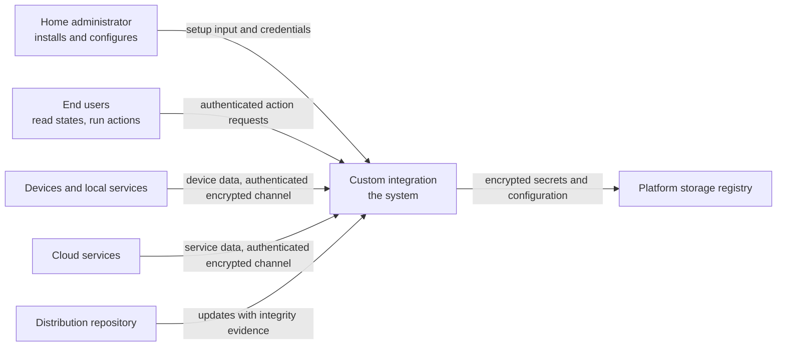
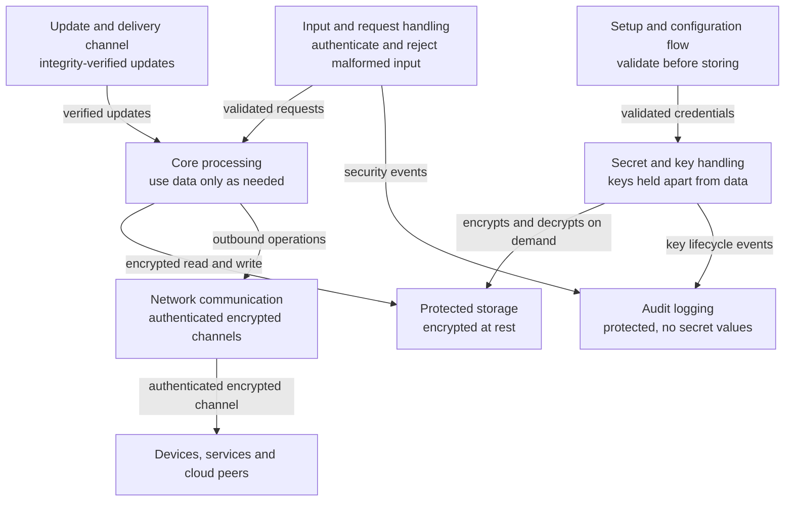
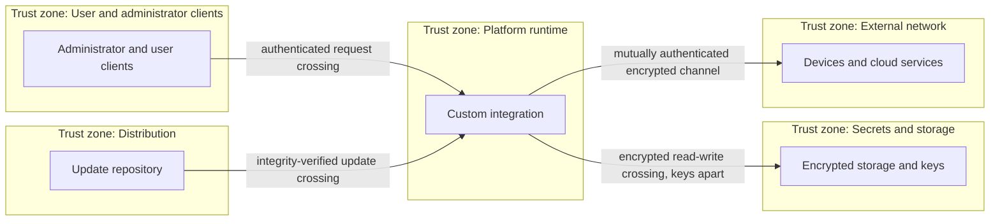

## Introduction

This document is the high-level security architecture for a custom Home Assistant integration that will be distributed through the Home Assistant Marketplace; it is written for technical managers and covers architecture design, security requirements and compliance only, with no code, libraries or low-level technical specifications.

### Purpose and Scope

The security objectives of the system are to protect credentials and secrets throughout their lifecycle, to keep all sensitive data confidential and integrity-protected whether stored or moving, to limit the blast radius of any compromise, and to keep the security posture simple, lightweight and efficient so that it survives maintenance over time. The expected security outcomes for technical managers are: an approved design with named trust boundaries, a set of testable requirements with priorities, a mapping to applicable standards, and an explicit statement of residual risk.

| Scope area   | In scope                                                                                                               | Out of scope                                                                           |
| ------------ | ---------------------------------------------------------------------------------------------------------------------- | -------------------------------------------------------------------------------------- |
| Architecture | Logical components, trust boundaries, data protection lifecycle, secure communication, access control and sandboxing   | Code structure, module design, algorithms selection                                    |
| Data         | Credentials, tokens and keys; device and service data; user configuration; audit records                               | Data of third-party systems the integration merely forwards                            |
| Compliance   | International security standards, EU regulations that apply to the distributed product, platform security expectations | Legal interpretation, certification decisions, contractual obligations of distributors |
| Operations   | Monitoring, vulnerability handling, update delivery, incident response at architecture level                           | Staffing, runbooks, on-call procedures, forensic tooling                               |

The data the system handles is classified as **restricted** (credentials, tokens, encryption keys), **confidential** (device and service data, user configuration, diagnostic detail), **internal** (entity states, operational metadata) and **public** (documentation, catalogue listings). Restricted and confidential classes receive the strongest controls defined in this document.

> Assumption: Distribution targets EU users as well as other regions, so EU regulations are treated as applicable; confirm with legal review before relying on this for compliance decisions. Regulatory content in this document is not legal advice.

### Audience and Use

The readers are technical managers and engineering leads responsible for the integration, together with security reviewers, compliance stakeholders and the administrators who install the integration. The decisions this document supports are approving the security design, funding the controls it requires, accepting the residual risks it names, and gating release on the Must-priority requirements. It relates to the product and technical requirements of the system as follows: the product requirements define what the integration does, the layer architecture requirements define how its code is organised, and this document defines the security properties every layer and component must satisfy; conflicts are resolved in favour of this document's Must-priority requirements.

## High-Level Architecture

The security architecture divides the integration into a small number of logical components, assigns each one a single security responsibility, protects all data from creation to destruction with encryption at rest, encryption in transit and end-to-end encryption, and confines every component inside explicit trust boundaries. The description stays at the architecture level and contains no implementation detail.

**Security design decisions.** The table records the decisions from which every requirement in this document is derived.

| Decision                   | Chosen approach                                                                                   | Rejected alternatives                                                                       | Evidence                                            | Residual risk                                                   |
| -------------------------- | ------------------------------------------------------------------------------------------------- | ------------------------------------------------------------------------------------------- | --------------------------------------------------- | --------------------------------------------------------------- |
| Data at rest               | Encrypt all stored sensitive data in the platform storage registry; hold keys apart from the data | Plaintext storage; relying only on host-disk protection                                     | ISO/IEC 27001:2022 A.8.24; NIST SP 800-53 SC-28     | Keys remain readable by code with platform-level access         |
| Transport protection       | Authenticated encryption on every crossing, mutual peer authentication, fail closed               | Opportunistic encryption; accepting legacy protocol versions                                | RFC 9846; NIST SP 800-53 SC-8                       | Legacy-only peers need documented exceptions                    |
| End-to-end confidentiality | Only the intended endpoints hold decryption keys                                                  | Decryption at intermediaries for inspection                                                 | NIST SP 800-53 SC-13; Cyber Resilience Act Annex I  | Endpoint compromise exposes the data                            |
| In-memory handling         | Shortest possible clear-text time; excluded from swap, dumps and logs; wiped after use            | Relying only on automatic reclamation                                                       | OWASP ASVS 5.0.0; ISO/IEC 27001:2022 A.8.12         | The runtime may not guarantee physical erasure                  |
| Memory-safe technology     | Required wherever applicable; exceptions documented, justified and compensated                    | No mandate; blanket exemption for the whole system                                          | CISA memory-safe roadmaps guidance                  | Exceptions persist in components outside direct control         |
| Isolation                  | Least privilege, confined file, network and privilege access, explicit containment objectives     | Full-trust coexistence; per-component operating-system sandboxing unavailable at this level | NIST SP 800-207; platform trust model               | The platform grants installed integrations broad runtime access |
| Access control             | Authenticate every action, authorize on least privilege, separate duties, audit all               | Implicit trust based on network location                                                    | NIST SP 800-53 AC family; ISO/IEC 27001:2022 A.5.15 | Administrator accounts hold broad rights by platform design     |
| Supply chain and updates   | Secure development practices, provenance checks on dependencies, verified update channel          | Manual, ad-hoc update delivery                                                              | NIST SP 800-218 SSDF; Cyber Resilience Act Annex I  | Third-party components may carry undiscovered flaws             |
| Simplicity                 | The simplest effective control, few layers, little added weight                                   | Stacked commercial tooling and redundant control layers                                     | CISA Secure by Design                               | Narrower defence coverage accepted deliberately                 |

### System Context

The system is a custom integration that runs inside the Home Assistant platform in a home environment. Its users are the home administrator, who installs and configures it, and ordinary users, who read states and perform actions. Across its edges it talks to devices and services on the local network or in the cloud, to the platform storage registry where configuration and secrets are kept, and to the distribution repository from which updates arrive.

| Actor or peer              | Direction       | Data crossing the edge                                                 |
| -------------------------- | --------------- | ---------------------------------------------------------------------- |
| Home administrator         | Into the system | Setup input, credentials, configuration choices                        |
| End users                  | Into the system | Action requests authenticated by platform tokens                       |
| Devices and local services | Two-way         | Commands out; device data in, on an authenticated encrypted channel    |
| Cloud services             | Two-way         | Requests out; service data in, over an authenticated encrypted channel |
| Platform storage registry  | Two-way         | Encrypted secrets and configuration out and in                         |
| Distribution repository    | Into the system | Updates and their integrity evidence                                   |

The diagram shows the system between its administrator and users on one side, devices, cloud services, the platform storage registry and the distribution repository on the other, with the data that crosses each edge.

### Architecture Components

Each logical component carries one security responsibility. The integration runs in the same process as the platform core, so components rely on the platform's built-in protections — token-checked requests, refused suspicious input, verified transport sessions — while enforcing their own restrictions on data and access (Home Assistant, "How Home Assistant handles trust", 2026, https://contributors.home-assistant.io/security/how-it-works/).

| Component                    | Security responsibility                                                                                                          | Trust zone        | Protected data                       |
| ---------------------------- | -------------------------------------------------------------------------------------------------------------------------------- | ----------------- | ------------------------------------ |
| Input and request handling   | Authenticate every inbound interaction and reject malformed or suspicious input before it reaches logic                          | Platform runtime  | Session and request data             |
| Setup and configuration flow | Validate user input and connection tests before anything is stored; never persist unvalidated input                              | Platform runtime  | Credentials, configuration           |
| Core processing              | Use sensitive data only as needed for the requested operation; apply business rules without leaking data                         | Platform runtime  | Confidential device and service data |
| Secret and key handling      | Generate, store, rotate and destroy keys; perform decryption only on demand; keep keys apart from the data they protect          | Secrets zone      | Keys, credentials, tokens            |
| Protected storage            | Persist secrets and configuration encrypted at rest in the platform storage registry                                             | Storage zone      | Restricted and confidential data     |
| Network communication        | Open authenticated encrypted channels to peers; enforce protocol version policy; fail closed on failed or downgraded connections | Network zone      | Data in transit                      |
| Audit logging                | Record security-relevant events with protection against tampering; never record secret values                                    | Logging zone      | Audit records                        |
| Update and delivery channel  | Accept updates only with verified integrity evidence and deliver vulnerability fixes promptly                                    | Distribution zone | Update artifacts                     |

The diagram shows the eight logical components, the permitted interactions between them, and the external peers reached only through the network communication component; all stored data flows through the protected storage component and all key material through the secret and key handling component.

### Trust Boundaries and Isolation

Five trust zones contain the system. The **user and administrator zone** holds clients that initiate requests; the **platform runtime zone** holds the integration and the platform core it runs beside; the **secrets and storage zone** holds keys and persisted sensitive data; the **external network zone** holds devices, local services and cloud peers; the **distribution zone** holds the repository and update artifacts. Every edge between zones is a trust boundary with a defined crossing rule.

| Boundary crossing     | Zones                                    | Data crossing                           | Isolation applied at the crossing                                                                         |
| --------------------- | ---------------------------------------- | --------------------------------------- | --------------------------------------------------------------------------------------------------------- |
| Client request        | User zone to runtime zone                | Action requests, setup input            | Platform token authentication; suspicious input refused before integration logic runs                     |
| Secret read and write | Runtime zone to storage and secrets zone | Keys, credentials, configuration        | Encryption at rest; keys held apart from data; access limited to the component that needs them            |
| Peer communication    | Runtime zone to external network zone    | Commands, device and service data       | Authenticated encrypted channel, mutual peer authentication, fail closed on downgrade                     |
| Update intake         | Distribution zone to runtime zone        | Update artifacts and integrity evidence | Integrity verification before any update is accepted                                                      |
| Internal hand-off     | Within runtime zone                      | Decrypted data between components       | Least privilege per component; no component reaches beyond its granted file, network and privilege access |

Isolation and sandboxing contain a breach so that compromise of one component does not spread: the component that fails keeps only the file paths, network destinations and privileges it was granted, secrets stay encrypted and unreachable without the key handling component, and audit records remain protected so the event is visible even when the failing component is corrupted. Because the platform runs installed integrations with broad runtime access in a shared process, containment inside the integration is enforced by these design rules and by the platform's own protections rather than by a separate operating-system sandbox; this constraint is recorded as an assumption.

The diagram shows the five trust zones as separate containers, the four boundary crossings between them, and the isolation rule applied at each crossing.

> Assumption: The platform storage registry protects stored data with strength equivalent to how it protects stored login credentials; verify the registry's protection at rest during implementation and treat any gap as a finding against SR-001.

### Data Protection Architecture

Data is protected from creation to destruction. Sensitive data is created only through validated input, is encrypted before it is first written and on every crossing of a trust boundary, and all stored data is encrypted at rest with keys held apart from the data it protects. End-to-end encryption keeps data readable only by its intended endpoints, so no intermediary — including any relay between the integration and a peer — ever holds decryption keys. Data is processed securely in memory for the shortest feasible time and is decrypted only when necessary, at the narrowest scope and only for as long as an authorised operation needs it.

The key lifecycle at architecture level runs through generation with approved mechanisms, protected storage with access limited to the key handling component, use only through that component, scheduled rotation and immediate rotation on suspected compromise, backup under controls equal to the primary keys, and destruction when retired or when the data it protects reaches end of life. Sensitive data is destroyed by secure deletion from the platform storage registry, and wiped from memory after use, so that destruction covers both storage and process state.

```mermaid
flowchart LR
    CRE["Creation<br/>validated input and secrets"]
    ENC["Encryption<br/>before storage and at every crossing"]
    STO["Storage<br/>platform registry, keys held apart"]
    USE["Use<br/>decrypt only when necessary"]
    MEM["In-memory processing<br/>shortest clear-text time, then wipe"]
    TRA["Transfer<br/>end-to-end to intended endpoints"]
    DES["Destruction<br/>secure deletion and key retirement"]
    CRE -- "sensitive data" --> ENC
    ENC -- "ciphertext" --> STO
    STO -- "ciphertext until needed" --> USE
    USE -- "clear text, narrow scope" --> MEM
    MEM -- "protected result" --> TRA
    TRA -- "readable only at endpoints" --> DES
    USE -- "keys never leave the key component" --> ENC
```

The diagram shows the lifecycle from creation through encryption, storage, use, in-memory processing and transfer to destruction, marking where data is encrypted, where it is decrypted, and that keys stay inside the key handling component.

### Secure Communication

Every peer relationship is mutually authenticated: the integration proves its identity to the peer and verifies the peer's identity before any sensitive data is exchanged, and it extends the platform's own token-checked request handling to its inbound interactions. Confidentiality and integrity in transit are protected by an authenticated encrypted channel on every crossing; there is no fallback path that sends sensitive data in the clear.

The protocol version policy requires the current version of the secure transport protocol — Transport Layer Security (TLS) version 1.3 as specified in RFC 9846, which obsoletes the earlier specifications (IETF, RFC 9846, 2026, https://www.rfc-editor.org/rfc/rfc9846.html) — with older versions permitted only as a documented, time-boxed exception that is compensated by restricting the data those connections may carry. Failed connections fail closed: an authentication failure, a certificate or identity mismatch, a version downgrade attempt or an integrity error terminates the connection, records a security event, and is retried only after the underlying problem is corrected; the system never degrades to an unauthenticated or unencrypted channel to preserve availability.

### Access Control and Sandboxing

**Identity.** Every actor — the administrator, end users, external peers and the update channel — has a distinct identity; the integration treats platform-authenticated identities as its own input and never invents implicit identities from network location, consistent with the zero-trust principle that no asset is trusted merely because of where it sits (NIST, SP 800-207 Zero Trust Architecture, 2020, https://csrc.nist.gov/pubs/sp/800/207/final).

**Authentication.** Inbound requests are authenticated by the platform's token checks before integration logic runs; outbound peer relationships use mutual authentication on the secure channel; secrets presented during setup are verified against the peer before an entry is created.

**Authorization and least privilege.** Access is granted per action on the principle of least privilege: users may read states and perform permitted actions, only administrators may change configuration, and no component receives privileges beyond what its function requires. Separation of duties keeps key handling, storage and audit logging in distinct components so that no single component can both alter sensitive data and erase the evidence.

**Sandboxing.** The integration restricts what it reads, writes, executes and reaches: file access is confined to its own paths inside the platform storage registry, it executes no code beyond its own update artifacts after integrity verification, and network egress is limited to the configured devices, services and update sources. These restrictions bound the component's capabilities even though the platform runs it with broad runtime access.

## Security Requirements

The requirements below are the security obligations of the architecture. Each carries a unique identifier in the scheme SR-001 to SR-026, a priority of **Must** (mandatory before release) or **Should** (planned and tracked), and a rationale that traces it to a design decision or a standard; every requirement is a single testable statement free of implementation detail, and every one appears in the Control Mapping table.

### Security-by-Design Principles

The principles follow official secure-by-design guidance, which treats customer security as a core design requirement rather than a feature (CISA, Secure by Design, 2023, https://www.cisa.gov/securebydesign).

| Principle                           | Architectural effect                                                                | How simplicity and efficiency are preserved                                    |
| ----------------------------------- | ----------------------------------------------------------------------------------- | ------------------------------------------------------------------------------ |
| Least privilege                     | Components receive only the file, network and privilege access their function needs | Few granted capabilities are simpler to review and cheap to enforce            |
| Defence in depth                    | Independent controls at storage, transport, memory and access layers                | Each layer is a single simple mechanism; no layer is complex on its own        |
| Secure defaults                     | New installations start with encryption on, strict transport and minimal access     | Defaults require no tuning, so secure operation is also the cheapest operation |
| Fail closed                         | Authentication, integrity or downgrade failures terminate the operation             | One failure path instead of parallel fallback logic                            |
| Minimal attack surface              | Only the interfaces required by the platform are exposed                            | Fewer exposed interfaces mean fewer paths to build and maintain                |
| Simplicity and economy of mechanism | Each requirement is met by the simplest control that satisfies it                   | Lower added weight and latency, easier audit, fewer moving parts               |
| Privacy by default                  | Data collection is limited to what the operation needs; nothing extra is stored     | Less data retained means less to protect, encrypt and destroy                  |

### Encryption Requirements

| ID     | Requirement                                                                                                                                                                                                                                            | Priority | Rationale                                                                                              |
| ------ | ------------------------------------------------------------------------------------------------------------------------------------------------------------------------------------------------------------------------------------------------------ | -------- | ------------------------------------------------------------------------------------------------------ |
| SR-001 | All sensitive data is encrypted with approved, strength-appropriate algorithms before it is written to storage, and its encryption keys are held separately from the data they protect.                                                                | Must     | Protects restricted data if storage is copied or lost; ISO/IEC 27001:2022 A.8.24, NIST SP 800-53 SC-28 |
| SR-002 | All data crossing a trust boundary in transit is protected by an authenticated encrypted channel that provides both confidentiality and integrity.                                                                                                     | Must     | No sensitive data may move in the clear; NIST SP 800-53 SC-8                                           |
| SR-003 | End-to-end encryption keeps sensitive data readable only by its intended endpoints, and no intermediary holds decryption keys.                                                                                                                         | Must     | Intermediary compromise must not expose data; Cyber Resilience Act Annex I                             |
| SR-004 | Encryption keys are generated with approved mechanisms, stored with protection equal to the data they protect, rotated on a defined schedule and immediately on suspected compromise, backed up under equivalent controls, and destroyed when retired. | Must     | Key weakness defeats all data encryption; NIST SP 800-57 Part 1 Revision 5                             |
| SR-005 | Decryption occurs only when necessary for an authorised operation, at the narrowest scope, and only for as long as that operation requires.                                                                                                            | Must     | Minimises exposure windows; data-minimisation obligation under GDPR Article 5(1)(c)                    |

### Secure In-Memory Processing Requirements

| ID     | Requirement                                                                                                                                 | Priority | Rationale                                                                              |
| ------ | ------------------------------------------------------------------------------------------------------------------------------------------- | -------- | -------------------------------------------------------------------------------------- |
| SR-006 | Sensitive data is held in the clear for the shortest feasible time and is cleared as soon as the operation that needs it completes.         | Must     | Shorter exposure reduces the value of memory disclosure; OWASP ASVS 5.0.0              |
| SR-007 | Sensitive data is prevented from appearing in swap, crash dumps and diagnostic output through the platform's protections and configuration. | Must     | Persistence outside the process widens the exposure surface; ISO/IEC 27001:2022 A.8.12 |
| SR-008 | Sensitive data values, credentials and keys are never written to logs, metrics, error messages or traces.                                   | Must     | Logs are widely read and long retained; NIST SP 800-53 AU-9                            |
| SR-009 | Sensitive data is wiped from memory after use, using the strongest mechanism the runtime supports, and exceptions are documented.           | Should   | Supports defence in depth for in-memory disclosure; OWASP ASVS 5.0.0                   |

### Memory-Safe Technology Requirements

| ID     | Requirement                                                                                                                                                                       | Priority | Rationale                                                                                           |
| ------ | --------------------------------------------------------------------------------------------------------------------------------------------------------------------------------- | -------- | --------------------------------------------------------------------------------------------------- |
| SR-010 | Memory-safe technology is used wherever applicable for components that handle sensitive data or parse untrusted input.                                                            | Must     | Memory flaws remain the dominant vulnerability class; CISA, The Case for Memory Safe Roadmaps, 2023 |
| SR-011 | Any exception to SR-010 is documented, justified by a concrete constraint, approved before use, and compensated by isolating the component and restricting the data it can reach. | Must     | Keeps exceptions rare, visible and bounded                                                          |
| SR-012 | A roadmap records remaining memory-unsafe exceptions, assigns each an owner, and is reviewed at least annually with the aim of reducing exceptions over time.                     | Should   | Converts one-off exceptions into a reduction programme; CISA memory-safe roadmaps guidance          |

### Isolation and Sandboxing Requirements

| ID     | Requirement                                                                                                                                                                                                                       | Priority | Rationale                                                                    |
| ------ | --------------------------------------------------------------------------------------------------------------------------------------------------------------------------------------------------------------------------------- | -------- | ---------------------------------------------------------------------------- |
| SR-013 | Every component runs with the minimum privileges and platform capabilities required for its stated function.                                                                                                                      | Must     | Limits what a compromised component can do; NIST SP 800-207                  |
| SR-014 | File system access is confined to the integration's own storage paths; no component reads or writes outside those paths.                                                                                                          | Must     | Bounds data exposure and tampering; ISO/IEC 27001:2022 A.8.3                 |
| SR-015 | Network egress is limited to the configured devices, services and update sources, and inbound traffic reaches only the integration's exposed interfaces.                                                                          | Must     | Shrinks the reachable attack surface; NIST SP 800-53 SC-7                    |
| SR-016 | A compromise of any single component is contained so that it cannot spread to other components or beyond its granted file, network and privilege capabilities, and the breach remains detectable through protected audit records. | Must     | Explicit containment objective for blast-radius control; NIST SP 800-53 SI-4 |

### Access Control Requirements

| ID     | Requirement                                                                                                                                                                                          | Priority | Rationale                                                                                       |
| ------ | ---------------------------------------------------------------------------------------------------------------------------------------------------------------------------------------------------- | -------- | ----------------------------------------------------------------------------------------------- |
| SR-017 | Every action initiated by a user, administrator or external peer is authenticated before any processing occurs.                                                                                      | Must     | Unauthenticated actions are rejected by default; NIST SP 800-53 IA-2                            |
| SR-018 | Authorization is enforced per action on least privilege, and no component or identity receives access beyond what its function requires.                                                             | Must     | Reduces impact of stolen or confused identities; NIST SP 800-53 AC-6, ISO/IEC 27001:2022 A.5.15 |
| SR-019 | Privileged operations — configuration changes, key operations, update acceptance — are separated from ordinary operations and recorded in the audit log.                                             | Must     | Separation of duties with accountability; ISO/IEC 27001:2022 A.5.3                              |
| SR-020 | Credentials and secrets are stored only in the platform's protected storage, encrypted under SR-001, never hard-coded, never transmitted in the clear, and rotated whenever compromise is suspected. | Must     | Credential theft is the primary path to account takeover; NIST SP 800-53 IA-5                   |
| SR-021 | Access rights and stored credentials are reviewed at least annually and revoked promptly when no longer required or when a peer reports compromise.                                                  | Should   | Stale access is a standing risk; ISO/IEC 27001:2022 A.5.18                                      |

### Monitoring and Incident Response Requirements

| ID     | Requirement                                                                                                                                                                                     | Priority | Rationale                                                                           |
| ------ | ----------------------------------------------------------------------------------------------------------------------------------------------------------------------------------------------- | -------- | ----------------------------------------------------------------------------------- |
| SR-022 | Security-relevant events — authentication failures, rejected input, configuration changes, encryption or integrity failures, update acceptance — are logged with timestamp, source and outcome. | Must     | Detection depends on recording the right events; NIST SP 800-53 AU-2                |
| SR-023 | Audit logs are protected against unauthorised modification and deletion and retained for a defined period.                                                                                      | Must     | Evidence must survive a compromised component; ISO/IEC 27001:2022 A.8.15            |
| SR-024 | Secret values, credentials, keys and sensitive data are never written to any log or diagnostic channel.                                                                                         | Must     | Log contents are a common disclosure path; NIST SP 800-53 AU-9                      |
| SR-025 | Reported vulnerabilities are assessed and remediated within defined timelines, and updates are delivered to users through the verified update channel with release notes that describe the fix. | Must     | Timely remediation limits exploitation of known flaws; Cyber Resilience Act Annex I |
| SR-026 | An incident response plan defines detection, containment, notification and recovery steps for this integration, and is exercised at least once a year with findings recorded.                   | Should   | Unrehearsed plans fail during real incidents; ISO/IEC 27001:2022 A.5.24             |

## Compliance Standards

The selected standards and regulations cover the five areas this architecture must address — cryptography and key management, secure development, access control, memory safety and data protection — and were confirmed current against their publishers' pages in November 2026. The mapping shows how each requirement is satisfied by an architecture component and traced to a standard clause or control.

### Applicable Standards and Regulations

| Standard or regulation                                      | Edition                                                                                                         | Publisher                                     | Purpose                                                                          | Reason it applies                                                                                     |
| ----------------------------------------------------------- | --------------------------------------------------------------------------------------------------------------- | --------------------------------------------- | -------------------------------------------------------------------------------- | ----------------------------------------------------------------------------------------------------- |
| ISO/IEC 27001                                               | 2022 edition, Amendment 1:2024                                                                                  | ISO/IEC                                       | Information security management requirements                                     | Provides the control objectives for access control, cryptography and operations referenced throughout |
| ISO/IEC 27002                                               | 2022 edition                                                                                                    | ISO/IEC                                       | Control guidance for cryptography, access control and secure development         | Supplies the control wording behind the mapped Annex A references                                     |
| NIST SP 800-53                                              | Revision 5, Release 5.2.0 (August 2025)                                                                         | NIST                                          | Security control catalogue                                                       | Gives the control identifiers used in the Control Mapping table                                       |
| NIST SP 800-218                                             | Version 1.1 (February 2022)                                                                                     | NIST                                          | Secure Software Development Framework                                            | Governs secure development, dependency handling and vulnerability response practices                  |
| NIST SP 800-207                                             | Final (August 2020)                                                                                             | NIST                                          | Zero trust architecture                                                          | Shapes the no-implicit-trust access model and least-privilege requirement                             |
| NIST SP 800-57 Part 1                                       | Revision 5 (May 2020)                                                                                           | NIST                                          | Key management guidance                                                          | Defines the key lifecycle expectations behind SR-004                                                  |
| RFC 9846                                                    | July 2026                                                                                                       | IETF                                          | Current Transport Layer Security specification                                   | Sets the secure transport baseline and version policy for SR-002 and secure communication             |
| OWASP ASVS                                                  | Version 5.0.0 (30 May 2025)                                                                                     | OWASP                                         | Verifiable application security requirements                                     | Provides the verification wording behind the in-memory and data-protection requirements               |
| CISA Secure by Design and The Case for Memory Safe Roadmaps | 2023                                                                                                            | CISA with NSA, FBI and international partners | Secure-by-design principles and memory-safe roadmaps                             | Source of the security-by-design principles and the memory-safe mandate and roadmap                   |
| Regulation (EU) 2024/2847 (Cyber Resilience Act)            | In force 10 December 2024; reporting obligations from 11 September 2026; main obligations from 11 December 2027 | European Union                                | Security by design and vulnerability handling for products with digital elements | The integration is distributed as a product; its essential security and reporting duties apply        |
| Regulation (EU) 2016/679 (GDPR)                             | 2016                                                                                                            | European Union                                | Data protection by design and security of processing                             | Articles 25 and 32 apply if personal data of EU users is processed                                    |

Regulatory content above is summarised for engineering guidance only and is not legal advice; applicability and obligations for this product need legal review.

### Control Mapping

| Requirement | Architecture component                                              | Standard clause or control                                 |
| ----------- | ------------------------------------------------------------------- | ---------------------------------------------------------- |
| SR-001      | Protected storage; Secret and key handling                          | ISO/IEC 27001:2022 A.8.24; NIST SP 800-53 SC-28            |
| SR-002      | Network communication                                               | NIST SP 800-53 SC-8; RFC 9846                              |
| SR-003      | Network communication; Secret and key handling                      | NIST SP 800-53 SC-13; Cyber Resilience Act Annex I         |
| SR-004      | Secret and key handling                                             | NIST SP 800-57 Part 1 Revision 5                           |
| SR-005      | Core processing; Secret and key handling                            | GDPR Article 5(1)(c); NIST SP 800-53 SC-28                 |
| SR-006      | Core processing                                                     | OWASP ASVS 5.0.0 data protection requirements              |
| SR-007      | Core processing; Protected storage                                  | ISO/IEC 27001:2022 A.8.12                                  |
| SR-008      | Audit logging; Core processing                                      | NIST SP 800-53 AU-9                                        |
| SR-009      | Core processing                                                     | OWASP ASVS 5.0.0 data protection requirements              |
| SR-010      | Core processing; Input and request handling                         | CISA, The Case for Memory Safe Roadmaps, 2023              |
| SR-011      | Core processing                                                     | NIST SP 800-53 CM-7                                        |
| SR-012      | Update and delivery channel                                         | CISA memory-safe roadmaps guidance                         |
| SR-013      | All components                                                      | NIST SP 800-207; NIST SP 800-53 AC-6                       |
| SR-014      | Protected storage; Core processing                                  | ISO/IEC 27001:2022 A.8.3                                   |
| SR-015      | Network communication                                               | NIST SP 800-53 SC-7                                        |
| SR-016      | All components; Audit logging                                       | NIST SP 800-53 SI-4                                        |
| SR-017      | Input and request handling; Network communication                   | NIST SP 800-53 IA-2                                        |
| SR-018      | Core processing; Input and request handling                         | NIST SP 800-53 AC-6; ISO/IEC 27001:2022 A.5.15             |
| SR-019      | Secret and key handling; Update and delivery channel; Audit logging | ISO/IEC 27001:2022 A.5.3                                   |
| SR-020      | Secret and key handling; Protected storage                          | NIST SP 800-53 IA-5                                        |
| SR-021      | Access Control (document-wide)                                      | ISO/IEC 27001:2022 A.5.18                                  |
| SR-022      | Audit logging                                                       | NIST SP 800-53 AU-2                                        |
| SR-023      | Audit logging                                                       | ISO/IEC 27001:2022 A.8.15                                  |
| SR-024      | Audit logging; Core processing                                      | NIST SP 800-53 AU-9                                        |
| SR-025      | Update and delivery channel                                         | Cyber Resilience Act Annex I; NIST SP 800-218 RV practices |
| SR-026      | Audit logging                                                       | ISO/IEC 27001:2022 A.5.24                                  |

### Assurance and Verification

Conformance is verified continuously and re-confirmed at each release. Security reviews of the design and of each change check the requirements and the mapping above; threat modelling classifies threats per component and per boundary crossing before development and re-runs when a boundary changes; testing verifies each Must requirement against its testable statement, including transport failure and downgrade handling, storage encryption, log exclusion of secrets and access denial outside least privilege. Supply chain assurance follows secure development practices — pinned and provenance-checked dependencies, build integrity evidence, and recorded vulnerability intake (NIST, SP 800-218 Version 1.1, 2022, https://csrc.nist.gov/pubs/sp/800/218/final). Independent assessment by a reviewer outside the development team occurs before first publication and annually afterwards. Evidence — reviews, test results, mapping decisions, incident records — is retained with the release it belongs to so that conformance can be demonstrated later, and the standards table is re-checked against publishers' pages at least annually to keep editions current.

## References

- ISO/IEC 27001:2022, Information security management systems — Requirements, including Amendment 1:2024. ISO/IEC, 2022. https://www.iso.org/standard/27001
- ISO/IEC 27002:2022, Information security controls. ISO/IEC, 2022. https://www.iso.org/standard/75652.html
- NIST SP 800-53 Revision 5, Security and Privacy Controls for Information Systems and Organizations, including Release 5.2.0. NIST, 2020 (release 2025). https://csrc.nist.gov/pubs/sp/800/53/r5/upd1/final
- NIST SP 800-218 Version 1.1, Secure Software Development Framework (SSDF). NIST, 2022. https://csrc.nist.gov/pubs/sp/800/218/final
- NIST SP 800-207, Zero Trust Architecture. NIST, 2020. https://csrc.nist.gov/pubs/sp/800/207/final
- NIST SP 800-57 Part 1 Revision 5, Recommendation for Key Management: Part 1 — General. NIST, 2020. https://csrc.nist.gov/pubs/sp/800/57/pt1/r5/final
- RFC 9846, The Transport Layer Security (TLS) Protocol Version 1.3. IETF, 2026. https://www.rfc-editor.org/rfc/rfc9846.html
- OWASP Application Security Verification Standard (ASVS) 5.0.0. OWASP, 2025. https://asvs.owasp.org/
- Secure by Design. CISA, 2023. https://www.cisa.gov/securebydesign
- The Case for Memory Safe Roadmaps. CISA with NSA, FBI and international cyber security partners, 2023. https://www.cisa.gov/case-memory-safe-roadmaps
- Regulation (EU) 2024/2847 (Cyber Resilience Act). European Union, 2024. https://eur-lex.europa.eu/eli/reg/2024/2847/oj
- Regulation (EU) 2016/679 (General Data Protection Regulation). European Union, 2016. https://eur-lex.europa.eu/eli/reg/2016/679/oj
- How Home Assistant handles trust. Home Assistant Contributors, 2026. https://contributors.home-assistant.io/security/how-it-works/
- How authentication works in Home Assistant. Home Assistant Contributors, 2026. https://contributors.home-assistant.io/core/internals/auth/
