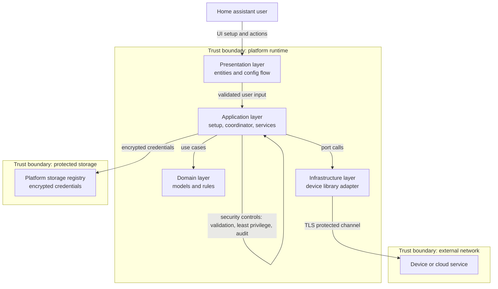
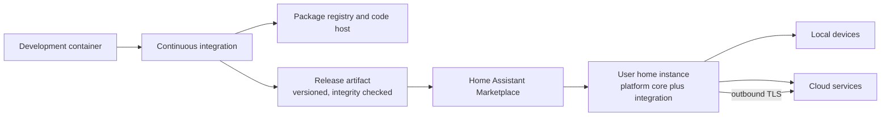
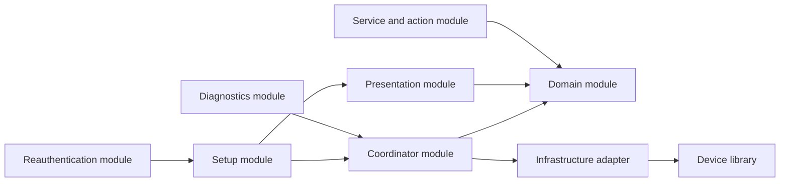
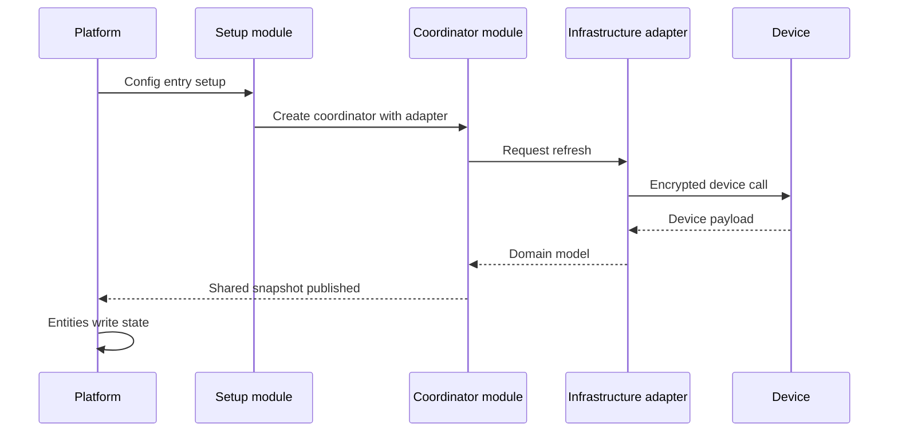
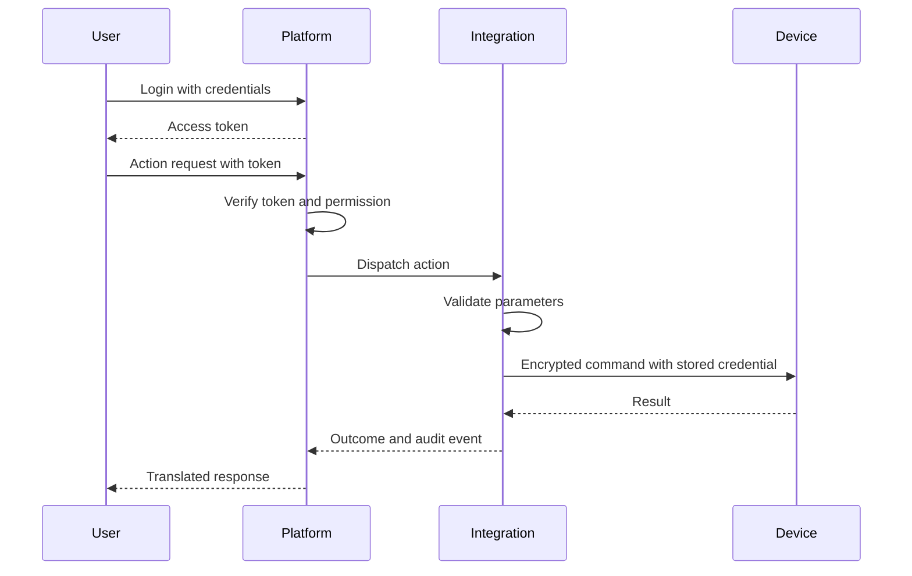
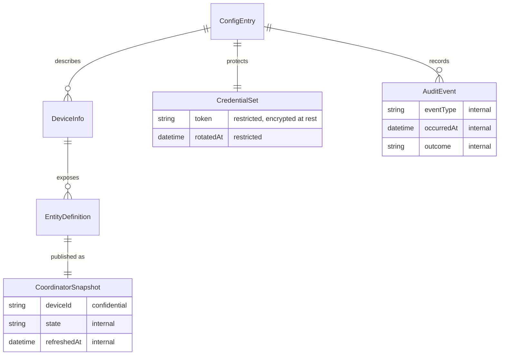
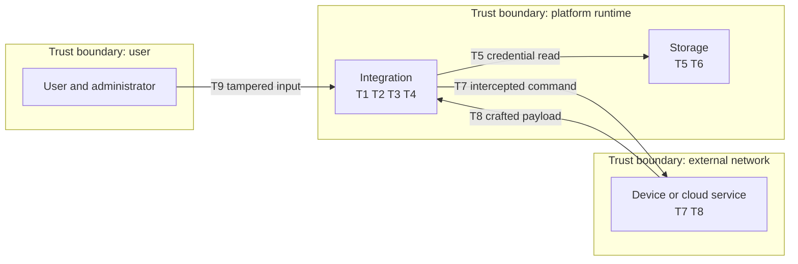
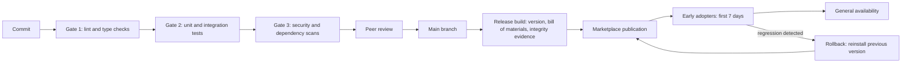

# Technical Requirements — Home Assistant Custom Integration

| Item                    | Value                                                                     |
| ----------------------- | ------------------------------------------------------------------------- |
| Version                 | 1.0                                                                       |
| Date                    | 2026-11-25                                                                |
| Owner                   | Integration development team                                              |
| Status                  | Draft for technical review                                                |
| Security classification | Internal application with restricted data elements (credentials and keys) |

## Overview

This document states the technical requirements that form the foundation of the custom Home Assistant integration, connecting each technical choice to the business goal of publishing a trustworthy, maintainable product in the Home Assistant Marketplace. It is derived from the layer architecture requirements (lightweight layered architecture) and the security architecture requirements (26 security requirements) already agreed for this project.

### Purpose and Alignment

Each technical choice family serves a named business objective: publishing a Marketplace product users trust, keeping maintenance costs low over a multi-year lifetime, and meeting international standards so that acceptance review and any future core submission succeed.

| Technical choice family                                                     | Business objective served                          | User need met                               |
| --------------------------------------------------------------------------- | -------------------------------------------------- | ------------------------------------------- |
| Lightweight layered architecture with a pure domain core                    | Fast, reviewable changes; low maintenance cost     | Reliable updates without regressions        |
| Platform-native integration interfaces (config flow, coordinator, entities) | Marketplace acceptance and long-term compatibility | Setup from the UI, states that just work    |
| Encrypted storage of credentials in the platform storage registry           | Trust and regulatory alignment                     | Confidence that secrets never leak          |
| Standards-driven testing, security and compliance gates                     | Credible acceptance and audit                      | A product that passes review the first time |
| Simple, observable operations (logging, diagnostics, graceful failure)      | Quick incident resolution                          | Homes keep working when a device is offline |

**Security classification.** The application is classified Internal; within it, credentials and encryption keys are classified Restricted and device data Confidential, matching the classes defined in the security architecture requirements. The protection level implied is: restricted data encrypted at rest and in transit, access on least privilege, and audit coverage of all privileged actions.

### Technical Hypothesis

**Problem and challenges.** The integration must talk to a device or service from inside a single-process, single-event-loop home automation platform, keep credentials as safe as the platform's own login secrets, survive years of platform releases, and be simple enough that a small team can maintain it.

**Proposed approach.** Use the platform's own integration interfaces as the outer shell, a lightweight layered architecture underneath (presentation, application, domain, infrastructure), a separate device library for protocol work, and the platform storage registry — protected exactly as the platform protects stored login credentials — for persistence. Every layer boundary, control and gate in this document follows from that choice.

**Rationale and challenge resolution.** Platform-native interfaces resolve the compatibility challenge because the platform owns them and evolves them; the layered structure resolves the maintainability challenge by keeping device protocol code and platform code apart; encrypted platform storage resolves the credential-protection challenge without inventing a separate security subsystem; and standards-based gates (secure development, testing, supply chain) resolve the acceptance challenge by producing evidence reviewers already expect (NIST, SP 800-218, 2022, https://csrc.nist.gov/pubs/sp/800/218/final).

**Key assumptions and validation.** The device library exists and exposes an asynchronous interface; performance targets below are proposed defaults pending formal product requirements; EU regulations apply because distribution targets EU users. These are validated by the first end-to-end test cycle, the performance test suite and legal review respectively.

> Assumption: The device library exposes an asynchronous interface and its exact version and licence are fixed at first release.
> Assumption: Performance targets in this document are proposed defaults pending formal product requirements.
> Assumption: EU regulations apply because distribution targets EU users; regulatory content in this document is not legal advice and needs legal review.

## System Architecture

The system architecture section describes the overall structure, the technology stack and the deployment infrastructure of the integration.

### High-Level Architecture

The chosen pattern is the **lightweight layered architecture** already decided in the layer architecture requirements: presentation (entities and config flow), application (setup, coordinator, services), domain (models and rules) and infrastructure (device library adapter), with the domain core isolated from both the platform and the transport. It was selected over Clean Architecture and Hexagonal alternatives because it maps directly onto the platform's prescribed integration structure while preserving inward-only dependencies (see the decision record in the layer architecture requirements; standards applied: ISO/IEC/IEEE 42010:2022 for the architecture description, https://www.iso.org/standard/74393.html).

The diagram shows the four layers inside the platform runtime trust boundary, the protected storage and external network boundaries, and the flows between them including where security controls apply.

| Decision                                                           | Alternatives considered                       | Rationale                                                                                 | Driver                          |
| ------------------------------------------------------------------ | --------------------------------------------- | ----------------------------------------------------------------------------------------- | ------------------------------- |
| Lightweight layered architecture                                   | Clean, Hexagonal, MVC, MVVM                   | Idiomatic fit with the platform structure; lowest ceremony; isolates the domain core      | Maintainability, delivery speed |
| Platform storage registry as system of record                      | Separate embedded database, external database | No extra operations surface; credentials protected as the platform protects login secrets | Simplicity, security            |
| Single event loop with executor offload for blocking calls         | Thread-per-request model                      | Matches the platform's runtime model; prevents house-wide freezes                         | Reliability, performance        |
| External device library for protocol code                          | Protocol code inside the integration          | Keeps the integration reviewable and the protocol independently testable                  | Maintainability, testability    |
| Standards-gated delivery (secure development, tests, supply chain) | Ad-hoc release checks                         | Produces the evidence reviewers and regulations expect                                    | Compliance, acceptance          |

### Technology Stack

Versions reflect the platform's current development requirements as verified on 2026-11-25; the platform runtime version is dictated by the host installation, not by this project.

| Layer                  | Selection                                                                   | Version                                                                         | Licence                      | Justification linked to constraint                                                         | Third-party assessment                                                                                                                                                |
| ---------------------- | --------------------------------------------------------------------------- | ------------------------------------------------------------------------------- | ---------------------------- | ------------------------------------------------------------------------------------------ | --------------------------------------------------------------------------------------------------------------------------------------------------------------------- |
| Language               | Python                                                                      | 3.14 (host provides at least 3.14.2 on the current platform development branch) | PSF-2.0                      | The host platform requires it; integrations inherit the host runtime                       | Mature; security-only releases continue to October 2029 for 3.13 (Python Software Foundation, https://www.python.org/downloads/)                                      |
| Runtime                | Platform single-threaded asynchronous event loop                            | Provided by host                                                                | Platform                     | The platform runs every integration on one loop; blocking code must be offloaded           | Well documented by the platform; slow callbacks over 100 ms are logged in debug mode (Python Software Foundation, https://docs.python.org/3/library/asyncio-dev.html) |
| Platform framework     | Integration platform: config flow, data update coordinator, entity platform | Host-provided                                                                   | Platform                     | Required for Marketplace publication and UI setup                                          | Maintained by the platform project; quality-scale rules define acceptance (Home Assistant, https://contributors.home-assistant.io/core/quality-scale/)                |
| Device client          | External protocol library on the public package index                       | Pinned per release                                                              | To be confirmed at selection | Protocol code lives outside the integration per platform guidance                          | Assess before first release: maturity, advisories, licence; re-assess each upgrade                                                                                    |
| Data store             | Platform storage registry (no separate database)                            | Host-provided                                                                   | Platform                     | Credentials stored with the same protection as platform login secrets; no extra operations | Native persistence of the host; covered by platform backups                                                                                                           |
| Testing                | pytest with platform test fixtures                                          | Host-compatible                                                                 | MIT                          | The platform's own test framework; fixture reuse                                           | Widely adopted; runs in continuous integration                                                                                                                        |
| Code quality           | Style linter, type checker, platform manifest validator                     | Host-compatible                                                                 | Mixed OSS                    | Enforced by platform review; keeps contributions reviewable                                | Standard tooling of the platform ecosystem                                                                                                                            |
| Continuous integration | Hosted workflow runner with the gates in Deployment Strategy                | —                                                                               | —                            | Every change must pass tests, lint and security scans before merge                         | Industry standard; evidence retained per release                                                                                                                      |

### Infrastructure Design

The integration has no infrastructure of its own: it deploys into the user's Home Assistant installation, which runs on hardware ranging from a single-board computer to a server. Development happens in a containerised environment provided by the platform project; continuous integration runs in hosted workflows; the production environment is the user's home instance, reached only through the Marketplace installation path.

| Environment                     | Purpose                                       | Network exposure                                      | Scaling approach                                        |
| ------------------------------- | --------------------------------------------- | ----------------------------------------------------- | ------------------------------------------------------- |
| Development container           | Local build, test and lint                    | None (local only)                                     | Single instance                                         |
| Continuous integration          | Automated gates on every change               | Outbound only to package registries and the code host | Parallel jobs per test shard                            |
| User home instance (production) | Runs the integration beside the platform core | Local network; outbound to device or cloud service    | Vertical only; one coordinator poll serves all entities |

The diagram shows the path from the development container through continuous integration to a release artifact, its publication through the Marketplace, and the production instance communicating outbound with local devices and cloud services.

**Choices mapped to needs.** Containerised development reproduces the host runtime and removes environment drift (operational need); outbound-only continuous integration limits supply-chain exposure (security need); a single production instance with one shared poll matches the event-loop runtime and keeps resource use low on small hardware (performance need).

### Technical Design

This section specifies the modules, the interfaces they expose and consume, and the data structures they share.

### Module Specifications

| Module                    | Responsibility                                                     | Mapped requirement  | Interfaces                    | Protocol                               | Data flows                   | Security controls                                 | User experience contribution            |
| ------------------------- | ------------------------------------------------------------------ | ------------------- | ----------------------------- | -------------------------------------- | ---------------------------- | ------------------------------------------------- | --------------------------------------- |
| Setup module              | Runs setup and teardown per config entry; wires the other modules  | FR-01               | Platform lifecycle callbacks  | Platform internal                      | Config entry in; modules out | Input validation, fail-fast errors                | Integration appears after UI setup      |
| Coordinator module        | Schedules refreshes and publishes one shared result                | FR-02, FR-03        | Device port, entities         | Platform internal plus device protocol | Device data in; snapshot out | Retry with back-off, unavailable marking          | Entities update together, no flicker    |
| Domain module             | Models, rules and validation independent of platform and transport | FR-03, FR-04        | Pure function calls           | None (in-process)                      | Snapshots and commands       | No platform or transport imports                  | Correct values and actions              |
| Infrastructure adapter    | Translates device library calls into domain results                | FR-02               | Device library                | Device protocol over TLS               | Commands out; payloads in    | Encrypted channel, credential handling            | Devices respond reliably                |
| Presentation module       | Entities and config flow forms                                     | FR-01, FR-03, FR-04 | Platform entity API           | Platform internal                      | Snapshot in; state out       | Read-only on shared data; no direct device access | Dashboards show live state              |
| Service and action module | Registers and executes user actions                                | FR-04               | Platform service registry     | Platform internal                      | Action calls into use cases  | Parameter validation, audit events                | Automations can control the device      |
| Diagnostics module        | Produces a redacted support bundle on demand                       | FR-06               | Platform diagnostics download | Platform internal                      | Runtime metadata out         | Redaction of credentials and personal data        | Issues get resolved faster              |
| Reauthentication module   | Re-runs credential collection when auth fails                      | FR-05               | Platform reauth flow          | Platform internal                      | New credentials in           | Secure re-entry, immediate validation             | Users fix breakage without reinstalling |

Functional requirements referenced above: FR-01 set up from the UI and create exactly one instance per device; FR-02 acquire device data on a fixed interval or by push; FR-03 publish entity states from one shared snapshot; FR-04 execute registered actions with validated parameters; FR-05 re-authenticate without losing configuration; FR-06 export redacted diagnostics; FR-07 unload cleanly leaving no background work; FR-08 mark entities unavailable on repeated failure and recover automatically.

The diagram shows module dependencies pointing inward: presentation and services depend on the domain, the coordinator depends on domain and infrastructure, and only the infrastructure adapter reaches the device library.

The diagram shows the key setup-to-first-refresh sequence: the platform triggers setup, the coordinator requests a refresh through the adapter, and the published snapshot becomes entity state.

### API Design

The integration exposes no public HTTP interface of its own; its "API" is the platform-facing surface (config flow steps, entity properties, registered actions) plus the outbound device API consumed through the device library. Both are specified below, and where any HTTP surface exists — including future diagnostics endpoints — it follows OpenAPI 3.1 for description and RFC 9457 for error bodies (OpenAPI Initiative, https://spec.openapis.org/oas/v3.1.0; IETF, https://www.rfc-editor.org/rfc/rfc9457).

| Aspect                           | Specification                                                                                                                                                               |
| -------------------------------- | --------------------------------------------------------------------------------------------------------------------------------------------------------------------------- |
| Style                            | Platform-native interfaces: stepwise config flow, entity state properties, named actions                                                                                    |
| Versioning                       | Semantic versioning of the integration release; the manifest version equals the release tag; breaking changes to stored configuration require a config entry migration step |
| Resources and operations         | Setup (user, reconfigure, reauth steps); entities (state, attributes, availability); actions (one registered action per device command); diagnostics (redacted export)      |
| Request and response schemas     | Config flow fields validated by platform schemas with explicit types and size limits; action parameters validated against domain rules before execution                     |
| Authentication and authorisation | Inbound requests carry platform access tokens verified before integration logic runs; outbound device calls authenticate with stored credentials over an encrypted channel  |
| Rate limiting                    | One shared poll per integration interval with exponential back-off on failure; actions are queued and coalesced to avoid device flooding                                    |
| Error format                     | Platform error keys with translated messages for user-facing failures; RFC 9457 problem details where an HTTP surface exists                                                |
| Documentation standard           | Repository documentation plus platform-generated integration page; any HTTP surface documented with an OpenAPI 3.1 description                                              |
| Documentation and controls       | See the OWASP API risk table below                                                                                                                                          |

| OWASP API risk (2023)                                | Applicable | Control in this integration                                                                                                                 |
| ---------------------------------------------------- | ---------- | ------------------------------------------------------------------------------------------------------------------------------------------- |
| API1:2023 Broken object level authorization          | Indirect   | All object access goes through platform-authenticated identifiers; no direct object endpoints exist                                         |
| API2:2023 Broken authentication                      | Yes        | Platform token verification before logic; device credentials verified at setup and reauth                                                   |
| API3:2023 Broken object property level authorization | Yes        | Entities expose only their declared state and attributes; no raw payload passthrough                                                        |
| API4:2023 Unrestricted resource consumption          | Yes        | Fixed poll interval, back-off, action coalescing, schema size limits                                                                        |
| API5:2023 Broken function level authorization        | Yes        | Actions restricted to users permitted by the platform; admin-only configuration changes                                                     |
| API7:2023 Server side request forgery                | Yes        | Host and port collected only through validated config flow fields; redirects from internet to local machine refused by the platform session |

(OWASP, API Security Top 10 2023, https://owasp.org/API-Security/editions/2023/en/0x11-t10/.)

The diagram shows a representative request lifecycle: token-based authentication at the platform, permission check, parameter validation in the integration, an encrypted device call, and an audited, translated response.

### Database Design

There is no standalone database. The system of record is the platform storage registry, which persists configuration entries and secrets with the same protection the platform applies to stored login credentials; runtime state lives in memory as one shared coordinator snapshot per refresh.

The diagram shows the persisted entities: each configuration entry describes one device, protects one credential set, exposes entity definitions, and records audit events; entity states come from the in-memory coordinator snapshot.

| Concern                | Decision                                                                                                                                                     |
| ---------------------- | ------------------------------------------------------------------------------------------------------------------------------------------------------------ |
| Technology choice      | Platform storage registry: no schema migrations to operate, covered by platform backups, credential protection identical to platform login secrets           |
| Encryption at rest     | All restricted fields encrypted before writing, keys held apart from the data (security architecture requirement SR-001)                                     |
| Access control         | Written only through the setup and reauthentication modules; read-only for diagnostics with redaction (SR-018, SR-020)                                       |
| Backup                 | Inherited from the platform configuration backup                                                                                                             |
| Retention and deletion | Configuration retained until the user removes the entry; removal deletes the entry, its credentials and its audit events within the next storage write cycle |

## Security Implementation

The security implementation follows the agreed security architecture: its objectives are confidentiality of credentials, integrity of commands and states, and availability of the integration, baselined on NIST SP 800-53 Revision 5 controls and ISO/IEC 27001:2022 Annex A (https://csrc.nist.gov/pubs/sp/800/53/r5/upd1/final; https://www.iso.org/standard/27001).

### Threat Model

The method is STRIDE applied per element of the data flow diagram, with risk rated as impact times likelihood on a three-level scale; assets are credentials (restricted), device data (confidential) and entity states (internal), and the trust boundaries are those defined in the security architecture requirements.

The diagram shows the data flow across trust boundaries with numbered threat references: T1 to T4 inside the runtime, T5 and T6 at storage, T7 and T8 on the network path, and T9 at the user input edge.

| ID  | Threat                                                   | STRIDE                            | Business impact                    | Likelihood | Risk   | Mitigation                                                         | Residual risk |
| --- | -------------------------------------------------------- | --------------------------------- | ---------------------------------- | ---------- | ------ | ------------------------------------------------------------------ | ------------- |
| T1  | Malicious input through config flow or action parameters | Tampering                         | Misconfiguration, unsafe commands  | Medium     | High   | Schema validation, domain rules, size limits                       | Low           |
| T2  | Blocking call freezes the platform event loop            | Repudiation (availability)        | Whole home unresponsive            | Medium     | High   | Async-first rule, executor offload, slow-callback checks           | Low           |
| T3  | Logic flaw leaks data across entities                    | Information disclosure            | Privacy breach of device data      | Low        | Medium | Layered isolation, read-only shared snapshot, tests                | Low           |
| T4  | Excessive resource use from rapid actions                | Denial of service                 | Degraded platform                  | Low        | Medium | Rate limiting, back-off, action coalescing                         | Low           |
| T5  | Credential theft from storage                            | Information disclosure            | Account takeover of device         | Low        | High   | Encryption at rest, keys apart, least privilege (SR-001, SR-020)   | Low           |
| T6  | Tampering with stored configuration                      | Tampering                         | Malicious endpoint injection       | Very low   | Medium | Integrity of platform storage, audit events (SR-023)               | Low           |
| T7  | Command interception or downgrade on the wire            | Tampering, Information disclosure | Device control by attacker         | Low        | High   | TLS 1.3 only, fail closed, mutual authentication (SR-002)          | Low           |
| T8  | Crafted device payload exploits parsing                  | Tampering                         | Code execution in platform process | Low        | High   | Memory-safe handling, input bounds, dependency scanning (SR-010)   | Medium        |
| T9  | Stolen platform session invokes actions                  | Elevation of privilege            | Unauthorized device control        | Low        | Medium | Token verification, permission checks, audit trail (SR-017)        | Low           |
| T10 | Malicious or compromised update                          | Tampering                         | Full compromise at install time    | Very low   | High   | Integrity-verified releases, signed history, review gates (SR-025) | Low           |

### Authentication and Authorization

**Identity management.** Users and administrators are the platform's identities; the integration creates no separate accounts. The device side uses one stored credential set per configuration entry, rotated whenever compromise is suspected.

**Authentication methods and assurance.** Inbound requests are authenticated by platform access tokens (short-lived, bearer-presented, verified before integration logic runs), aligned with NIST SP 800-63-4 (final July 2025, superseding SP 800-63-3, https://csrc.nist.gov/pubs/sp/800/63/4/final). Outbound device connections authenticate with the stored credential over the encrypted channel. Where a device supports it, mutual authentication is required.

**Multi-factor authentication.** Enforced by the platform's own login; the integration adds no second factor but must never weaken platform authentication, and reauthentication prompts re-verify identity through the platform flow.

**Session and token management.** Platform access tokens live about 30 minutes with refresh tokens expiring after 90 days of disuse (Home Assistant, "How authentication works", 2026, https://contributors.home-assistant.io/core/internals/auth/); the integration stores no platform tokens of its own and revokes device credentials immediately on reauthentication.

**Access control model.** Role-based through platform permission groups (administrator, user, read-only): configuration and reauthentication are administrator-only, actions follow user permissions, diagnostics follow administrator rights. Least privilege applies per module as specified in the security architecture requirements.

### Cryptography

| Use                      | Specification                                                                                                                                                                                                                                                                                         |
| ------------------------ | ----------------------------------------------------------------------------------------------------------------------------------------------------------------------------------------------------------------------------------------------------------------------------------------------------- |
| Encryption in transit    | TLS 1.3 per RFC 9846 (IETF, July 2026, https://www.rfc-editor.org/rfc/rfc9846.html); older versions only as documented, time-boxed exceptions with restricted data                                                                                                                                    |
| Encryption at rest       | Approved authenticated encryption for all restricted fields in storage; keys held apart from data (SR-001, SR-004)                                                                                                                                                                                    |
| Algorithm policy         | Algorithms and key sizes per current NIST guidance (SP 800-131A successors and FIPS-validated modules where applicable); reviewed annually                                                                                                                                                            |
| Key lifecycle            | Generation with a cryptographically secure random generator, protected storage, scheduled rotation plus immediate rotation on suspected compromise, backup under equivalent controls, destruction at retirement (NIST SP 800-57 Part 1 Revision 5, https://csrc.nist.gov/pubs/sp/800/57/pt1/r5/final) |
| Certificate handling     | Platform session verifies peer certificates and refuses redirects from the internet to the local machine; device certificate validation enabled where the device supports it                                                                                                                          |
| Secure random generation | All nonces, tokens and keys drawn from the runtime's cryptographically secure random source only                                                                                                                                                                                                      |
| Crypto agility           | Algorithm policy isolated in one decision point so a future migration (including post-quantum key establishment, FIPS 203 finalised 2024) changes one place, not the codebase                                                                                                                         |

### Data Protection

Protection follows the data classes from the security architecture requirements. **Restricted** (credentials, keys): encrypted at rest, never logged, wiped after use, decrypted only when necessary. **Confidential** (device data): encrypted in transit, held in memory only during processing, excluded from diagnostics unless redacted. **Internal** (states, metadata): integrity-protected through the shared snapshot, retained only while the entry exists. **Public** (documentation): no protection beyond integrity of release artefacts.

Anonymisation and masking apply to diagnostics exports: identifiers are truncated or replaced and credential material removed before export. Secure deletion follows the storage lifecycle — removing a configuration entry deletes its credentials and audit events in the next storage write, and backups age out under the platform's backup retention. This aligns with GDPR data protection by design (Regulation (EU) 2016/679 Article 25, https://eur-lex.europa.eu/eli/reg/2016/679/oj).

### Input Validation and Output Encoding

**Validation strategy.** All config flow fields use explicit schema validation with allowed value lists where applicable, type checks and size limits; action parameters are validated against domain rules before execution; device payloads are bounds-checked before mapping into domain models. Validation is allow-list based — anything not explicitly accepted is rejected (OWASP ASVS 5.0.0, https://asvs.owasp.org/).

**Output encoding.** Entity states and attributes are formatted from typed domain values, never by interpolating raw device strings into structured output; user-facing messages come from translated templates, not from exception text.

**Injection defences.** No SQL exists (no database); command injection is prevented by never constructing shell commands; template and cross-site scripting risks are eliminated because the integration produces data values for the platform to render, and the platform encodes them — the integration must never emit markup.

**Content security policy and browser headers.** The integration ships no browser surface; where the platform renders integration-provided links or media, only platform-approved schemes are used. Any future web asset must inherit the platform's content security policy unchanged.

## Integration Implementation

The integration implementation section covers the external systems it connects to and the third-party components it depends on.

### External Systems Integration

| Integration point           | Direction  | Protocol                 | Data format                                     | Authentication                                 | Rate limits                                  | Error handling                                                                                    | Fallback                               |
| --------------------------- | ---------- | ------------------------ | ----------------------------------------------- | ---------------------------------------------- | -------------------------------------------- | ------------------------------------------------------------------------------------------------- | -------------------------------------- |
| Device or local service     | Outbound   | Device protocol over TLS | Device-specific payload mapped to domain models | Stored credential over encrypted channel       | One poll per interval; back-off on failure   | Classified errors: auth failure triggers reauthentication; unreachable marks entities unavailable | Retry with back-off; unavailable state |
| Cloud service               | Outbound   | HTTPS with TLS 1.3       | Structured payload                              | Stored credential; mutual auth where supported | Same as above plus service-advertised limits | Same classification                                                                               | Same as above                          |
| Platform storage            | In-process | Platform internal        | Registry records                                | Platform internal                              | Write-on-change                              | Write failure surfaced at setup; never silently dropped                                           | Setup fails closed                     |
| Marketplace release channel | Inbound    | Repository release       | Versioned artefact with integrity evidence      | Release signing and platform verification      | n/a                                          | Rejected update leaves current version in place                                                   | Continue on previous version           |

**Reliability behaviour.** Retries use exponential back-off with jitter and a capped attempt count; timeouts are set per call well below the refresh interval; a circuit breaker opens after repeated consecutive failures, keeps entities unavailable, and half-opens on the next scheduled refresh; fail-safe defaults mean the integration never blocks the platform loop, never falls back to an unencrypted channel and never writes unvalidated data.

### Third-Party Dependencies

| Component                      | Version                              | Purpose                                  | Licence                      | Security assessment                                                                                         | Update policy                                          |
| ------------------------------ | ------------------------------------ | ---------------------------------------- | ---------------------------- | ----------------------------------------------------------------------------------------------------------- | ------------------------------------------------------ |
| Device client library          | Pinned exact per release             | Protocol access to the device or service | To be confirmed at selection | Required before first release: advisories, maintainer activity, download integrity; re-checked each upgrade | Monthly review; immediate upgrade on relevant advisory |
| Platform-provided dependencies | Host-managed                         | Runtime services                         | Platform                     | Inherited from platform release                                                                             | Follow platform releases                               |
| Test and quality tooling       | Pinned exact in development lockfile | Testing, linting, type checks            | Open source                  | Selected from mainstream, actively maintained projects                                                      | Quarterly review                                       |

**Supply chain controls.** Dependencies are pinned to exact versions; a software bill of materials is generated for every release; artefacts carry integrity evidence and are published only through the verified release pipeline; the target is SLSA Build Level 2 or above for the release path (OpenSSF, SLSA, https://slsa.dev/), consistent with secure development practice (NIST SP 800-218). Update strategy: one dependency upgrade per pull request, each passing the full gate set before merge.

## Performance and Scalability Implementation

The performance and scalability targets keep the platform responsive on small hardware while allowing the number of entities and devices to grow.

### Performance Implementation

| Target                                     | Measure                                                                                                  | Rationale                                                                                                                |
| ------------------------------------------ | -------------------------------------------------------------------------------------------------------- | ------------------------------------------------------------------------------------------------------------------------ |
| No blocking of the platform event loop     | Zero synchronous I/O calls on the loop; callbacks under 100 ms (slow callbacks are logged in debug mode) | One blocked loop freezes the whole home (Python Software Foundation, https://docs.python.org/3/library/asyncio-dev.html) |
| Refresh completes within the poll interval | 95th percentile refresh duration under 50 percent of the configured interval                             | Prevents overlapping refreshes                                                                                           |
| Entity state publication                   | Within one event-loop turn of snapshot completion                                                        | Avoids partial state updates                                                                                             |
| Startup setup                              | Config entry setup completes within platform timeout budgets                                             | Setup failures trigger clean retries                                                                                     |
| Resource use                               | Steady-state memory bounded by snapshot size plus module overhead; no unbounded caches                   | Small hardware target                                                                                                    |

**Optimisation approaches.** One shared poll instead of per-entity polling; immutable snapshots replaced atomically; no work when no entity is listening; executor offload only for genuinely blocking calls. **Performance testing methods.** Timed refresh tests against a simulated device, slow-callback detection in debug runs, and soak tests over repeated refresh cycles. **Monitoring.** Refresh duration, failure counts and back-off events are logged and visible in diagnostics.

> Assumption: The latency, duration and resource figures in this table are proposed defaults pending formal product requirements; confirm them before treating them as acceptance criteria.

### Scalability Implementation

**Scaling strategy.** Vertical only — the integration scales with the host instance; the design point is one shared refresh serving any number of entities, so entity growth adds negligible per-entity cost. **Load balancing.** Not applicable: a single instance runs per configuration entry, and multiple devices are separate entries running independently. **Caching.** The coordinator snapshot is the cache; invalidation is replacement on each refresh, so there is no stale-read path. **Database scaling.** The storage registry holds configuration-sized data (kilobytes per entry); growth is linear in devices and bounded by the platform's storage, with no scaling action required. **Alignment with growth.** Projected growth in entities increases snapshot size only; if a future product requirement exceeds ten times the initial entity count, revisit the snapshot representation — recorded as an assumption in the Appendices.

## Error Handling and Observability

The error handling and observability section defines how failures are contained and how behaviour stays visible.

### Error Handling

**Exception management.** Errors are classified at the infrastructure boundary into three kinds — authentication, reachability, malformed data — and translated once into platform outcomes: reauthentication flow, unavailable state, or a logged update failure. Unexpected exceptions are caught at module boundaries, logged with context and converted to a failed refresh; they never propagate into the platform loop.

**Graceful degradation.** Repeated failures mark entities unavailable while the platform keeps running; recovery is automatic on the next successful refresh; the integration never restarts or blocks the host. **Retry and back-off.** Exponential back-off with jitter, capped attempts, honouring any retry hint from the device service. **Idempotency.** Actions are safe to retry: read operations are naturally idempotent, and state-changing actions carry enough identity to be coalesced or skipped when already applied. **Secure error messaging.** User-facing messages are translated templates containing no stack traces, hostnames, endpoints or credential material (aligned with RFC 9457 problem details where an HTTP surface exists, https://www.rfc-editor.org/rfc/rfc9457). **User experience during failure.** Entities show unavailable rather than stale values, the platform raises a repair issue when a condition needs user action, and diagnostics can be exported redacted.

### Logging and Monitoring

**Logging architecture.** One structured logger per module using the platform's logging facility; levels follow the platform convention: debug for development detail, info for lifecycle events, warning for degradation, error for failures requiring attention. **Log schema.** Every record carries timestamp, module, event name and outcome; sensitive values are never included (SR-008, SR-024). **Security events tracked.** Authentication failures, rejected input, configuration changes, credential rotation, update acceptance and integrity failures. **Log protection.** Logs inherit platform log access controls and retention; they are append-oriented and protected against modification (SR-023). **Metrics and tracing.** Refresh duration, failure counts, back-off depth and action outcomes are exposed through platform diagnostics and the developer tooling of the host; distributed tracing is not applicable to a single-process integration. **Alerting and dashboards.** The platform surfaces repairs and unavailable entities; thresholds for action are: any authentication failure (immediate), three consecutive refresh failures (degradation warning), and any integrity failure (error). **Integration with security information systems.** Exported diagnostics and log events provide the evidence feed for any downstream security monitoring the administrator runs; no telemetry leaves the home unless the user opts in.

## Testing Strategy

The testing strategy states the test levels and the quality gates every change must pass: unit and integration tests mandatory, security and performance suites mandatory before release, all gating merges in continuous integration.

### Functional Testing

**Unit tests.** Domain rules and mappers tested in isolation with no platform or device; target at least 90 percent line coverage on the domain and application layers. **Integration tests.** Coordinator, setup, config flow and actions tested against platform fixtures and a simulated device; every functional requirement FR-01 to FR-08 traced to at least one test case. **End-to-end tests.** A full flow — setup from UI, first refresh, action execution, unload — runs against the simulated device in continuous integration. **Frameworks and automation.** pytest with the platform's test fixtures; every pull request runs the full suite; coverage and snapshot reports are gate outputs. **Standards.** Test levels and documentation follow ISO/IEC/IEEE 29119 concepts and the platform's own testing guidance (https://contributors.home-assistant.io/core/development/testing/).

### Security Testing

**Static analysis.** Style linting, type checking and secret scanning on every change; static security checks integrated as a gate. **Dynamic testing.** The integration's flows exercised against a running instance with hostile inputs: oversized fields, malformed device payloads, expired tokens. **Interactive testing.** Manual verification of config flow and reauthentication paths each release. **Dependency scanning.** Advisories checked on every build; a relevant high-severity advisory blocks release. **Penetration testing.** Focused review before first publication and annually, scoped to authentication, storage and the device channel; findings triaged by severity with fix deadlines. **Fuzzing.** Device payload parsing fuzzed in continuous integration with a fixed corpus. **Vulnerability triage and fix policy.** Critical within 7 days, high within 30, medium within 90; all fixes verified by a regression test (aligned with OWASP Web Security Testing Guide, https://owasp.org/www-project-web-security-testing-guide/).

### Performance Testing

**Load tests.** Simulated device answering the maximum supported entity count; pass criterion: refresh stays within the performance targets under that load. **Stress tests.** Refresh interval shortened and failures injected to confirm back-off and recovery without event-loop starvation. **Soak tests.** Repeated refresh cycles over an extended run to detect memory growth; pass criterion: steady-state memory bounded. **Spike tests.** Burst of action calls to confirm coalescing and rate limits hold. **Monitoring during tests.** Refresh duration distributions, slow-callback logs and memory samples are captured; bottlenecks are analysed from the slowest stage of the refresh sequence (adapter, mapping, publication).

## Compliance Implementation

The applicable regulatory and industry standards are GDPR for personal data, the EU Cyber Resilience Act for the distributed product, ISO/IEC 27001:2022 and NIST SP 800-53 Revision 5 for the control baseline, and the platform's quality scale for acceptance.

### Compliance Controls

| Requirement source           | Obligation                                        | Technical implementation                                                                | Evidence                                              | Audit logging               | Verification test                |
| ---------------------------- | ------------------------------------------------- | --------------------------------------------------------------------------------------- | ----------------------------------------------------- | --------------------------- | -------------------------------- |
| GDPR Article 25              | Data protection by design and default             | Data minimisation at setup; no personal data beyond configuration; redacted diagnostics | Data inventory in this document                       | Configuration change events | Erasure test on entry removal    |
| GDPR Article 32              | Security of processing                            | Encryption at rest and in transit, least privilege, testing gates                       | Security architecture requirements SR-001 to SR-026   | Security event log          | Security test suite              |
| Cyber Resilience Act Annex I | Secure by design, vulnerability handling, updates | Secure development gates, verified releases, advisory intake, support period statement  | Release pipeline records, advisory log                | Update acceptance events    | Supply chain gate run            |
| ISO/IEC 27001:2022 Annex A   | Access control, cryptography, operations          | Module-level least privilege, key lifecycle, controlled changes                         | Control mapping in security architecture requirements | Privileged action events    | Access review checklist          |
| NIST SP 800-53 Rev. 5        | Control catalogue (AC, IA, AU, SC families)       | Controls mapped in the security architecture requirements                               | Control mapping table                                 | AU-2 event logging          | Control tests per release        |
| Platform quality scale       | Tier rules for published integrations             | Config flow, unique IDs, translated strings, tests, documentation                       | Quality scale file listing rule status                | n/a                         | Platform validation checks in CI |

(Regulation (EU) 2016/679, https://eur-lex.europa.eu/eli/reg/2016/679/oj; Regulation (EU) 2024/2847, https://eur-lex.europa.eu/eli/reg/2024/2847/oj; ISO/IEC 27001:2022, https://www.iso.org/standard/27001.) Regulatory content summarised here is not legal advice and requires legal review for applicability.

### Privacy Implementation

**Data minimisation.** Setup collects only what the device needs (address and credential); no behavioural or personal analytics exist. **Purpose limitation.** Collected data is used only for device communication and state publication. **Consent management.** Installation through the Marketplace is the user's explicit act; opt-in applies to any diagnostic sharing. **Data subject request handling.** Access and deletion requests are answered from the configuration entry: removal deletes the entry and its credentials. **Erasure and retention.** Entry removal triggers deletion of credentials and audit events at the next storage write; retained backups age out under platform retention; the support period and deletion behaviour are stated in the release notes (ISO/IEC 27701 privacy management concepts applied to this scope).

## Deployment and Operations

The deployment and operations section defines how releases reach users and how the integration stays healthy afterwards.

### Deployment Strategy

The diagram shows pipeline stages and gates from commit to publication, the seven-day early-adopter period, and the rollback path back to the previous release.

**Pipeline stages and gates.** Every pull request passes lint and type checks, the full test suite, and security and dependency scans, then peer review; merges to main trigger an automatic release build that records the version, bill of materials and integrity evidence. **Environment management.** Development in a container matching the host; continuous integration in ephemeral runners; production is the user's instance installed through the Marketplace. **Release pattern.** Marketplace publication reaches early adopters first for seven days before general availability, serving as the canary; feature flags are not applicable — changes ship as small, independently reversible pull requests. **Rollback.** Users or maintainers roll back by reinstalling the previous release tag; stored configuration remains compatible because breaking changes require a config entry migration, and a failed migration leaves the previous version installable.

### Operational Considerations

**Backup and restore.** Configuration is covered by the platform's configuration backup; restore is tested once per release cycle by removing and restoring a test entry. **Disaster recovery.** Recovery point objective: the last platform backup (typically daily); recovery time objective: reinstall plus restore under one hour.

> Assumption: The recovery point and recovery time objectives are proposed defaults pending confirmation against formal product requirements. **Monitoring setup.** Entity availability, repair issues and the log events listed in Logging and Monitoring form the monitoring surface; no external monitoring service is required. **On-call and incident response.** Issues arrive through the repository issue tracker with the platform's security reporting path for vulnerabilities; incident handling follows the plan exercised under security requirement SR-026. **Maintenance and capacity management.** Monthly dependency review, annual standards-edition re-check, and capacity review triggered if entity count exceeds ten times the initial design point.

## References

- ISO/IEC/IEEE 29148:2018, Systems and software engineering — Life cycle processes — Requirements engineering. ISO, IEC, IEEE, 2018. https://www.iso.org/standard/72089.html (accessed 2026-11-25).
- ISO/IEC/IEEE 42010:2022, Software, systems and enterprise — Architecture description. ISO, IEC, IEEE, 2022. https://www.iso.org/standard/74393.html (accessed 2026-11-25).
- ISO/IEC 25010:2023, Systems and software engineering — SQuaRE — Product quality model. ISO, IEC, 2023. https://www.iso.org/standard/78176.html (accessed 2026-11-25).
- ISO/IEC 27001:2022, Information security management systems — Requirements. ISO, IEC, 2022. https://www.iso.org/standard/27001 (accessed 2026-11-25).
- NIST SP 800-53 Revision 5 (Release 5.2.0), Security and Privacy Controls. NIST, 2020 (release 2025). https://csrc.nist.gov/pubs/sp/800/53/r5/upd1/final (accessed 2026-11-25).
- NIST SP 800-218 Version 1.1, Secure Software Development Framework. NIST, 2022. https://csrc.nist.gov/pubs/sp/800/218/final (accessed 2026-11-25).
- NIST SP 800-63-4, Digital Identity Guidelines. NIST, 2025. https://csrc.nist.gov/pubs/sp/800/63/4/final (accessed 2026-11-25).
- NIST SP 800-57 Part 1 Revision 5, Key Management. NIST, 2020. https://csrc.nist.gov/pubs/sp/800/57/pt1/r5/final (accessed 2026-11-25).
- RFC 9846, The Transport Layer Security (TLS) Protocol Version 1.3. IETF, 2026. https://www.rfc-editor.org/rfc/rfc9846.html (accessed 2026-11-25).
- RFC 9457, Problem Details for HTTP APIs. IETF, 2023. https://www.rfc-editor.org/rfc/rfc9457 (accessed 2026-11-25).
- OWASP Application Security Verification Standard 5.0.0. OWASP, 2025. https://asvs.owasp.org/ (accessed 2026-11-25).
- OWASP API Security Top 10 2023. OWASP, 2023. https://owasp.org/API-Security/editions/2023/en/0x11-t10/ (accessed 2026-11-25).
- OpenAPI Specification 3.1.0. OpenAPI Initiative, 2021. https://spec.openapis.org/oas/v3.1.0 (accessed 2026-11-25).
- SLSA, Supply-chain Levels for Software Artifacts. OpenSSF. https://slsa.dev/ (accessed 2026-11-25).
- Regulation (EU) 2016/679 (General Data Protection Regulation). European Union, 2016. https://eur-lex.europa.eu/eli/reg/2016/679/oj (accessed 2026-11-25).
- Regulation (EU) 2024/2847 (Cyber Resilience Act). European Union, 2024. https://eur-lex.europa.eu/eli/reg/2024/2847/oj (accessed 2026-11-25).
- Python downloads and support lifecycle. Python Software Foundation, 2026. https://www.python.org/downloads/ (accessed 2026-11-25).
- Developing with asyncio. Python Software Foundation, 2026. https://docs.python.org/3/library/asyncio-dev.html (accessed 2026-11-25).
- Home Assistant contributor documentation: architecture principles, integration concepts, file structure, fetching data, quality scale, authentication, development workflow, security trust model. Home Assistant, 2026. https://contributors.home-assistant.io/ (accessed 2026-11-25).
- Home Assistant Core project metadata (requires Python 3.14.2 or newer on the development branch). Home Assistant. https://github.com/home-assistant/core/blob/dev/pyproject.toml (accessed 2026-11-25).

## Conclusion

This document defines a technically conservative, standards-aligned foundation for the custom Home Assistant integration: a lightweight layered architecture on the platform's native interfaces, credentials protected as the platform protects its own login secrets, performance targets that keep a single event loop responsive on small hardware, and gated delivery that produces the evidence compliance and Marketplace review require. Together with the layer architecture and security architecture requirements, it gives the development team a complete, testable basis for building and maintaining the product, and technical managers a basis for approving design, funding controls and accepting residual risk.

## Appendices

**Glossary.** Config flow — the platform's stepwise UI setup dialog. Config entry — one stored instance of the integration. Coordinator — the component that polls or receives data once and publishes one shared snapshot. Domain layer — platform-independent models and rules. Entity — one state-producing object shown in dashboards. IoT class — the platform's label for local or cloud dependence. Marketplace — the in-product store for custom integrations. STRIDE — threat categories: spoofing, tampering, repudiation, information disclosure, denial of privilege, elevation of privilege. SLSA — Supply-chain Levels for Software Artifacts. SBOM — software bill of materials.

**Decision records summary.** DR-001 lightweight layered architecture over Clean and Hexagonal (driver: maintainability with platform fit). DR-002 platform storage registry over a separate database (driver: simplicity and credential protection). DR-003 single event loop with executor offload (driver: platform runtime model). DR-004 external device library (driver: reviewability and independent testing). DR-005 standards-gated delivery (driver: acceptance and regulation).

**Evidence log summary.** Sources are listed with publisher, year, URL and access date in References; the four primary platform documentation sets, five NIST publications, four ISO standards, two IETF specifications, three OWASP resources and two EU regulations were verified online on 2026-11-25.

**Open assumptions.**

> Assumption: The device library exposes an asynchronous interface and its exact version and licence are fixed at first release.
> Assumption: Performance targets and recovery objectives are proposed defaults pending formal product requirements.
> Assumption: EU regulations apply because distribution targets EU users; regulatory content is not legal advice and needs legal review.
> Assumption: Host installations provide Python 3.14.2 or newer as on the current platform development branch; older hosts require a compatibility check before release.
> Assumption: Entity growth beyond ten times the initial design point triggers a snapshot design review.
